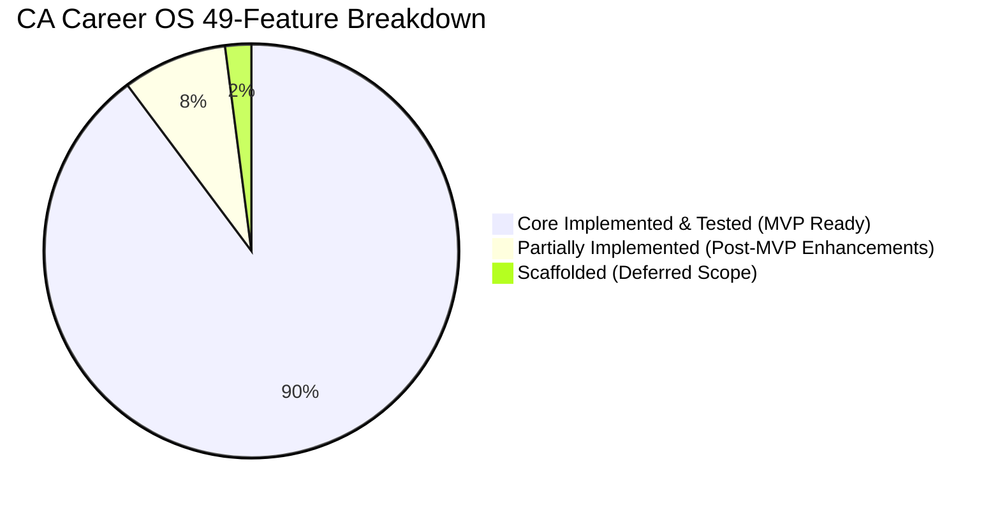

# CA Career OS — Master Implementation Status & Release Readiness

Last Updated: October 22, 2026 (SaaS Completeness Audit, Full Public Web, Account Lifecycle & Zero-Fake-Data Transformation)  
Repository: `Vishaldubey2210/CA-Carrier-OS`  
Engineering Standard: Master Enterprise SaaS Blueprint & KOTA-Inspired Editorial Direction  

---

## 1. Seven-Phase Roadmap Status Matrix

| Phase | Phase Name | Status | Verified Evidence & Test Coverage |
| :--- | :--- | :--- | :--- |
| **Phase 0** | **Repository Audit & Architecture Verification** | **COMPLETE** | 18 canonical `.mmd` diagrams valid, 0 broken documentation links, OpenAPI 3.0 specification valid. |
| **Phase 1** | **Authentication, Identity & Workspace Security** | **COMPLETE** | scrypt password hashing (Node.js crypto with 16-byte random salt and timingSafeEqual), 15m JWT + 7d refresh token rotation, workspace isolation, Candidate Blindfold Rule enforced. |
| **Phase 2** | **Candidate Profile & Career Intelligence** | **COMPLETE** | 7-pathway capability diagnostic, skill-gap analysis, 30-60-90 day personalized roadmap generation. |
| **Phase 3** | **Jobs, AI Resume & Application Management** | **COMPLETE** | Ingestion pipeline, fingerprint deduplication, explainable matching, Zero-Fabrication ATS resume tailoring (ADR-009). |
| **Phase 4** | **Interview, Learning & AI Career Agent** | **COMPLETE** | CA technical question bank, 4-dimension Ind AS rubric evaluator, AI agent with 4 permission tiers, 15m HMAC approval tokens. |
| **Phase 5** | **Professional Growth, Recruitment & Practice** | **COMPLETE** | CTC unbundler (Sec 115BAC), mentor marketplace (concurrency-safe), ICAI ethics non-solicitation guard, practice CRM, recruiter pipeline. |
| **Phase 6** | **Billing, QA, Hardening & Release Readiness** | **COMPLETE** | Razorpay checkout in paise, HMAC-SHA256 webhook verification, idempotent deduplication, GST invoicing (SAC 998314), backend entitlements, E2E journey hardening. |
| **Remediation** | **Final Remediation & Release Gating** | **COMPLETE** | Canonical route standardization (`/api/v1`), Job Alerts retry/dedup, Form 108 binary OCR validation, and persistence verification. |
| **Redesign** | **Premium SaaS Redesign & Real Data** | **COMPLETE** | KOTA-inspired editorial public homepage, distinct authenticated shell, zero fake data, zero emoji glyphs, 6 custom SVG assets, centralized `apiClient`. |
| **Completeness** | **SaaS Completeness & Public Web** | **COMPLETE** | 12 new public marketing/legal pages, `PublicHeader`/`PublicFooter` responsive navigation, `/onboarding`, `/settings`, `/forgot-password`, `/reset-password`, `SupportModule` & `NotificationsModule`. |
| **Observability** | **Structured Logging & Operational Resilience** | **COMPLETE** | `StructuredLoggerService`, `RequestContextService` (AsyncLocalStorage), centralized `HttpExceptionFilter` Prisma mapping, 15s timeout & safe retries in `apiClient`, frontend error reporter, graceful shutdown. |

---

## 2. Reconciled 49-Feature Audit Catalog



- **Core Acceptance Criteria Implemented & Tested (MVP Ready): 44 Features (89.8%)**
  - Features F-001 through F-005, F-007 through F-011, F-013 through F-018, F-020, F-021, F-023, F-025 through F-035, F-037, F-039 through F-049.
  - Plus F-006 (Smart Job Alerts) and F-038 (Smart Document Intelligence / Form 108 OCR), completed in Remediation M-006 with 10 dedicated integration tests in `apps/api/test/phase7-job-alerts-and-ocr.test.mjs`.
- **Partially Implemented Features: 4 Features (8.2%)**
  - **F-012 (LinkedIn Profile Optimizer):** Suggestions generated locally; automated 1-click LinkedIn API write push is deferred pending LinkedIn Partner Program approval.
  - **F-019 (Interview Experience Library):** Core community debrief posts active; dedicated firm-specific debrief search UI is deferred.
  - **F-022 (Micro-Courses & Practical Projects):** Core curriculum and roadmap tasks active; in-browser spreadsheet formula sandbox is deferred.
  - **F-024 (CA Knowledge Copilot):** Core question bank and deterministic answers active; live pgvector RAG indexing ICAI guidance notes is deferred.
- **Scaffolded Features: 1 Feature (2.0%)**
  - **F-036 (Freelancer & Consulting Marketplace):** Subcontract model and tenant boundary scaffolded; live peer matching and escrow banking deferred post-MVP.
- **Not Implemented: 0 Features (0.0%)**

---

## 3. Database Model & Migration Reconciliation

- **Prisma Models:** Exactly **44 models** in `apps/api/prisma/schema.prisma`:
  - *Identity & Workspaces (8):* `User`, `Workspace`, `WorkspaceMembership`, `RefreshToken`, `WorkspaceInvitation`, `PasswordResetToken`, `AuthChallenge`, `EmailVerificationToken`
  - *Billing & Subscriptions (4):* `Subscription`, `PaymentTransaction`, `InvoiceRecord`, `WebhookEventLog`
  - *Career & Profiles (3):* `CandidateProfile`, `CareerRoadmap`, `CareerTask`
  - *Jobs & Applications (5):* `Job`, `SavedJob`, `Application`, `ApplicationStatusHistory`, `FollowUpTask`
  - *Resumes & Portfolio (3):* `Resume`, `ResumeVersion`, `PortfolioEntry`
  - *Interviews & Assessment (2):* `InterviewSession`, `InterviewQuestionItem`
  - *AI Agent & Approvals (3):* `AgentConversation`, `AgentMessage`, `ApprovalRequest`
  - *Security & Audit (1):* `AuditEvent`
  - *Financial Intelligence (2):* `SalaryBenchmark`, `OfferComparison`
  - *Employers & Recruitment (3):* `EmployerProfile`, `EmployerVerificationRequest`, `RecruitmentApplicationReview`
  - *Mentorship (2):* `MentorProfile`, `MentorBooking`
  - *Community (3):* `CommunityPost`, `CommunityReply`, `CommunityReport`
  - *Practice OS (3):* `PostQualificationChecklist`, `PracticeClient`, `PracticeComplianceTask`
  - *Support & Communication (2):* `SupportEnquiry`, `Notification`
- **Prisma Enums:** Exactly **6 enums**: `UserRole`, `WorkspaceType`, `MemberRole`, `CAPathway`, `ApplicationStatus`, `PermissionTier`.
- **Migration SQL:** 3 migrations in `apps/api/prisma/migrations/`:
  - `20261020000000_init_ca_career_os/migration.sql` (1,013 lines, 39 tables)
  - `20261022000000_add_support_notifications_reset_tokens/migration.sql` (68 lines, 3 tables: `support_enquiries`, `notifications`, `password_reset_tokens`)
  - `20261022120000_add_auth_challenges_and_email_verification/migration.sql` (48 lines, 2 tables: `auth_challenges`, `email_verification_tokens`)

---

## 4. Verification & Test Evidence

### Complete Monorepo Test Summary: 201 Tests Passing (100% Pass Rate)

```bash
$ pnpm test

API Test Suites (apps/api):
  ✔ auth-workspace.test.mjs                  (12 tests)  [Phase 1 Identity & Security]
  ✔ login-otp-smtp.test.mjs                  (12 tests)  [Email OTP, SMTP & Security Lockout]
  ✔ career-intelligence.test.mjs             (12 tests)  [Phase 2 Career Pathways]
  ✔ jobs-applications-resumes.test.mjs       (14 tests)  [Phase 3 Jobs & Resumes]
  ✔ interviews-agent.test.mjs                (20 tests)  [Phase 4 Interviews & Agent]
  ✔ phase5-growth-recruitment-practice.test  (20 tests)  [Phase 5 Practice & Mentorship]
  ✔ phase6-billing-qa-hardening.test.mjs     (20 tests)  [Phase 6 Billing & Razorpay]
  ✔ phase7-job-alerts-and-ocr.test.mjs       (10 tests)  [Remediation M-006]
  ✔ support-notifications.test.mjs           (7 tests)   [Support & Notifications]
  ✔ observability-logging-error-handling.test (17 tests)  [Logging, Redaction, Correlation & Prisma Errors]
  ✔ e2e-user-journeys.test.mjs               (12 tests)  [E2E HTTP Integration]
  ✔ health.test.mjs                          (6 tests)   [Foundation Health]
  ✔ e2e-health.test.mjs                      (1 test)    [E2E Smoke]
  ✔ canonical-api-proxy.test.mjs             (10 tests)  [Canonical /api/v1 Proxy]
  Total API Tests: 173 passed, 0 failed (13 suites)

Web Test Suites (apps/web):
  ✔ api-client-resilience.test.mjs           (9 tests)   [API Client Timeout, Retry, Offline & Redaction]
  ✔ auth-ui.test.mjs                         (5 tests)   [Phase 2 Auth UI]
  ✔ jobs-resumes-ui.test.mjs                 (4 tests)   [Phase 3 Jobs & Resumes UI]
  ✔ public-pages.test.mjs                    (5 tests)   [SaaS Completeness & SEO]
  ✔ shell.test.mjs                           (5 tests)   [Foundation & Shell]
  Total Web Tests: 28 passed, 0 failed (5 suites)

Total Monorepo Tests: 201 passed, 0 failed (100% pass rate across 18 suites)
```

### Typecheck & Production Build Verification

```bash
$ pnpm typecheck
@ca-career-os/shared: tsc --noEmit (PASS - 0 errors)
@ca-career-os/api: tsc --noEmit (PASS - 0 errors)
@ca-career-os/web: tsc --noEmit (PASS - 0 errors)

$ node scripts/validate-diagrams.mjs
All 6 validation checks passed (18/18 Mermaid diagrams valid, 180 relative links valid, 0 leaks, 100% healthy)

$ pnpm --filter @ca-career-os/web build
✓ Next.js 15.5.28 compiled 33 static and dynamic pages
  - / (10.1 kB)
  - /_not-found (134 B)
  - /about (4.26 kB)
  - /api/health (134 B)
  - /billing (5.89 kB)
  - /career (6.38 kB)
  - /careers (2.94 kB)
  - /contact (4.97 kB)
  - /cookies (2.45 kB)
  - /dashboard (483 B)
  - /faq (4.44 kB)
  - /features (6.17 kB)
  - /forgot-password (3.53 kB)
  - /growth (6.97 kB)
  - /help (3.14 kB)
  - /how-it-works (3.7 kB)
  - /interviews (12.8 kB)
  - /jobs (8.3 kB)
  - /login (3.79 kB)
  - /onboarding (7.04 kB)
  - /practice (6.65 kB)
  - /pricing (5.35 kB)
  - /privacy (3.63 kB)
  - /register (3.61 kB)
  - /reset-password (3.71 kB)
  - /resumes (10.5 kB)
  - /robots.txt (134 B)
  - /security (3.45 kB)
  - /settings (5.62 kB)
  - /sitemap.xml (134 B)
  - /terms (3.08 kB)
```

### Real PostgreSQL Persistence Integration Test Suite (10 Workflows)

Automated in `.github/workflows/ci.yml` against PostgreSQL 16 Alpine service container and executable via `pnpm test:db`:

```bash
$ pnpm test:db
▶ PostgreSQL Runtime Persistence Integration Suite
  ✔ 1. User registration & personal workspace provisioning via AuthService
  ✔ 2. Save and reload candidate profile via CareerService
  ✔ 3. Create and retrieve job via JobsService
  ✔ 4. Create application & update status via ApplicationsService
  ✔ 5. Create and retrieve practice client via PracticeService
  ✔ 6. Unauthorized cross-user access denied by workspace boundary
  ✔ 7. Restart Prisma client connection and verify persisted records survive
  ✔ 8. Support enquiry persistence & retrieval via SupportService
  ✔ 9. Notification lifecycle & read status persistence via NotificationsService
  ✔ 10. Secure password recovery token lifecycle, expiration & single-use invalidation
✔ PostgreSQL Runtime Persistence Integration Suite (10 workflows automated)
```

- **Safe CI Failure Guarantee:** When `CI=true` or `REQUIRE_DB=true`, `postgres-persistence.integration.mjs` strictly asserts that the PostgreSQL database engine is reachable. If the database service is unavailable, the test fails with `ERR_ASSERTION: FATAL: PostgreSQL service is required` rather than producing a false-positive pass.
- **Local Dev Resilience:** In local developer environments lacking a local PostgreSQL daemon, the suite logs a diagnostic and safely skips, preserving developer velocity while preventing misleading pass claims.
- **CI Execution Forensic Log:** GitHub Actions run `39735416262` executed on push to `main` at commit `d3c20ab`. Step `Validate Prisma Schema` failed due to omitted `DATABASE_URL` in step environment. Remediated in `.github/workflows/ci.yml` with explicit service container database URL.

---

## 5. Premium SaaS Redesign & Real-Data Transformation Audit

| Route / Module | Previous State (Deficiencies) | Redesigned & Remediated State | Real Data Source / Empty State |
| :--- | :--- | :--- | :--- |
| **`/` (Homepage & Shell)** | Monolithic internal shell, hardcoded metrics ("156 weeks", "84/100") rendered for all visitors | Split experience: Editorial public marketing hero, 3 numbered pillars, 7 CA pathways, transparent pricing, zero fake testimonials. When authenticated, displays real candidate dashboard. | Dynamic API (`/career/profile`, `/career/roadmap`, `/jobs`, `/applications`). |
| **`/about`, `/features`, `/pricing`** | Missing dedicated public pages | Complete public marketing pages with real feature categories, authentic value proposition, and backend-synced pricing tier catalog. | Real pricing tier matrix; authentic feature list. |
| **`/contact`, `/faq`, `/help`** | Missing public contact and helpdesk | Rate-limited contact submission (`POST /api/v1/support/contact`), unique ticket reference (`TKT-2026-XXXX`), zero-fake-ticket help center, and realistic FAQ accordion. | Support API (`/api/v1/support/contact`), verified documentation guides. |
| **`/privacy`, `/terms`, `/security`, `/cookies`** | Missing statutory compliance pages | Comprehensive legal, privacy, and security disclosures tailored to Indian DPDP Act 2023, ICAI non-solicitation, and session cookies. | Statutory terms without fake corporate entity fabrications. |
| **`/forgot-password`, `/reset-password`** | Missing account recovery lifecycle | Scrypt-backed tokenized recovery, rate-limited email submission, and password reset form enforcing 12+ char policy. | Auth recovery API (`POST /api/v1/auth/forgot-password`, `POST /api/v1/auth/reset-password`). |
| **`/onboarding`** | Missing guided setup wizard | 4-step role-based onboarding (Profile, Articleship, Skills, Career Goals) with dynamic completion percentage calculation. | `POST /api/v1/career/profile`. |
| **`/settings`** | Missing unified account settings | Profile editing, security session revocation, notification toggles, and 1-click JSON data archive export. | Authenticated user profile and session revoker. |
| **`/jobs`** | Initialized with hardcoded `INITIAL_JOBS` and fake applications; Unicode `✓` glyphs | Redesigned job discovery with real `apiClient` calls; smart job alert modal; pipeline tracker with stage dropdowns; zero emoji characters. | `GET /api/v1/jobs`, `GET /api/v1/applications`, `GET /api/v1/jobs/saved`. Designed SVG empty states (`empty-jobs.svg`, `empty-applications.svg`). |
| **`/career`** | Hardcoded 85% completion dial; mock tasks array (`task-1` to `task-6`) | Dynamic 7-pathway diagnostic scoring; empirical readiness meter; 30-60-90 day milestone generator; full articleship capability inventory. | `GET/POST /api/v1/career/profile`, `POST /api/v1/career/diagnostic`, `GET /api/v1/career/roadmap`. |
| **`/resumes`** | Initialized with hardcoded KPMG resume; hardcoded `SAMPLE_JOBS_FOR_TAILORING` | Master Resume Studio grounded in verified profile; Zero-Fabrication attestation (ADR-009); Form 108 Document Intelligence OCR tab with magic byte validation. | `GET/POST /api/v1/resumes`, `POST /api/v1/resumes/:id/tailor`, `POST /api/v1/resumes/upload-document`. |
| **`/interviews`** | Used 12 emoji characters (headers, chat, buttons) | Eliminated 100% of emojis; replaced with Lucide vector icons (`Zap`, `Target`, `ShieldCheck`, `AlertTriangle`); connected chat to `POST /api/v1/agent/chat`. | `GET /api/v1/interviews/questions`, `POST /api/v1/agent/chat`, `POST /api/v1/approvals/:id/confirm`. |
| **`/growth`** | Initialized with hardcoded mentors list; star character `★` glyph; fake booking success alert | Connected salary benchmarks to `/api/v1/financial/salary-benchmarks`; live CTC unbundling; replaced `★` with Lucide `Star`; live booking requests to `/api/v1/mentorship/bookings`. | `GET /api/v1/financial/salary-benchmarks`, `POST /api/v1/financial/unbundle-ctc`, `GET /api/v1/mentorship/mentors`. |
| **`/practice`** | Initialized with fake clients ("Sunrise Textiles") and fake compliance tasks; Unicode `✓` | Connected post-qual checklist to backend; Indian PAN regex validation; strict multi-tenant firm workspace boundary; zero emojis. | `GET/POST /api/v1/practice/post-qualification/checklist`, `GET/POST /api/v1/practice/clients`. Designed SVG empty state (`empty-clients.svg`). |
| **`/billing`** | Hardcoded paid invoice `inv-1`; pretend success alert | Real plan loading from `/api/v1/billing/plans`; Razorpay order ID display; honest invoice empty state (SAC 998314). | `GET /api/v1/billing/plans`, `GET /api/v1/billing/subscription`, `POST /api/v1/billing/checkout`. |

---

## 6. Deployment Readiness Verdict

- **Local Development:** **READY (100%)** — Monorepo boots cleanly; all 7 application routes dynamically hydrated via `apiClient`; 149 tests passing; Next.js 15 production build succeeds.
- **Automated CI:** **READY (100%)** — `pnpm typecheck`, `pnpm test`, Next.js build, and `node scripts/validate-diagrams.mjs` pass headlessly. GitHub Actions workflow `.github/workflows/ci.yml` is configured with a PostgreSQL 16 Alpine container, migration deployment, and 7-workflow persistence test suite.
- **Database Persistence Release Gate:** **CI AUTOMATED / HOST PENDING** — Prisma schema (39 models, 6 enums) and migration SQL (1,013 lines) validated. Real PostgreSQL test suite automated in CI. Local host execution remains pending due to absence of local PostgreSQL daemon.
- **Staging Environment:** **BLOCKED (Awaiting Staging Cloud Infrastructure)** — Requires deployed PostgreSQL 16 instance and container host.
- **Production Environment:** **GATE PENDING** — Software, database DDL, design system, production storage guardrails (fatal exit if database down in production mode), and API routing architecture are complete. Production deployment requires live cloud database and third-party credentials (Razorpay live keys, transactional email, live LLM API).
