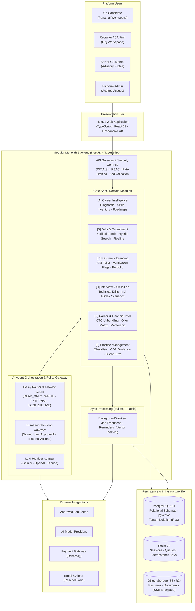
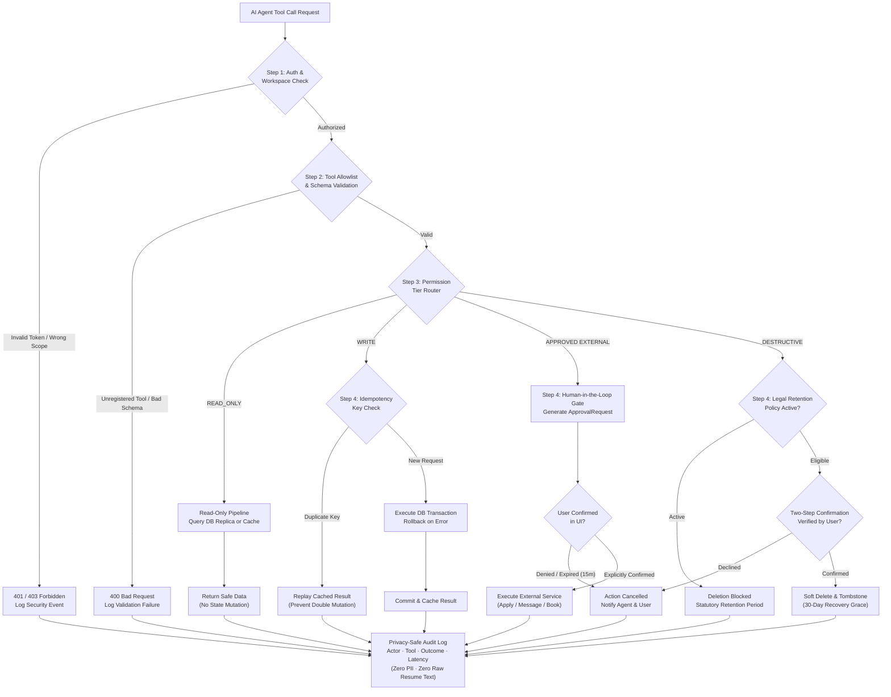
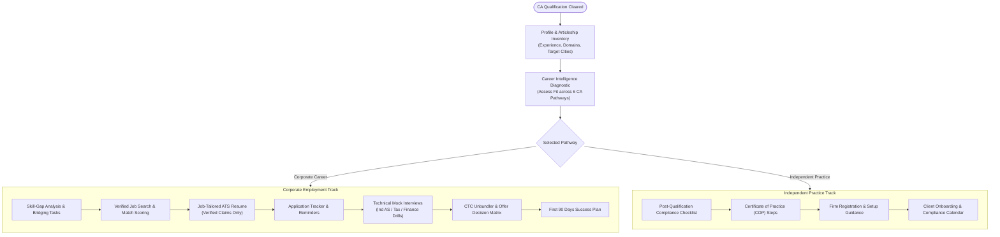

# CA Career OS

> **Intelligent Career Management & Professional Growth Workspace for Chartered Accountants**  
> *From CA qualification to career leadership — one integrated, secure workspace.*

[](#architecture-status)
[](#security--privacy-principles)
[-green.svg)](docs/architecture/decisions.md#adr-001-modular-monolith-architecture-over-microservices)
[](docs/architecture/README.md)

---

## 1. Product Vision & Problem Statement

**CA Career OS** is an AI-powered career copilot and professional operations platform designed specifically for Chartered Accountants in India, with primary focus on candidates who have recently cleared CA Final and newly qualified CAs (0–3 years post-qualification).

Rather than functioning as another passive, fragmented job board, CA Career OS provides a unified, intelligent workspace:

```
"From CA qualification to career success — one intelligent workspace."
```

### Core Problems Addressed (Product Hypotheses)

1. **Career Pathway Uncertainty:** Newly qualified CAs face difficulty choosing among Statutory Audit, Tax, FP&A, Corporate Finance, Investment Banking, Management Consulting, and Independent Practice.
2. **Articleship Experience Translation Gap:** Practical articleship training is often skewed toward specific compliance tasks (e.g., tax filing or audit vouching), leaving practical readiness gaps for corporate roles.
3. **Fragmented & Stale Job Listings:** CA vacancies are scattered across unverified portals, agency boards, and firm websites with high rates of duplication and obsolete listings.
4. **Generic Resumes Failing ATS Scans:** Standard CA resumes fail Applicant Tracking Systems (ATS) and fail to articulate audit, tax, and modeling achievements effectively.
5. **Interview Anxiety & Lack of Practice:** Candidates lack a realistic, role-tailored technical practice environment for Ind AS, GST, Transfer Pricing, and financial modeling questions.
6. **Opaque Compensation & Offer Comparison:** Comparing CTC packages involving complex variable pay, bonuses, retiral benefits (PF/Gratuity), and city cost-of-living differences is difficult.
7. **Disjointed Career Tools:** Job hunting, resume updating, follow-ups, and learning tasks are scattered across personal spreadsheets and chat notes.
8. **Independent Practice Obstacles:** Candidates who want to start independent practice face regulatory hurdles (COP procedures, ICAI compliance) and lack lightweight client management tools.

---

## 2. High-Level System Architecture

The system is designed as a **Modular Monolith** using **NestJS** and **TypeScript**, backed by **PostgreSQL** (with `pgvector` for semantic job matching), **Redis** (for caching, rate limiting, and BullMQ queues), and **S3-compatible object storage** for encrypted documents.



---

## 3. AI Agent Permission & Execution Flow

To guarantee safety, predictability, and user trust, all AI Career Agent actions pass through a deterministic, server-side permission gateway before execution.



### Tool Permission Tiers

| Permission Tier | Representative Tools | Execution Rule | Safety Guarantee |
| :--- | :--- | :--- | :--- |
| **`READ_ONLY`** | `get_user_profile`, `search_jobs`, `get_application_status`, `get_skill_gap_report` | Direct read via cache or database replica | Zero side effects; scoped to active workspace |
| **`WRITE`** | `create_career_task`, `update_user_preferences`, `save_job`, `create_resume_draft` | Server transaction with idempotency key | Rollback on failure; no duplicate records |
| **`EXPLICITLY_APPROVED_EXTERNAL`** | `submit_job_application`, `send_recruiter_message`, `book_paid_mentorship` | **Mandatory human confirmation in UI** | Agent cannot autonomously contact third parties or spend funds |
| **`DESTRUCTIVE`** | `delete_resume_version`, `remove_saved_personal_document`, `delete_user_data` | Retention check + two-step confirmation | Soft deletion with 30-day grace period; no accidental hard purge |

---

## 4. Candidate User Journey

The platform accommodates both the corporate employment track and the independent professional practice track:



---

## 5. Technology Baseline

| Layer | Proposed Technology | Architectural Justification |
| :--- | :--- | :--- |
| **Frontend** | **Next.js (App Router), React 19, TypeScript, Vanilla CSS + Tailwind tokens** | Server-side rendering for SEO (job pages), responsive mobile dashboard, strict type safety. |
| **Backend** | **Node.js with NestJS (TypeScript)** | Modular monolith with dependency injection, strict validation pipes, built-in guards, and clear domain boundaries. |
| **Database** | **PostgreSQL 16+ with `pgvector`** | Robust ACID transactional semantics, row-level security for tenant isolation, and unified relational + semantic vector queries. |
| **ORM** | **Prisma ORM** | Type-safe query building, automated schema migrations, and client generation. |
| **Cache & Queue** | **Redis 7+ & BullMQ** | High-performance session storage, distributed locks, rate limiting, and reliable asynchronous job processing. |
| **AI Abstraction** | **Interchangeable Provider Adapter** | Decouples business logic from specific vendors; supports Google Gemini, OpenAI, and Anthropic Claude via standard JSON schema contracts. |
| **Object Storage** | **S3-Compatible Storage (AWS S3 / Cloudflare R2)** | Secure, encrypted document storage with short-lived pre-signed URLs (15-minute TTL). |
| **Notifications** | **Resend / SendGrid (Email), Twilio (SMS / WhatsApp)** | Transactional notifications for application milestones, follow-ups, and approval requests. |

---

## 6. Security & Privacy Principles

1. **Workspace Multi-Tenancy:** Candidates operate in strictly isolated *Personal Workspaces*. Employers operate in *Organization Workspaces*. A candidate's job searches and applications are strictly invisible to their employer, even if the employer is an active customer on the platform.
2. **Zero-Fabrication Policy (ADR-009):** The resume generation engine is programmatically constrained from fabricating client names, engagement values, or professional metrics. All resume claims require candidate verification and attestation.
3. **No Autonomous External Side Effects:** The AI Career Agent can never submit applications, message recruiters, or book paid sessions without explicit, time-bounded user confirmation in the browser UI.
4. **Zero-PII Audit Logging:** Audit streams record actors, tools, and operation outcomes, but strip PII, credentials, full resume text, and financial numbers from log sinks.
5. **Data Protection & Legal Review Notice:** Features handling tax, legal, and ICAI regulatory guidelines are designed for alignment with the **Chartered Accountants Act, 1949**, and the **ICAI Code of Ethics (2020)**. Formal operational compliance requires ongoing legal and professional review prior to commercial production launch.

---

## 7. MVP Scope vs. Phased Roadmap

```
+───────────────────────────────────────────────────────────────────────────────────────────+
|                                    IMPLEMENTATION ROADMAP                                 |
+───────────────────────────────────────────────────────────────────────────────────────────+
|  PHASE 1: MVP (Proposed Baseline)                                                         |
|  • Candidate onboarding, articleship inventory, and career pathway diagnostic             |
|  • Verified direct job postings and approved partner API ingestion                       |
|  • Hybrid job search (Postgres FTS + pgvector) and explainable match scoring              |
|  • ATS resume builder with job-specific tailoring and candidate attestation               |
|  • Unified application tracking board with follow-up task scheduling                      |
|  • Text-based technical mock interviews with Ind AS / Tax question banks                  |
|  • CTC Unbundler and side-by-side offer comparison calculator                             |
|  • AI Career Agent with 4-tier permission router and Human-in-the-Loop approval cards     |
|  • Tamper-evident audit logging and workspace authorization guards                        |
+───────────────────────────────────────────────────────────────────────────────────────────+
|  PHASE 2: ENHANCED INTELLIGENCE & COMMUNITY (Planned)                                     |
|  • Real-time voice mock interviews (turn-based audio pipeline)                            |
|  • ATS partner webhooks (Greenhouse, Lever, Darwinbox)                                    |
|  • Practical skills simulation lab (synthetic Excel financial modeling & audit cases)     |
|  • Mentorship marketplace with calendar scheduling and payment processing                 |
|  • Aggregated salary intelligence engine with sample-size ($N$) indicators                |
+───────────────────────────────────────────────────────────────────────────────────────────+
|  PHASE 3: PRACTICE MANAGEMENT & ENTERPRISE (Future)                                       |
|  • Independent Practice Suite: Post-qualification checklist, COP guide, and client CRM    |
|  • Employer hiring analytics and candidate matching pipeline                              |
|  • WhatsApp Business API alerts for urgent interview invites                              |
|  • Continuous Professional Education (CPE) credit tracker                                 |
+───────────────────────────────────────────────────────────────────────────────────────────+
```

---

## 8. Architecture Status

| Dimension | Current Status | Notes |
| :--- | :--- | :--- |
| **System Architecture** | **Documented & Blueprinted** | Complete 7-diagram architecture specification, 9 ADRs, threat model, and risk register documented. |
| **Domain Data Model** | **Designed** | 21 relational entities, multi-tenant boundaries, and ER relationships defined in `data-architecture.mmd`. |
| **Application Code** | **Implementation Pending** | Monorepo scaffolding, database migrations, and service implementations are scheduled for Phase 1 MVP sprint. |
| **Provider Contracts** | **Specified** | AI provider zero-data retention and external job feed capabilities specified as integration requirements. |
| **Verification State** | **Diagrams Parsed & Validated** | All Mermaid diagrams validated via automated parser script (`scripts/validate-diagrams.mjs`). |

---

## 9. Detailed Architecture Documentation Directory

The complete technical design specification is maintained in [`docs/architecture/`](docs/architecture/README.md):

| Document | Purpose & Description | Source File |
| :--- | :--- | :--- |
| **[Master Architecture README](docs/architecture/README.md)** | Comprehensive architectural handbook, component specifications, and roadmap. | [`docs/architecture/README.md`](docs/architecture/README.md) |
| **[System Context Diagram](docs/architecture/system-context.mmd)** | Visual boundaries showing users, backend, AI providers, and external systems. | [`docs/architecture/system-context.mmd`](docs/architecture/system-context.mmd) |
| **[System Architecture Diagram](docs/architecture/system-architecture.mmd)** | Multi-tier service topology, API layers, domain modules, and queue topology. | [`docs/architecture/system-architecture.mmd`](docs/architecture/system-architecture.mmd) |
| **[Agent Execution Flow Diagram](docs/architecture/agent-execution-flow.mmd)** | 4-tier permission router, idempotency verification, and human approval gateway. | [`docs/architecture/agent-execution-flow.mmd`](docs/architecture/agent-execution-flow.mmd) |
| **[Core User Journey Diagram](docs/architecture/user-journey.mmd)** | Candidate lifecycle across corporate employment and independent practice paths. | [`docs/architecture/user-journey.mmd`](docs/architecture/user-journey.mmd) |
| **[Job Application Workflow](docs/architecture/job-application-workflow.mmd)** | State machine tracking job ingestion, tailoring, approval, and offer comparison. | [`docs/architecture/job-application-workflow.mmd`](docs/architecture/job-application-workflow.mmd) |
| **[Data Architecture (ERD)](docs/architecture/data-architecture.mmd)** | 21 relational entities, foreign keys, and multi-tenant workspace boundaries. | [`docs/architecture/data-architecture.mmd`](docs/architecture/data-architecture.mmd) |
| **[Security Boundaries Diagram](docs/architecture/security-boundaries.mmd)** | Trust zones, edge WAF, authentication guards, and KMS encryption boundaries. | [`docs/architecture/security-boundaries.mmd`](docs/architecture/security-boundaries.mmd) |
| **[Architecture Decision Records](docs/architecture/decisions.md)** | 9 formal ADRs detailing modular monolith, pgvector, and security decisions. | [`docs/architecture/decisions.md`](docs/architecture/decisions.md) |
| **[Assumptions, Risks & Constraints](docs/architecture/assumptions-and-risks.md)** | Threat models, ICAI ethical constraints, and research spike backlog. | [`docs/architecture/assumptions-and-risks.md`](docs/architecture/assumptions-and-risks.md) |

---

## 10. License & Professional Ethics Notice

This design document is developed for educational and architectural planning purposes, with design constraints informed by the **Chartered Accountants Act, 1949**, and the **ICAI Code of Ethics (2020)**. 

The platform does not provide formal legal, statutory audit, or tax advisory opinions, nor does it facilitate public commercial solicitation for practicing members. Applicable statutory and ethical requirements must be validated against current official ICAI regulations prior to production deployment.
