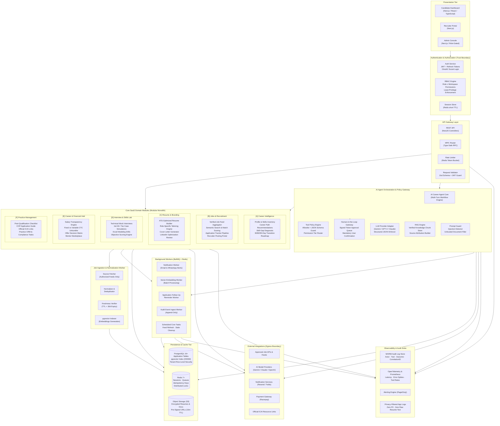
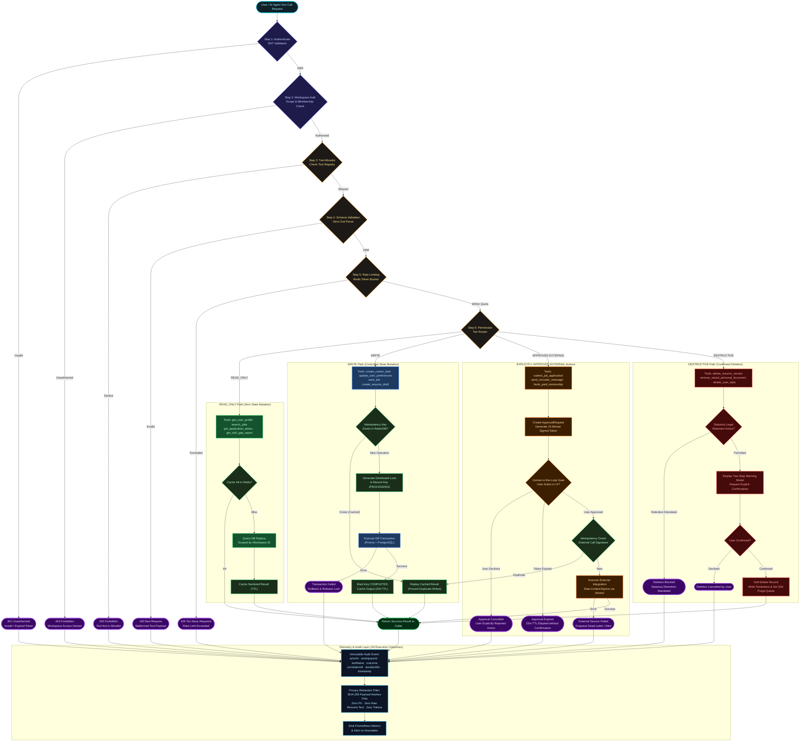
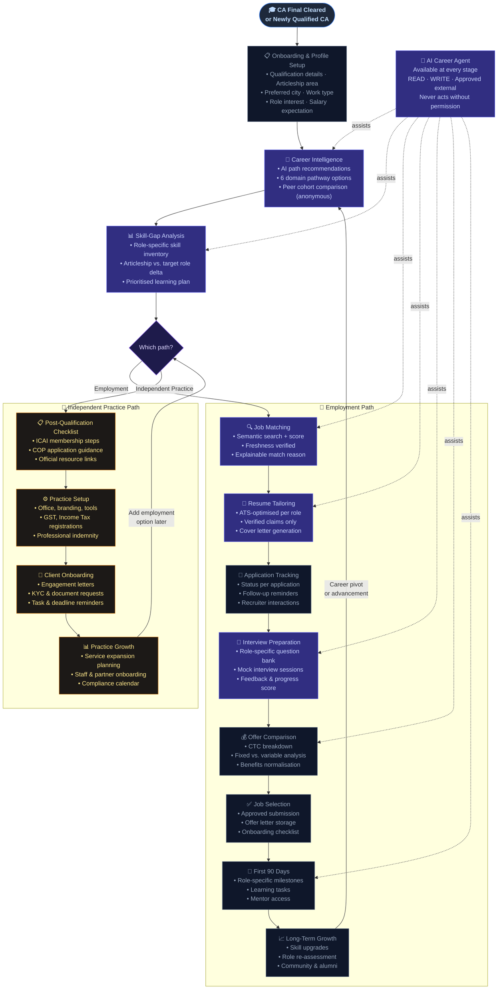

# CA Career OS

> **Intelligent Career Management & Professional Growth Workspace for Chartered Accountants**  
> *From CA qualification to career leadership — one integrated, secure workspace.*

[](#8-architecture-status)
[](#6-security--privacy-principles)
[-green.svg)](docs/architecture/decisions.md#adr-001-modular-monolith-architecture-over-microservices)
[](docs/architecture/README.md)
[](docs/architecture/README.md#2-visual-architecture-diagrams-handbook)

---

## 1. Product Vision & Target Users

**CA Career OS** is an AI-powered career copilot and professional operations platform engineered specifically for Chartered Accountants in India, with primary focus on candidates who have recently cleared CA Final and newly qualified CAs (0–3 years post-qualification).

Rather than functioning as another passive, unverified job board, CA Career OS provides a unified, intelligent workspace:

```
"From CA qualification to career success — one intelligent workspace."
```

### Target Personas
1. **Newly Qualified CAs (0–3 Years Post-Qualification):** Transitioning from articleship to industry or practice, requiring pathway clarity, ATS-ready resumes, technical mock interviews, and transparent offer evaluations.
2. **CA Final Cleared Candidates:** Awaiting campus placements or lateral recruitment, seeking role-specific skill gap analysis and bridging tasks.
3. **Independent CA Practitioners:** Launching sole proprietorships or partnerships, requiring post-qualification compliance checklists, Certificate of Practice (COP) workflows, and a lightweight client CRM.
4. **Hiring Firms & Corporate Recruiters:** Seeking verified, domain-tested CA talent with verifiable articleship credentials and domain capabilities.

### Core Problems Addressed (Product Hypotheses)
1. **Career Pathway Uncertainty:** Newly qualified CAs face difficulty choosing among Statutory Audit, Direct/Indirect Tax, FP&A, Corporate Finance, Investment Banking, Management Consulting, and Independent Practice.
2. **Articleship Experience Translation Gap:** Practical articleship training is often skewed toward specific compliance tasks (e.g., tax filing or audit vouching), leaving practical readiness gaps for corporate roles.
3. **Fragmented & Stale Job Listings:** CA vacancies are scattered across unverified portals, agency boards, and firm websites with high rates of duplication and obsolete listings.
4. **Generic Resumes Failing ATS Scans:** Standard CA resumes fail Applicant Tracking Systems (ATS) and fail to articulate audit, tax, and modeling achievements effectively.
5. **Interview Anxiety & Lack of Practice:** Candidates lack a realistic, role-tailored technical practice environment for Ind AS, GST, Transfer Pricing, and financial modeling questions.
6. **Opaque Compensation & Offer Comparison:** Comparing CTC packages involving complex variable pay, bonuses, retiral benefits (PF/Gratuity), and city cost-of-living differences is difficult.
7. **Disjointed Career Tools:** Job hunting, resume updating, follow-ups, and learning tasks are scattered across personal spreadsheets and chat notes.
8. **Independent Practice Obstacles:** Candidates who want to start independent practice face regulatory hurdles (COP procedures, ICAI compliance) and lack lightweight client management tools.

---

## 2. High-Level System Architecture

The platform is designed as a **Modular Monolith** using **NestJS** and **TypeScript**, backed by **PostgreSQL 16+** (with `pgvector` for semantic job matching), **Redis 7+** (for caching, rate limiting, and BullMQ queues), and **S3-compatible object storage** for encrypted documents.

<!-- DIAGRAM:system-architecture:START -->

<!-- DIAGRAM:system-architecture:END -->

---

## 3. AI Agent Permission & Execution Flow

To guarantee safety, predictability, and user trust, all AI Career Agent actions pass through a deterministic, server-side permission gateway before execution. The agent cannot autonomously perform real-world external mutations without explicit human approval.

<!-- DIAGRAM:agent-execution-flow:START -->

<!-- DIAGRAM:agent-execution-flow:END -->

### Deterministic Permission Tiers

| Permission Tier | Representative Tools | Execution Rule | Safety Guarantee |
| :--- | :--- | :--- | :--- |
| **`READ_ONLY`** | `get_user_profile`, `search_jobs`, `get_application_status`, `get_skill_gap_report` | Direct read via cache or database replica | Zero side effects; scoped to active workspace |
| **`WRITE`** | `create_career_task`, `update_user_preferences`, `save_job`, `create_resume_draft` | Server transaction with idempotency key | Rollback on failure; no duplicate records |
| **`EXPLICITLY_APPROVED_EXTERNAL`** | `submit_job_application`, `send_recruiter_message`, `book_paid_mentorship` | **Mandatory human confirmation in UI (15m TTL)** | Agent cannot autonomously contact third parties or spend funds |
| **`DESTRUCTIVE`** | `delete_resume_version`, `remove_saved_personal_document`, `delete_user_data` | Retention check + two-step confirmation | Soft deletion with 30-day grace period; no accidental hard purge |

---

## 4. Candidate User Journey (Employment & Practice Tracks)

The platform supports two distinct professional trajectories for Chartered Accountants:

<!-- DIAGRAM:user-journey:START -->

<!-- DIAGRAM:user-journey:END -->

---

## 5. Technology Stack Baseline

| Layer | Proposed Technology | Architectural Justification |
| :--- | :--- | :--- |
| **Frontend** | **Next.js (App Router), React 19, TypeScript, Vanilla CSS** | Fast server-side rendering for SEO (job pages), responsive client components, strict TypeScript type safety. |
| **Backend** | **Node.js with NestJS (TypeScript)** | Modular monolith with dependency injection, strict validation pipes, built-in guards, and clean domain encapsulation. |
| **Database** | **PostgreSQL 16+ with `pgvector`** | ACID transactions, row-level security for tenant isolation, and unified relational + vector similarity queries. |
| **ORM** | **Prisma ORM** | Type-safe query building, automated schema migrations, and client generation. |
| **Cache & Queue** | **Redis 7+ & BullMQ** | High-performance session storage, distributed locks, rate limiting, and reliable asynchronous job processing. |
| **AI Abstraction** | **Universal Provider Adapter** | Decouples business logic from vendors; supports Google Gemini, OpenAI, and Anthropic Claude via standard JSON schema contracts. |
| **Object Storage** | **S3-Compatible Storage (AWS S3 / Cloudflare R2)** | Secure, encrypted document storage with short-lived pre-signed URLs (15-minute TTL). |
| **Notifications** | **Resend (Email), Twilio (SMS / WhatsApp Alerts)** | Transactional notifications for application milestones, follow-ups, and approval cards. |

---

## 6. Security & Privacy Principles

1. **Workspace Multi-Tenancy:** Candidates operate in strictly isolated *Personal Workspaces*. Employers operate in *Organization Workspaces*. A candidate's job searches and applications are strictly invisible to their current employer.
2. **Zero-Fabrication Policy (ADR-009):** The resume generation engine is programmatically constrained from fabricating client names, engagement values, or professional metrics. All resume claims require candidate verification and attestation.
3. **No Autonomous External Side Effects:** The AI Career Agent can never submit applications, message recruiters, or book paid sessions without explicit, time-bounded user confirmation in the browser UI.
4. **Zero-PII Audit Logging (ADR-008):** Audit streams record actors, tools, and operation outcomes, but strip PII, credentials, full resume text, and financial numbers from log sinks using SHA-256 hashes.
5. **Data Protection & Legal Review Notice:** Features handling tax, legal, and ICAI regulatory guidelines are designed for alignment with the **Chartered Accountants Act, 1949**, and the **ICAI Code of Ethics (2020)**.

---

## 7. MVP Scope vs. Phased Roadmap

```
+───────────────────────────────────────────────────────────────────────────────────────────+
|                                    IMPLEMENTATION ROADMAP                                 |
+───────────────────────────────────────────────────────────────────────────────────────────+
|  PHASE 1: MVP (Proposed Baseline)                                                         |
|  • Candidate onboarding, articleship inventory, and career pathway diagnostic             |
|  • Verified direct job postings and approved partner API ingestion                       |
|  • Hybrid job search (Postgres FTS + pgvector) and explainable match scoring              |
|  • ATS resume builder with job-specific tailoring and candidate attestation               |
|  • Unified application tracking board with follow-up task scheduling                      |
|  • Text-based technical mock interviews with Ind AS / Tax question banks                  |
|  • CTC Unbundler and side-by-side offer comparison calculator                             |
|  • AI Career Agent with 4-tier permission router and Human-in-the-Loop approval cards     |
|  • Tamper-evident audit logging and workspace authorization guards                        |
+───────────────────────────────────────────────────────────────────────────────────────────+
|  PHASE 2: ENHANCED INTELLIGENCE & COMMUNITY (Planned)                                     |
|  • Real-time voice mock interviews (turn-based audio pipeline)                            |
|  • ATS partner webhooks (Greenhouse, Lever, Darwinbox)                                    |
|  • Practical skills simulation lab (synthetic Excel financial modeling & audit cases)     |
|  • Mentorship marketplace with calendar scheduling and payment processing                 |
|  • Aggregated salary intelligence engine with sample-size (N) indicators                  |
+───────────────────────────────────────────────────────────────────────────────────────────+
|  PHASE 3: PRACTICE MANAGEMENT & ENTERPRISE (Future)                                       |
|  • Independent Practice Suite: Post-qualification checklist, COP guide, and client CRM    |
|  • Employer hiring analytics and candidate matching pipeline                              |
|  • WhatsApp Business API alerts for urgent interview invites                              |
|  • Continuous Professional Education (CPE) credit tracker                                 |
+───────────────────────────────────────────────────────────────────────────────────────────+
```

---

## 8. Architecture Status

| Dimension | Current Status | Notes |
| :--- | :--- | :--- |
| **System Architecture** | **Documented & Blueprinted** | Complete 18-diagram architecture handbook, 9 ADRs, STRIDE threat model, and risk register documented. |
| **Product Specifications** | **Fully Specified (PRD)** | Complete functional requirements, 10 personas, 15 user journeys, 12 UX states, and monetization hypotheses. |
| **Domain Data Model** | **Designed & Specified** | 21 relational entities, multi-tenant boundaries, Prisma models, and retention lifecycles specified. |
| **REST API Contracts** | **Specified & OpenAPI Compliant** | Formal OpenAPI 3.0.3 specification (`api/openapi.yaml`) and REST architectural guidelines documented. |
| **SRE & Operations** | **Runbooks Specified** | 6 operational runbooks covering deployment, rollback, PITR recovery, worker triage, provider failover, and incident response. |
| **Application Code** | **Implementation Pending** | Monorepo scaffolding, database migrations, and service implementations scheduled for Phase 1 MVP sprint. |
| **Verification State** | **Diagrams Parsed & Validated** | All 18 Mermaid diagrams validated via automated parser script (`scripts/validate-diagrams.mjs`). |

---

## 9. Master Documentation & Architecture Blueprint Index

The CA Career OS engineering blueprint is structured across the following master specifications:

### 9.1 Visual Architecture Diagrams (18 Canonical Views)

| # | Diagram | Purpose & Description | Canonical Source |
| :-: | :--- | :--- | :--- |
| **01** | **[System Context Diagram](docs/architecture/system-context.mmd)** | Platform boundary, human actors, persistence, and external SaaS providers. | [`docs/architecture/system-context.mmd`](docs/architecture/system-context.mmd) |
| **02** | **[Container Architecture](docs/architecture/system-architecture.mmd)** | Multi-tier service topology, API layers, domain modules, and queue topology. | [`docs/architecture/system-architecture.mmd`](docs/architecture/system-architecture.mmd) |
| **03** | **[Backend Component Architecture](docs/architecture/backend-component-architecture.mmd)** | NestJS component topology, guards, domain services, repositories, and DB adapters. | [`docs/architecture/backend-component-architecture.mmd`](docs/architecture/backend-component-architecture.mmd) |
| **04** | **[Domain Module Dependencies](docs/architecture/domain-module-dependencies.mmd)** | Modular monolith module dependency graph and decoupled domain event bus. | [`docs/architecture/domain-module-dependencies.mmd`](docs/architecture/domain-module-dependencies.mmd) |
| **05** | **[AI Agent System Architecture](docs/architecture/ai-agent-system.mmd)** | Multi-turn workflow, RAG grounding, context assembly, and safety gates. | [`docs/architecture/ai-agent-system.mmd`](docs/architecture/ai-agent-system.mmd) |
| **06** | **[Agent Execution Flow](docs/architecture/agent-execution-flow.mmd)** | 4-tier permission router, idempotency verification, and human approval gateway. | [`docs/architecture/agent-execution-flow.mmd`](docs/architecture/agent-execution-flow.mmd) |
| **07** | **[Human-Approval Sequence](docs/architecture/human-approval-sequence.mmd)** | Interactive confirmation cards, 15m signed tokens, and cancellation paths. | [`docs/architecture/human-approval-sequence.mmd`](docs/architecture/human-approval-sequence.mmd) |
| **08** | **[Candidate User Journey](docs/architecture/user-journey.mmd)** | Dual candidate lifecycles: corporate employment vs independent practice. | [`docs/architecture/user-journey.mmd`](docs/architecture/user-journey.mmd) |
| **09** | **[Job Ingestion Pipeline](docs/architecture/job-ingestion-pipeline.mmd)** | Ingestion, normalization, SHA-256 deduplication, freshness, and vector indexing. | [`docs/architecture/job-ingestion-pipeline.mmd`](docs/architecture/job-ingestion-pipeline.mmd) |
| **10** | **[Job Application Workflow](docs/architecture/job-application-workflow.mmd)** | State machine tracking discovery, resume tailoring, approval, and offer comparison. | [`docs/architecture/job-application-workflow.mmd`](docs/architecture/job-application-workflow.mmd) |
| **11** | **[Database Architecture (ERD)](docs/architecture/data-architecture.mmd)** | 21 relational entities, foreign keys, and multi-tenant workspace boundaries. | [`docs/architecture/data-architecture.mmd`](docs/architecture/data-architecture.mmd) |
| **12** | **[Security Boundaries Diagram](docs/architecture/security-boundaries.mmd)** | Trust zones, edge WAF, authentication guards, and KMS encryption boundaries. | [`docs/architecture/security-boundaries.mmd`](docs/architecture/security-boundaries.mmd) |
| **13** | **[Background Jobs & Queues](docs/architecture/background-processing.mmd)** | BullMQ queues, worker pool, retry backoff, DLQ, and nightly reconciliation. | [`docs/architecture/background-processing.mmd`](docs/architecture/background-processing.mmd) |
| **14** | **[Independent Practice Workflow](docs/architecture/independent-practice-workflow.mmd)** | COP checklist, firm constitution, ethics boundaries, client KYC, and compliance calendar. | [`docs/architecture/independent-practice-workflow.mmd`](docs/architecture/independent-practice-workflow.mmd) |
| **15** | **[Deployment Architecture](docs/architecture/deployment-architecture.mmd)** | Multi-AZ ECS Fargate, Cloudflare WAF, Aurora PostgreSQL, and Redis in AWS Mumbai. | [`docs/architecture/deployment-architecture.mmd`](docs/architecture/deployment-architecture.mmd) |
| **16** | **[Identity & Access Model](docs/architecture/identity-and-access.mmd)** | User authentication, workspace scopes, RBAC permissions, and session lifecycles. | [`docs/architecture/identity-and-access.mmd`](docs/architecture/identity-and-access.mmd) |
| **17** | **[Billing & Commercial Lifecycle](docs/architecture/billing-lifecycle.mmd)** | Subscription state machine, Razorpay webhooks, idempotency, and grace periods. | [`docs/architecture/billing-lifecycle.mmd`](docs/architecture/billing-lifecycle.mmd) |
| **18** | **[Observability Architecture](docs/architecture/observability-architecture.mmd)** | OpenTelemetry tracing, structured logs, Prometheus metrics, and alert triggers. | [`docs/architecture/observability-architecture.mmd`](docs/architecture/observability-architecture.mmd) |

### 9.2 Product Management & UX Specifications (`docs/product/`)

- [Product Vision & Strategic Scope](docs/product/vision-and-scope.md) — Product promise, scope bounds, and evidence register.
- [Personas & Jobs to be Done](docs/product/personas-and-jobs-to-be-done.md) — 10 detailed personas with JTBD, permissions, and prohibited actions.
- [Product Requirements Specification (PRD)](docs/product/product-requirements.md) — Structured functional requirements with stable IDs (`REQ-CAR-001`, `REQ-JOB-001`, etc.).
- [Monetization & Business Model Hypotheses](docs/product/monetization-hypotheses.md) — 5-tier SaaS business model, unit economics, and billing risks.
- [User Experience & IA Specification](docs/product/user-experience-specification.md) — Information architecture, route boundaries, 12 UX states, and WCAG accessibility.
- [End-to-End User Journeys](docs/product/user-journeys.md) — 15 complete journeys with frontend, backend, DB, auth, and failure behavior.
- [Feature Traceability Matrix & Gap Register](docs/product/feature-traceability.md) — Cross-document requirements traceability matrix.

### 9.3 Technical Architecture Handbooks (`docs/architecture/`)

- [Master Architecture Handbook](docs/architecture/README.md) — Canonical system architecture handbook with all 18 embedded diagrams.
- [Modular Monolith System Overview](docs/architecture/system-overview.md) — Modular monolith topology, module boundaries, and trade-offs.
- [Relational Database Schema](docs/architecture/database-schema.md) — Comprehensive relational schema with 21+ tables and representative Prisma schema.
- [Data Ownership & Retention](docs/architecture/data-ownership-and-retention.md) — Tenant isolation boundaries, retention periods, and DPDP Act 2023 controls.
- [REST API Architecture Guidelines](docs/architecture/api-design.md) — REST conventions, headers, error envelopes, and HTTP status codes.
- [Asynchronous Queue Processing](docs/architecture/async-processing.md) — BullMQ queues, DLQ triage, retries, and Transactional Outbox pattern.
- [STRIDE Security Threat Model](docs/architecture/security-threat-model.md) — Detailed STRIDE threat model, mitigations, and verification tests.
- [Data Protection & File Handling](docs/architecture/data-protection.md) — Pre-signed S3 URLs, document parsing pipeline, and Zero-PII sanitization.
- [Incident Response Policy](docs/architecture/incident-response.md) — P0-P3 severity levels, CERT-In 6-hour reporting mandate, and post-mortem runbooks.
- [Reliability & Observability](docs/architecture/reliability-and-observability.md) — SLIs/SLOs, telemetry pipelines, and failure-handling matrix.
- [Product Analytics Event Taxonomy](docs/architecture/product-analytics.md) — 14 core event schemas, prohibited properties, and product metrics.
- [Testing Strategy & Quality Gates](docs/architecture/testing-strategy.md) — Test pyramid, mandatory negative test cases, and release readiness gates.
- [Deployment & Environment Management](docs/architecture/deployment-and-environments.md) — 4-tier environments, zero-downtime database migrations, and AWS topology.
- [Third-Party Integration Register](docs/architecture/integration-register.md) — Integration catalog covering AI, jobs, email, storage, and payment providers.
- [Implementation Roadmap](docs/architecture/implementation-roadmap.md) — 5 implementation phases, team work packages, and definition of done.
- [Assumptions, Risks & Open Spikes](docs/architecture/assumptions-risks-and-open-questions.md) — Risk register and prioritized engineering spikes.
- [Domain & Architecture Glossary](docs/architecture/glossary.md) — Indian CA domain terminology and software engineering concepts.
- [Architecture Decision Records (ADRs)](docs/architecture/decisions.md) — 9 formal ADRs detailing foundational system decisions.

### 9.4 API Specifications & Contracts (`api/`)

- [OpenAPI 3.0.3 Contract](api/openapi.yaml) — Formal REST API specification defining endpoints, request/response schemas, and auth scopes.

### 9.5 SRE & Operational Runbooks (`runbooks/`)

- [RB-OPS-001: Production Deployment Checklist](runbooks/deployment.md) — Step-by-step deployment procedure and ECS Fargate commands.
- [RB-OPS-002: Production Rollback Procedure](runbooks/rollback.md) — Rollback triggers and automated reversion steps.
- [RB-OPS-003: Database PITR & Disaster Recovery](runbooks/database-recovery.md) — Point-in-time restoration and database failover procedure.
- [RB-OPS-004: Background Worker Failure & DLQ Triage](runbooks/worker-failures.md) — BullMQ stalled jobs, memory exhaustion, and dead-letter queue triage.
- [RB-OPS-005: Upstream Provider Outage & Failover](runbooks/provider-outages.md) — LLM provider failover, email fallback, and degraded mode operation.
- [RB-OPS-006: Security Incident Containment & Breach Filing](runbooks/security-incident.md) — Session revocation, credential rotation, and CERT-In regulatory notification.

---

## 10. License & Professional Ethics Notice

This design document is developed for educational and architectural planning purposes, with design constraints informed by the **Chartered Accountants Act, 1949**, and the **ICAI Code of Ethics (2020)**. 

The platform does not provide formal legal, statutory audit, or tax advisory opinions, nor does it facilitate public commercial solicitation for practicing members. Applicable statutory and ethical requirements must be validated against current official ICAI regulations prior to production deployment.
