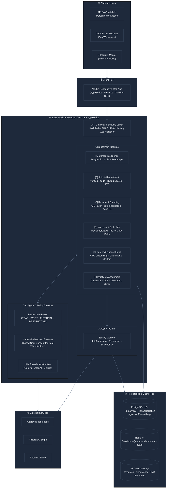

# CA Career OS

> **Production-Grade SaaS Architecture & System Design**  
> *AI-Powered Career Management and Professional Growth Platform for Chartered Accountants in India*

[](#)
[](#)
[](#)
[](#)

---

## 1. Product Vision

**CA Career OS** is purpose-built to guide a newly qualified Chartered Accountant through the complete professional journey from passing CA Final to long-term career leadership.

Rather than another fragmented job board, CA Career OS provides a unified, intelligent workspace:

```
"From CA qualification to career success — one intelligent workspace."
```

### Core Problems Solved

1. **Path Uncertainty:** Newly qualified CAs frequently struggle to choose between Assurance, Tax, FP&A, Corporate Finance, Investment Banking, Consulting, and Independent Practice.
2. **Articleship Experience Gap:** Practical articleship training is often domain-skewed, leaving candidates underprepared for corporate expectations.
3. **Fragmented & Stale Jobs:** Job listings across job boards are duplicated, outdated, or lack CA-specific qualification matching.
4. **Generic Resumes:** Standard resumes fail ATS scans and fail to articulate audit, tax, and finance accomplishments effectively.
5. **Interview Apprehension:** Candidates lack a realistic, role-specific technical practice environment for Ind AS, GST, Transfer Pricing, and financial modeling questions.
6. **Opaque Compensation:** Comparing CTC offers with complex fixed vs. variable pay, retiral benefits, and city cost-of-living differences is difficult.
7. **Disjointed Career Tools:** Job hunting, resume updating, follow-ups, and interview prep are scattered across spreadsheets and notes.
8. **Practice Setup Roadblocks:** Candidates aspiring to launch an independent practice face confusing post-qualification compliance and client management overhead.

---

## 2. High-Level System Architecture



---

## 3. Product Modules Overview

| Module | Core Purpose | Primary Capabilities |
| :--- | :--- | :--- |
| **[A] Career Intelligence** | Clarify direction & roadmap | 6-pathway diagnostic (Audit, Tax, FP&A, IB, Consulting, Practice), skill-gap analysis, 30/60/90-day action plans. |
| **[B] Jobs & Recruitment** | High-signal job discovery | Aggregation from verified sources, semantic match score ($0.0-1.0$), application tracker, recruiter portal. |
| **[C] AI Resume & Branding** | ATS-proof professional brand | Role-specific resume tailoring, cover letters, LinkedIn optimization, **Zero-Fabrication Guard (ADR-009)**. |
| **[D] Interview & Skills Lab** | Practical job readiness | Text/voice mock interviews, Ind AS / Tax scenarios, Excel financial modeling drills with synthetic data. |
| **[E] Financial Intelligence** | Objective offer decisions | Transparent salary percentiles, CTC unbundler (fixed vs. variable vs. benefits), side-by-side offer comparison. |
| **[F] Practice Management** | Independent firm launch | Post-qualification checklist, COP guidance, ICAI resource links, client onboarding workflows, compliance calendar. |
| **[G] AI Career Agent** | Cross-module copilot | Multi-turn career assistant, safe tool execution, human-in-the-loop approvals for external side effects. |

---

## 4. Key Architectural Decisions (ADR Highlights)

- **[ADR-001: Modular Monolith Architecture](./docs/architecture/decisions.md#adr-001-modular-monolith-architecture-over-microservices):** Built as a single cohesive NestJS service to optimize developer velocity, maintain strict transactional boundaries, and eliminate microservices overhead.
- **[ADR-003: Multi-Tenant Workspace Model](./docs/architecture/decisions.md#adr-003-multi-tenant-workspace-and-data-isolation-model):** Candidates own private *Personal Workspaces*; employers and firms operate *Organization Workspaces*. Complete tenant isolation guarantees an employer cannot view an employee's job search.
- **[ADR-004: Tiered Tool Permissions & Human Approval Gate](./docs/architecture/decisions.md#adr-004-tiered-tool-permissions-and-human-in-the-loop-approval-gateway):** LLM tool execution is partitioned into 4 deterministic tiers (`READ_ONLY`, `WRITE`, `EXPLICITLY_APPROVED_EXTERNAL`, and `DESTRUCTIVE`). External actions (applications, messaging) strictly require explicit user confirmation.
- **[ADR-006: Hybrid Lexical + Vector Search](./docs/architecture/decisions.md#adr-006-hybrid-search-postgresql-full-text-search--pgvector-embeddings):** Combines PostgreSQL Full-Text Search with `pgvector` embeddings to ensure both exact accounting keyword precision and semantic matching.
- **[ADR-007: Idempotency Keys & Distributed Locks](./docs/architecture/decisions.md#adr-007-idempotency-keys-and-distributed-lock-strategy):** Guarantees zero duplicate job submissions or transactions via SHA-256 operation keys cached in Redis.
- **[ADR-008: Privacy-Preserving Audit Logging](./docs/architecture/decisions.md#adr-008-privacy-preserving-audit-logging-and-zero-pii-telemetry):** Immutable audit trails capture actor, tool, and outcome with zero PII, resume text, or credentials in log sinks.
- **[ADR-009: Strict Candidate Verification & Zero Fabrication](./docs/architecture/decisions.md#adr-009-strict-candidate-verification-and-prohibition-of-ai-fabrication):** Programmatic constraint forbidding the AI from hallucinating or embellishing metrics, client names, or credentials.

---

## 5. Feature-to-Pain-Point Matrix

| User Pain Point | Target User | Proposed Feature | Required System Components | Required Data | Security Considerations | Success Metric | Phase |
| :--- | :--- | :--- | :--- | :--- | :--- | :--- | :--- |
| **1. Career Path Uncertainty** | Newly qualified CA | Career Intelligence Engine & 6-pathway diagnostic | `CareerModule`, LLM Adapter, `Skill` Catalog | Articleship details, domain interests, preferred cities | Personal workspace isolation; no sharing with current employer | Completion of career diagnostic; reduction in time to career choice | **MVP** |
| **2. Articleship Experience Gap** | CA Final passed / Fresh CA | Role-Specific Skill-Gap Analysis & Practical Roadmap | `CareerModule`, `LearningModule`, RAG Engine | Target job requirements vs articleship exposure | Objective scoring; no disparagement of articleship firms | $>75\%$ completion rate of assigned bridging tasks | **MVP** |
| **3. Fragmented & Stale Job Listings** | All CA job seekers | Unified Verified Job Aggregator with Hybrid Search | `JobsModule`, Job Ingestion Worker, `pgvector`, Redis | Standardized job feeds from verified employers & APIs | Zero unauthorized scraping; source attribution check | Stale/ghost listing rate $<2\%$; search relevance CTR $>40\%$ | **MVP** |
| **4. Generic Resumes Fail ATS** | Job applicants | Job-Specific ATS Resume Tailor with Provenance Link | `ResumeModule`, PDF/DOCX Generator, Prompt Guard | Candidate verified profile, Target Job Description | **Zero-Fabrication Guard (ADR-009)**; mandatory candidate attestation | Verified resume creation time $<10$ min; interview shortlist rate $+35\%$ | **MVP** |
| **5. Technical Interview Anxiety** | Candidates facing corporate interviews | AI Mock Interview & Domain Case Simulator | `InterviewModule`, Speech-to-Text, Feedback Engine | Role question banks, Ind AS / Tax synthetic case studies | Synthetic data only; zero PII in audio storage; encrypted logs | $\ge 2$ mock sessions completed per candidate; score uplift $>20\%$ | **MVP** (Text), **Phase 2** (Voice) |
| **6. Opaque CTC & Offer Comparison** | Candidates evaluating offers | CTC Unbundler & Offer Decision Matrix | `FinancialIntelModule`, Cost-of-Living Index API | Offer letter terms (fixed, variable, ESOPs, retiral) | Confidential offer storage; client-side unbundling; no employer leaks | $100\%$ candidate comprehension of in-hand vs CTC; decision time $<48$h | **MVP** |
| **7. Scattered Applications & Tools** | Active job seekers | Unified Application Tracker & Follow-Up Automation | `JobsModule`, BullMQ Reminder Worker, Email Service | Application state, follow-up dates, recruiter correspondence | Idempotent status updates; strict user opt-in for alerts | Application follow-up rate $>80\%$; tracking completeness $>90\%$ | **MVP** |
| **8. Independent Practice Hurdles** | CAs entering practice | Practice Setup Assistant & Lightweight Client CRM | `PracticeModule`, Compliance Calendar Worker | Post-qualification steps, KYC checklists, deadline schemas | ICAI Code of Ethics compliance; strictly no client solicitation | Practice setup completion time reduced from 30 days to 7 days | **Phase 3** |

---

## 6. Architecture Documentation Index

The complete architectural specification is organized within `docs/architecture/`:

| Document | Purpose & Contents |
| :--- | :--- |
| **[Master Architecture README](./docs/architecture/README.md)** | Full system specification, module data flows, implementation roadmap, and glossary. |
| **[System Context Diagram](./docs/architecture/system-context.mmd)** | C4 Context showing users, SaaS backend, external job sources, AI providers, and data stores. |
| **[System Architecture Diagram](./docs/architecture/system-architecture.mmd)** | Detailed multi-tier architecture diagram covering presentation, API, modules, queues, and persistence. |
| **[AI Agent Execution Flow](./docs/architecture/agent-execution-flow.mmd)** | Visual reference for 4-tier permission routing, idempotency checks, and human approval gates. |
| **[Core User Journey](./docs/architecture/user-journey.mmd)** | Dual-path flowchart tracking qualification through corporate employment or independent practice. |
| **[Job Application Workflow](./docs/architecture/job-application-workflow.mmd)** | State machine tracking job ingestion, resume selection, approval gates, and offer unbundling. |
| **[Data Architecture ERD](./docs/architecture/data-architecture.mmd)** | Complete entity-relationship model with multi-tenant boundaries and foreign key constraints. |
| **[Security & Trust Boundaries](./docs/architecture/security-boundaries.mmd)** | Network ingress, authentication guards, AI sandbox boundaries, and encrypted storage tiers. |
| **[Architecture Decision Records](./docs/architecture/decisions.md)** | 9 formal ADRs detailing modular monolith, tech stack, pgvector, and security decisions. |
| **[Assumptions, Risks & Constraints](./docs/architecture/assumptions-and-risks.md)** | Threat models, ICAI ethical boundaries, integration constraints, and research spikes. |

---

## 7. Technology Baseline

- **Frontend:** Next.js (App Router), React 19, TypeScript, Vanilla CSS + Tailwind CSS tokens.
- **Backend:** Node.js with NestJS (TypeScript), REST APIs + tRPC.
- **Database:** PostgreSQL 16+ with `pgvector` extension and Prisma ORM.
- **Cache & Async Queues:** Redis 7+ and BullMQ for background tasks and idempotency management.
- **AI Engine:** Interchangeable provider adapter (Google Gemini, OpenAI, Anthropic) with strict JSON schema validation.
- **Object Storage:** S3-compatible storage with KMS encryption and pre-signed access URLs.
- **Notifications:** Resend / SendGrid for transactional email; Twilio for optional WhatsApp alerts.

---

## 8. License & Professional Ethics Notice

This architecture document is designed in strict compliance with the **Chartered Accountants Act, 1949**, and the **ICAI Code of Ethics (2020)**. 

All career guidance, compliance checklists, and mock interview case studies are intended solely for professional education and career preparation. The platform does not offer statutory legal, tax, or audit opinions, nor does it facilitate public commercial client solicitation for practicing members.
# CA-Carrier-OS
