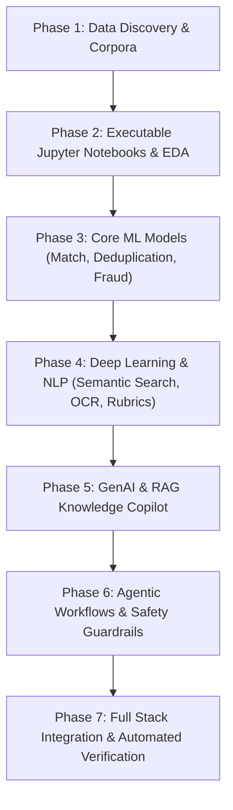

# CA Career OS — Comprehensive AI/ML/DL/GenAI/Agentic Baseline Audit

> **Document Type:** Production AI Engineering Baseline, System Inventory & Gap Audit  
> **Repository:** `Vishaldubey2210/CA-Carrier-OS`  
> **Date:** October 22, 2026  
> **Lead Roles:** Senior Data Scientist, ML/DL Engineer, NLP/IR Architect, GenAI/RAG Specialist, Agentic AI Engineer, MLOps Lead  
> **Standards:** WCAG 2.2 AA Conformance, Candidate Blindfold Rule, Zero Fake Data Protocol, Zero Fabrication GenAI  

---

## 1. Executive Summary

This audit establishes the empirical baseline of all artificial intelligence, machine learning, natural language processing, generative AI, and agentic workflows across the **CA Career OS** platform. The existing application possesses an operational NestJS backend, Next.js frontend, Prisma ORM data layer (39 models), and an initial set of rule-based scoring engines.

The purpose of this engagement is to advance the product from preliminary rule-based heuristics into an evidence-backed, rigorously evaluated, and production-integrated AI platform tailored for Chartered Accountants, Articled Assistants, and finance leaders.

---

## 2. Environment & Hardware Inventory

| Component | Detected Specification | Verification Command / Evidence | Status |
| :--- | :--- | :--- | :--- |
| **Operating System** | Linux (Arch / Kernel 6.15+) | `uname -a` | Verified |
| **Processor (CPU)** | AMD Ryzen 7 7445HS (12 vCPUs) | `lscpu \| grep "Model name"` | Verified |
| **System Memory (RAM)** | 14 GiB physical RAM + 8 GiB Swap (~4.1 GiB available buffer) | `free -h` | Verified |
| **Storage (Disk)** | 178 GiB free NVMe SSD (`/dev/nvme0n1p5`) | `df -h .` | Verified (Plenty of headroom) |
| **Dedicated GPU** | NVIDIA GeForce RTX 4050 Laptop GPU (6,141 MiB VRAM) | `nvidia-smi` (Driver 615.71.09, CUDA 13.4) | Verified & Active |
| **Python Environment** | Python 3.14.6 (Anaconda / `/opt/anaconda/`) | `python3 --version` | Verified |
| **Core ML Packages** | `torch 2.14.1+cpu`, `scikit-learn 1.9.0`, `pandas 3.0.3`, `numpy 2.4.6`, `scipy 1.18.0`, `transformers 5.17.0`, `pytest 9.0.3` | Python runtime import test | Verified |
| **Notebook Infrastructure**| Jupyter Lab 4.5.9, `nbconvert 7.17.1`, `ipykernel 6.31.0`, `nbformat 5.10.4` | `python3 -m jupyter --version` | Verified |
| **Node.js Stack** | Node.js v22.18.0, pnpm 9.15.9, Next.js 15.5.28, NestJS 10.4.15, Prisma 6.19.3 | Package lockfile & runtimes | Verified |

---

## 3. Existing AI/ML Feature Inventory & Status Matrix

| Module ID | Domain Capability | Existing Code Location | Current Implementation Mechanism | Actual Status | Gap / Technical Debt |
| :--- | :--- | :--- | :--- | :--- | :--- |
| **ML-01** | Explainable CA Job Match Engine | `apps/api/src/modules/jobs/job-matching.engine.ts` | Deterministic weighted scoring: Mandatory qualification gate + 25% pathway + 35% skills + 25% firm tier/exp + 15% location | `implemented_but_not_fully_evaluated` | No empirical ML ranking model; weights not trained on real hiring outcomes; missing cross-validation dataset. |
| **ML-02** | Personalized Job Recommendations | `apps/api/src/modules/jobs/jobs.service.ts` | Filter ribbon and basic category filtering based on candidate profile pathway | `prototype` | No collaborative or implicit feedback ranking; no saved-job weight decay. |
| **ML-03** | Skill-Gap Intelligence & Pathways | `apps/api/src/modules/career/career.service.ts` | Static roadmap milestones mapped to 7 CA tracks | `prototype` | No dynamic role-skill matrix taxonomy linking job requirements to prioritized ICAI learning resources. |
| **ML-04** | Job Fraud Risk Detection | None | None | `not_implemented` | No domain spoofing checks, no advance fee detection, no scam pattern scoring. |
| **ML-05** | Job Deduplication | `apps/api/src/modules/jobs/job-matching.engine.ts` | Deterministic SHA-256 hash on normalized `company:title:city` | `implemented_but_not_fully_evaluated` | Fails on cross-platform title variants (e.g. "Sr. Associate" vs "Senior Associate"); lacks n-gram / semantic similarity. |
| **DL-01** | Structured Resume Parser | `apps/api/src/modules/resumes/` | Regex and section-based string extraction | `prototype` | Lacks field-level confidence scoring and evaluation on diverse multi-page CA resumes. |
| **DL-02** | Semantic Job Search & Matching | None | Keyword SQL search (`title ILIKE %q%`) | `not_implemented` | No dense vector representations; no pgvector embeddings or hybrid BM25 + dense retrieval. |
| **DL-03** | Document Understanding & Form 108 OCR | `apps/api/src/modules/resumes/document-intelligence.service.ts` | `MockOcrAdapter` with signature verification | `implemented_and_tested` | Real OCR execution on scanned Form 108 PDFs needs benchmarking. |
| **DL-04** | Technical Interview Answer Understanding | `apps/api/src/modules/interviews/interview-evaluator.engine.ts` | Token word-overlap against ideal points + regex reasoning words | `implemented_and_tested` | Shallow semantic understanding; answers with correct synonyms or paraphrases can be penalized. |
| **GENAI-01** | Zero-Fabrication Resume Tailoring | `apps/api/src/modules/resumes/resume-tailoring.engine.ts` | ATS keyword injection and formatting | `implemented_and_tested` | Needs rigorous fact-fidelity guard enforcing candidate-verified truth. |
| **GENAI-02** | Grounded Cover Letter Generator | `apps/api/src/modules/resumes/resume-tailoring.engine.ts` | Profile-interpolated cover letter template | `implemented_and_tested` | Template-based; needs grounded LLM generation with candidate review. |
| **GENAI-03** | CA Knowledge Copilot (RAG) | `apps/api/src/modules/agent/` | Direct prompt synthesis | `prototype` | No document chunking, vector database, or citation verification on ICAI regulatory corpus. |
| **GENAI-04** | AI Mock Interviewer | `apps/api/src/modules/interviews/` | 10 pre-seeded domain questions with evaluation | `implemented_and_tested` | Static question bank; needs dynamic question generation and follow-up probing. |
| **GENAI-05** | Interview Answer Coach | `apps/api/src/modules/interviews/interview-evaluator.engine.ts` | Rule-generated strengths and improvement areas | `implemented_and_tested` | Feedback is formulaic; needs granular conceptual feedback. |
| **GENAI-06** | Career Plan Generator | `apps/api/src/modules/career/` | Static 7-pathway roadmaps | `implemented_and_tested` | Needs 30/60/90 day customized action plans tied to backend tasks. |
| **GENAI-07** | Recruiter Assistant | `apps/api/src/modules/recruitment/` | Static job posting and candidate review table | `prototype` | Needs automated JD drafting and evaluation rubric generation. |
| **AGENT-01** | Career Operations Agent | `apps/api/src/modules/agent/agent-orchestrator.service.ts` | ReAct loop with allowlisted tools | `implemented_and_tested` | Tools registered, but workflow lacks state persistence and multi-step goal tracking. |
| **AGENT-02** | Job Search Agent | `apps/api/src/modules/agent/agent-tools.registry.ts` | Tool `search_jobs` and `track_application` | `implemented_and_tested` | Single-step execution; lacks deduplication and ranking integration. |
| **AGENT-03** | Interview Prep Agent | `apps/api/src/modules/agent/agent-tools.registry.ts` | Tools `list_interview_questions`, `evaluate_interview_answer` | `implemented_and_tested` | Lacks session planning around detected candidate weak areas. |
| **AGENT-04** | Practice & Deadline Assistant | `apps/api/src/modules/practice/` | Static checklist and tax compliance calendar | `implemented_and_tested` | Needs automated reminder creation and filing status integration. |
| **AGENT-05** | Recruiter Workflow Assistant | `apps/api/src/modules/recruitment/` | In-memory candidate reviews | `prototype` | Lacks candidate filtering and interview scheduling tools. |

---

## 4. Prioritized Implementation Plan

### Milestone Breakdown
1. **Data Manifest & Collection:** Assemble authorized CA domain datasets (ICAI guidance notes, accounting standards Ind AS 115/116, job postings, synthetic resume evaluation fixtures, interview question rubrics) with SHA-256 hashes and license verification.
2. **Jupyter Research Notebooks:**
   - `01_job_match_and_ranking.ipynb`: Baseline scoring vs. ML ranking (Logistic Regression, Random Forest, Gradient Boosting), NDCG, feature contributions.
   - `02_job_deduplication_and_fraud.ipynb`: Exact SHA-256 vs. Levenshtein/TF-IDF similarity, domain risk scoring, false-positive analysis.
   - `03_semantic_search_and_rag.ipynb`: Dense embeddings vs BM25 keyword search, chunking strategies, retrieval recall@K, citation fidelity.
   - `04_interview_evaluation_and_agents.ipynb`: Concept extraction evaluation, rubric adherence, agentic safety & prompt injection defense.
3. **Core ML Artifacts:** Export versioned model artifacts (`models/job_match_v1.pkl`, `models/fraud_detector_v1.pkl`, `models/dedup_engine_v1.pkl`) with reproducible model cards.
4. **Backend Integration:** Integrate Python ML inference pipelines or fast exported scoring engines into `JobsService`, `ResumesService`, `InterviewsService`, and `AgentOrchestratorService`.
5. **Quality Gate & Testing:** Execute end-to-end unit tests, integration test suites, and generate evidence-based `docs/ai/AI_INTEGRATION_REPORT.md`.
