# CA Career OS — Master System Architecture Handbook

> **Document Type:** Production-Grade SaaS Architecture Blueprint & Engineering Handbook  
> **Status:** Architecture Blueprint — Implementation Pending  
> **Target Audience:** Principal Software Architects, Backend Engineers, Security Auditors, Product Leads  
> **Repository:** `Vishaldubey2210/CA-Carrier-OS`

[](#11-architecture-status-implementation-phases--roadmap)
[-blue.svg)(decisions.md#adr-001-modular-monolith-architecture-over-microservices)
[](#7-security-architecture--threat-model)
[](#2-visual-architecture-diagrams-handbook)
[-orange.svg)](#13-legal-professional-ethics--regulatory-disclaimers)

---

## Table of Contents

1. [Executive Summary & Architectural Vision](#1-executive-summary--architectural-vision)
2. [Visual Architecture Diagrams Handbook (14 Core Views)](#2-visual-architecture-diagrams-handbook)
   - [2.1 System Context Diagram](#21-system-context-diagram)
   - [2.2 Detailed Container Architecture](#22-detailed-container-architecture)
   - [2.3 Backend Component Architecture](#23-backend-component-architecture)
   - [2.4 Domain Module Dependencies](#24-domain-module-dependencies)
   - [2.5 AI Agent System Architecture](#25-ai-agent-system-architecture)
   - [2.6 AI Agent Permission & Execution Flow](#26-ai-agent-permission--execution-flow)
   - [2.7 Human-in-the-Loop Approval Sequence](#27-human-in-the-loop-approval-sequence)
   - [2.8 Candidate Dual-Pathway User Journey](#28-candidate-dual-pathway-user-journey)
   - [2.9 Job Ingestion Pipeline](#29-job-ingestion-pipeline)
   - [2.10 Job Application Lifecycle State Machine](#210-job-application-lifecycle-state-machine)
   - [2.11 Database Entity-Relationship Diagram](#211-database-entity-relationship-diagram)
   - [2.12 Security Boundaries & Trust Zones](#212-security-boundaries--trust-zones)
   - [2.13 Background Jobs & Asynchronous Queues](#213-background-jobs--asynchronous-queues)
   - [2.14 Independent Practice Workflow](#214-independent-practice-workflow)
3. [Product & Domain Architecture (11 Core Modules)](#3-product--domain-architecture-11-core-modules)
4. [AI Agent Request & Execution Lifecycle](#4-ai-agent-request--execution-lifecycle)
5. [Database Architecture & Schema Specification](#5-database-architecture--schema-specification)
6. [API Architecture & Endpoint Contracts](#6-api-architecture--endpoint-contracts)
7. [Security Architecture & Threat Model](#7-security-architecture--threat-model)
8. [Background Processing, Queues & Reliability](#8-background-processing-queues--reliability)
9. [Architecture Decision Records (ADRs) Summary](#9-architecture-decision-records-adrs-summary)
10. [Feature-to-Pain-Point Traceability Matrix](#10-feature-to-pain-point-traceability-matrix)
11. [Architecture Status, Implementation Phases & Roadmap](#11-architecture-status-implementation-phases--roadmap)
12. [Architecture Glossary](#12-architecture-glossary)
13. [Legal, Professional Ethics & Regulatory Disclaimers](#13-legal-professional-ethics--regulatory-disclaimers)

---

## 1. Executive Summary & Architectural Vision

### 1.1 The Core Product Promise

> *"From CA qualification to career success — one intelligent workspace."*

**CA Career OS** is an integrated software-as-a-service (SaaS) platform engineered specifically for Chartered Accountants in India, with primary focus on candidates who have recently cleared CA Final and newly qualified CAs (0–3 years post-qualification).

Unlike generic, fragmented job boards, CA Career OS provides an active, personalized career copilot combining:
1. Career pathway diagnostics and personalized 30/60/90-day transition roadmaps.
2. Verified, deduplicated job discovery and explainable semantic matching (`pgvector`).
3. ATS-optimized resume building with strict zero-fabrication verification (ADR-009).
4. Technical mock interviews and domain simulation labs (Ind AS, Tax, Financial Modeling).
5. Transparent CTC unbundling and side-by-side offer decision comparison.
6. Post-qualification compliance checklists and independent practice setup tools.
7. A permission-governed AI Career Agent operating under strict human-in-the-loop controls.

### 1.2 Core Architectural Principles

- **Security & Multi-Tenant Isolation First:** Personal candidate workspaces and employer organization workspaces are strictly decoupled. A candidate's current employer can never observe their job search or career planning activities.
- **Deterministic AI Safeguards:** LLMs are never granted autonomous write permissions for external side effects. Tool invocations are partitioned into four deterministic tiers (`READ_ONLY`, `WRITE`, `EXPLICITLY_APPROVED_EXTERNAL`, and `DESTRUCTIVE`).
- **Zero-Fabrication Guard (ADR-009):** The platform strictly prohibits AI fabrication of credentials, client names, engagement fees, or professional metrics. All resume claims require explicit candidate attestation.
- **Modular Monolith Baseline (ADR-001):** Single deployable NestJS service with clean domain boundaries, avoiding microservices network latency while preserving clean future extraction boundaries.
- **Standard REST API Standard (ADR-002):** Unified RESTful API with strict Zod schema validation, predictable error envelopes, and idempotency headers.

---

## 2. Visual Architecture Diagrams Handbook

This section documents all 14 visual architecture diagrams across the system. Every diagram includes its embedded, GitHub-compatible Mermaid source, purpose statement, component breakdown, data flow, trust boundaries, failure paths, and implementation status.

```
+───────────────────────────────────────────────────────────────────────────────────────────+
|                                14 VISUAL ARCHITECTURE VIEWS                               |
+───────────────────────────────────────────────────────────────────────────────────────────+
| 01. System Context            | Users, platform boundary, persistence, external systems   |
| 02. Container Architecture    | Presentation tier, API gateway, modules, workers, stores  |
| 03. Backend Components        | Ingress guards, domain services, infrastructure, data     |
| 04. Domain Module Deps        | Modular monolith dependency graph, event bus decoupling   |
| 05. AI Agent System           | Context assembly, RAG grounding, policy gateway, output   |
| 06. Agent Execution Flow      | 4-tier router, idempotency, human approval, audit stream  |
| 07. Human Approval Sequence   | 15m signed token lifecycle, UI cards, confirm / decline   |
| 08. Candidate User Journey    | Corporate employment track vs Independent practice track  |
| 09. Job Ingestion Pipeline    | Normalization, SHA-256 deduplication, vector indexing     |
| 10. Job Application Lifecycle | State machine from discovery to offer comparison          |
| 11. Database ERD              | 21 relational entities, foreign keys, multi-tenant scopes |
| 12. Security Boundaries       | Edge WAF, API ingress, agent gateway, KMS storage zones   |
| 13. Background Processing     | BullMQ queues, worker pool, retry backoff, DLQ, reconcile |
| 14. Independent Practice      | COP checklist, firm constitution, ethics, client CRM      |
+───────────────────────────────────────────────────────────────────────────────────────────+
```

---

### 2.1 System Context Diagram

- **Purpose:** Establishes the outermost system boundary of CA Career OS, defining all external human actors, integrated external SaaS services, persistence infrastructure, and high-level interaction protocols.
- **Canonical Source:** [`system-context.mmd`](system-context.mmd)
- **Implementation Status:** *Blueprint / Architecture Specification*

<!-- DIAGRAM:system-context:START -->
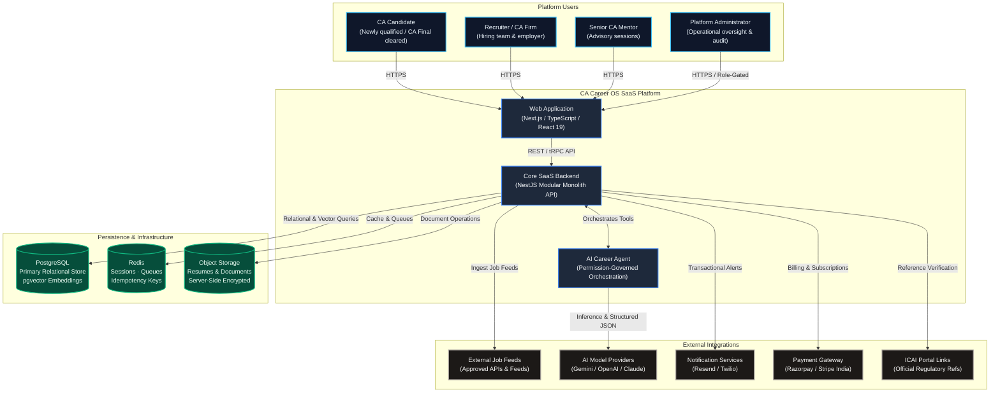
<!-- DIAGRAM:system-context:END -->

#### Architectural Breakdown:
- **Actors:** 
  - `CANDIDATE`: Primary persona accessing personal workspace via desktop/mobile web.
  - `RECRUITER`: Corporate employer or CA firm hiring manager managing job postings and candidate pipelines.
  - `MENTOR`: Senior CA professional conducting advisory sessions.
  - `ADMIN`: Platform operator with role-gated access restricted to operational telemetry.
- **Trust Boundaries:** The public Internet terminates at the Web App and API Gateway. All communication between the Web App and Backend is authenticated via JWT and scoped by `workspaceId`. External egress calls to AI providers, payment gateways, and notification APIs are strictly controlled via adapter services.
- **Failure Paths:** If external job feeds fail, cached jobs remain active; if AI providers experience transient outages, tool execution gracefully returns HTTP 503 with user retry prompts.

---

### 2.2 Detailed Container Architecture

- **Purpose:** Illustrates the multi-tier containerized deployment topology, detailing the presentation layer, authentication layer, API gateway, core domain modules, background workers, persistence tier, and observability sinks.
- **Canonical Source:** [`system-architecture.mmd`](system-architecture.mmd)
- **Implementation Status:** *Blueprint / Monorepo Architecture Planned*

<!-- DIAGRAM:system-architecture:START -->
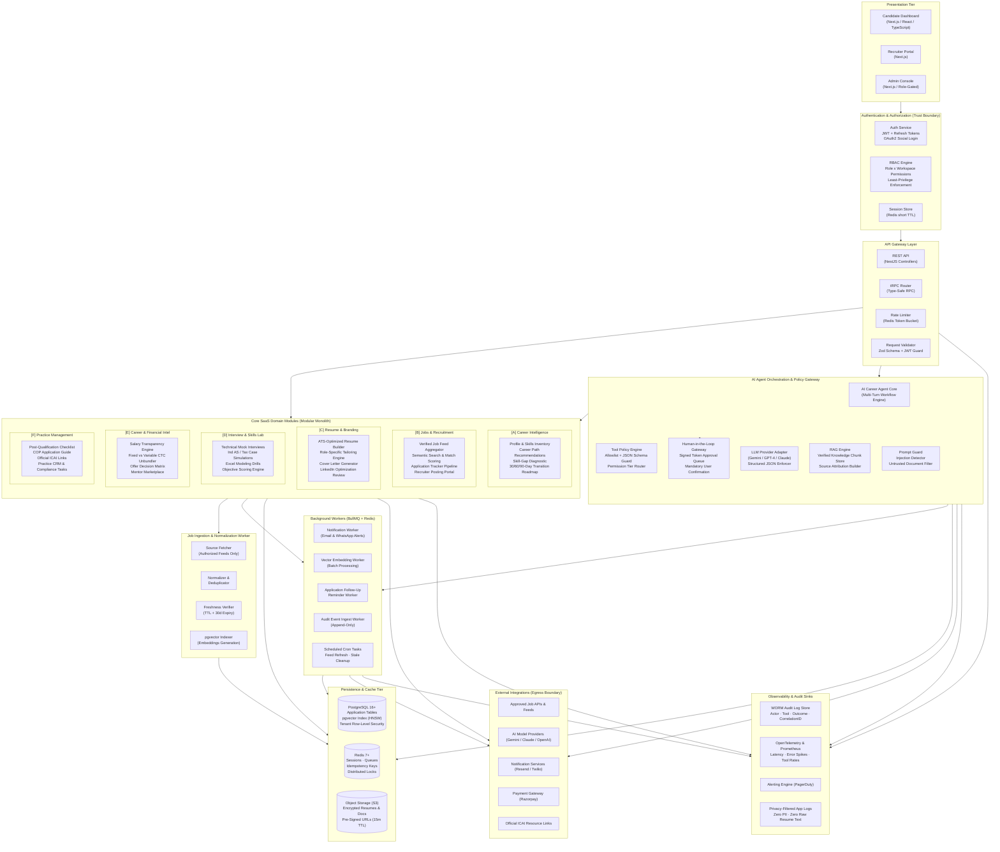
<!-- DIAGRAM:system-architecture:END -->

#### Architectural Breakdown:
- **Presentation Tier:** Next.js App Router providing Server-Side Rendered (SSR) public career pages and React 19 interactive client workspaces.
- **Backend Tier:** NestJS Modular Monolith containing 6 core domain modules, an AI Agent Orchestrator, an API Gateway layer with guards, and BullMQ worker processors.
- **Persistence:** PostgreSQL 16+ with `pgvector` HNSW index for unified relational and embedding storage; Redis 7+ for sessions, token-bucket rate limits, distributed locks, and BullMQ queues; S3/R2 for encrypted document storage.
- **Observability:** Append-only SIEM audit log, Prometheus metrics exporter, and OpenTelemetry distributed tracing with zero-PII logging policies.

---

### 2.3 Backend Component Architecture

- **Purpose:** Deconstructs the internal NestJS application structure, detailing controllers, pipeline guards, domain services, cross-cutting infrastructure services, and persistence clients.
- **Canonical Source:** [`backend-component-architecture.mmd`](backend-component-architecture.mmd)
- **Implementation Status:** *Blueprint / Monorepo Architecture Planned*

<!-- DIAGRAM:backend-component-architecture:START -->
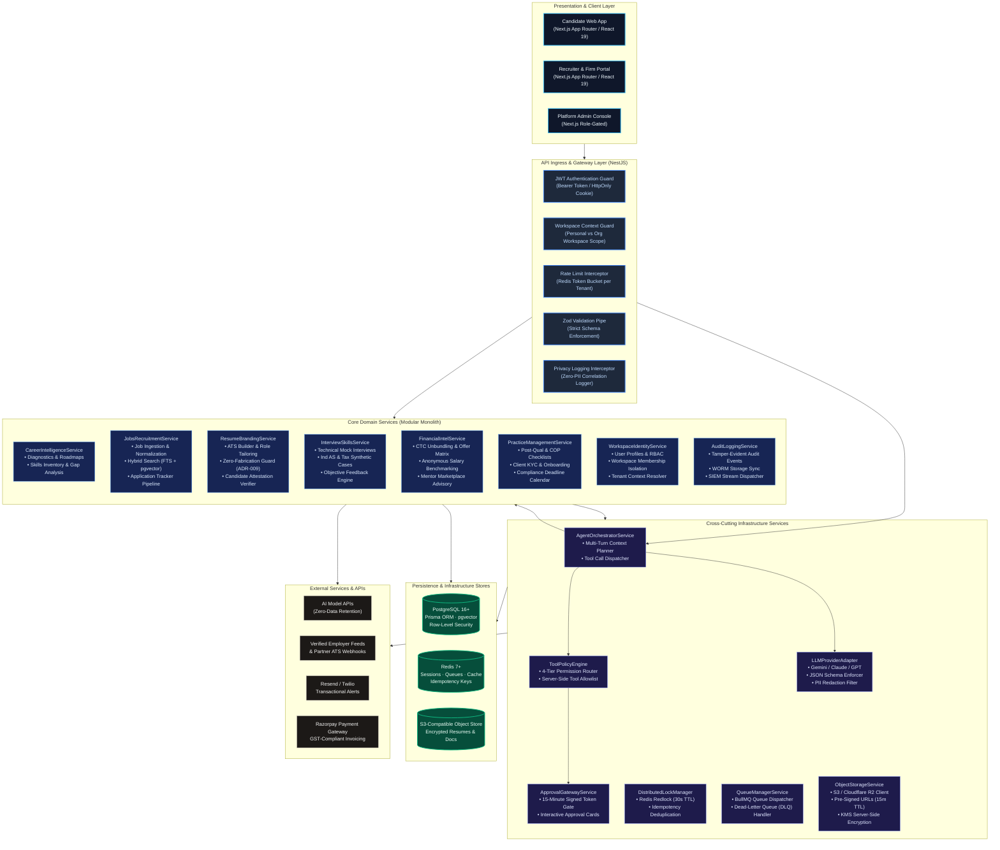
<!-- DIAGRAM:backend-component-architecture:END -->

#### Architectural Breakdown:
- **Pipeline Order:** Every request sequentially traverses `JWT_GUARD` $\rightarrow$ `WS_GUARD` $\rightarrow$ `RATE_LIMIT` $\rightarrow$ `ZOD_PIPE` before hitting controllers.
- **Cross-Cutting Isolation:** Infrastructure concerns (Locking, Queues, Storage, Tool Policy) are encapsulated into separate NestJS injectable services, ensuring domain services focus purely on business logic.
- **Zero-Fabrication Enforcement:** `ResumeBrandingService` directly injects validation rules ensuring LLM output cannot introduce facts missing from the candidate's verified articleship profile.

---

### 2.4 Domain Module Dependencies

- **Purpose:** Documents the strict compile-time and runtime dependency graph across NestJS modules, proving the prevention of circular dependencies through an asynchronous domain event bus (`EventEmitter2`).
- **Canonical Source:** [`domain-module-dependencies.mmd`](domain-module-dependencies.mmd)
- **Implementation Status:** *Blueprint / Architecture Specification*

<!-- DIAGRAM:domain-module-dependencies:START -->
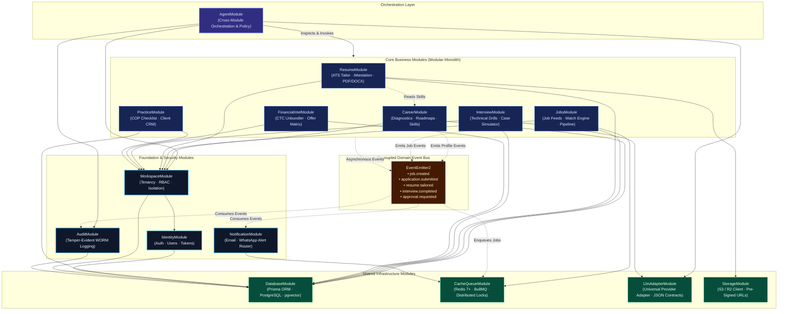
<!-- DIAGRAM:domain-module-dependencies:END -->

#### Architectural Breakdown:
- **Dependency Inversion:** Foundation modules (`IdentityModule`, `WorkspaceModule`, `AuditModule`) never import business modules.
- **Event Bus Decoupling:** Side-effects (sending notifications, triggering vector embeddings, generating audit streams) occur asynchronously via `EventEmitter2` and BullMQ, preventing blocking transactional chains.

---

### 2.5 AI Agent System Architecture

- **Purpose:** Details the internal reasoning, context assembly, grounding, safety policy evaluation, and output sanitization pipeline of the AI Career Agent.
- **Canonical Source:** [`ai-agent-system.mmd`](ai-agent-system.mmd)
- **Implementation Status:** *Blueprint / Implementation Pending*

<!-- DIAGRAM:ai-agent-system:START -->
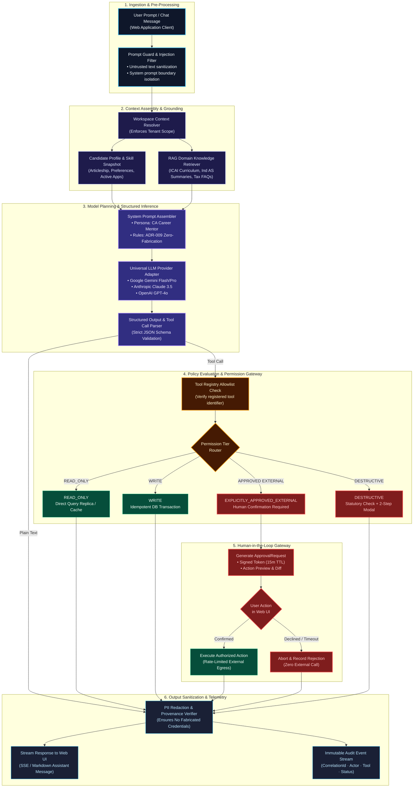
<!-- DIAGRAM:ai-agent-system:END -->

#### Architectural Breakdown:
- **Grounding & RAG:** Prevents hallucinated statutory rules by grounding prompt generation in pre-indexed ICAI curriculum documents and Ind AS disclosure checklists.
- **Output Sanitization:** Before streaming tokens to the client, the response passes through PII redaction and provenance checking to ensure zero fabricated credentials.

---

### 2.6 AI Agent Permission & Execution Flow

- **Purpose:** Full deterministic decision tree governing tool invocation, error branches, permission routing, idempotency caching, user approval cards, and audit event emission.
- **Canonical Source:** [`agent-execution-flow.mmd`](agent-execution-flow.mmd)
- **Implementation Status:** *Blueprint / Architecture Specification*

<!-- DIAGRAM:agent-execution-flow:START -->
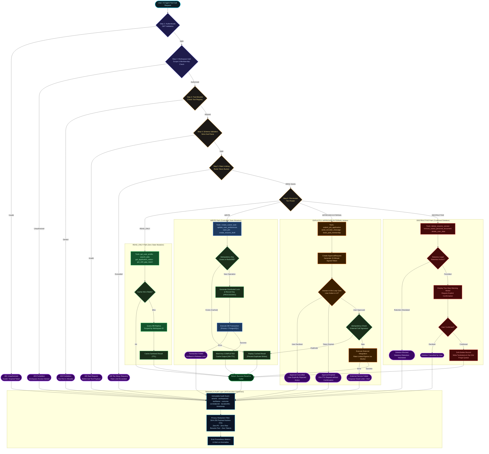
<!-- DIAGRAM:agent-execution-flow:END -->

#### Error Paths & Failure Handling:
- **Authentication Failure (401):** Expired or invalid JWT token logs a security event and halts execution.
- **Cross-Workspace Access Denial (403):** Attempting to execute tools against resources outside the active `workspaceId` is blocked.
- **Duplicate Requests:** Replays cached results using Redis SHA-256 idempotency records without executing database mutations.
- **Expired Approvals (15m TTL):** Approval tokens automatically expire in Redis after 900 seconds, requiring the candidate to re-request the operation.

---

### 2.7 Human-in-the-Loop Approval Sequence

- **Purpose:** Sequence diagram detailing the lifecycle of an `EXPLICITLY_APPROVED_EXTERNAL` tool execution, showing the browser UI approval card, cryptographic signed token generation, Redis state tracking, confirmation, and cancellation paths.
- **Canonical Source:** [`human-approval-sequence.mmd`](human-approval-sequence.mmd)
- **Implementation Status:** *Blueprint / Implementation Pending*

<!-- DIAGRAM:human-approval-sequence:START -->
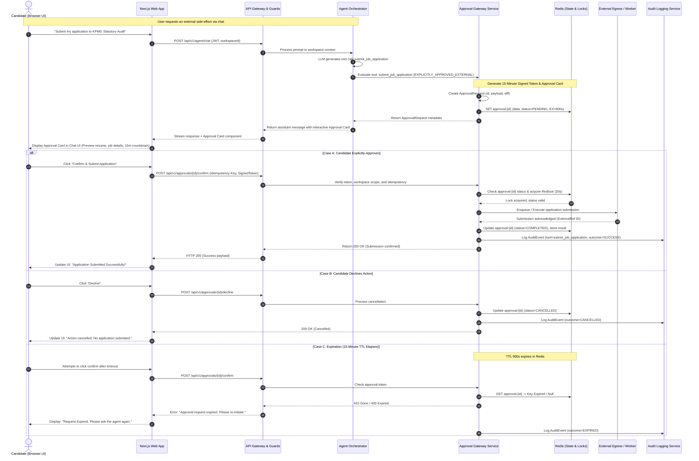
<!-- DIAGRAM:human-approval-sequence:END -->

#### Architectural Breakdown:
- **Cryptographic Security:** The approval token is an HMAC-SHA256 signature binding `approvalRequestId`, `workspaceId`, `userId`, `actionPayloadHash`, and `expiresAt`. Tampering with the client-side confirmation payload invalidates the signature.
- **Idempotency Guarantee:** Acquires a Redis distributed lock for 30s during confirmation execution to prevent double-click race conditions.

---

### 2.8 Candidate Dual-Pathway User Journey

- **Purpose:** Maps the end-to-end user experience for Chartered Accountants across two primary tracks: the Corporate Employment Track (Industry, Big 4, Consulting) and the Independent Practice Track (Sole Proprietorship, Partnership, LLP).
- **Canonical Source:** [`user-journey.mmd`](user-journey.mmd)
- **Implementation Status:** *Blueprint / Design Specified*

<!-- DIAGRAM:user-journey:START -->
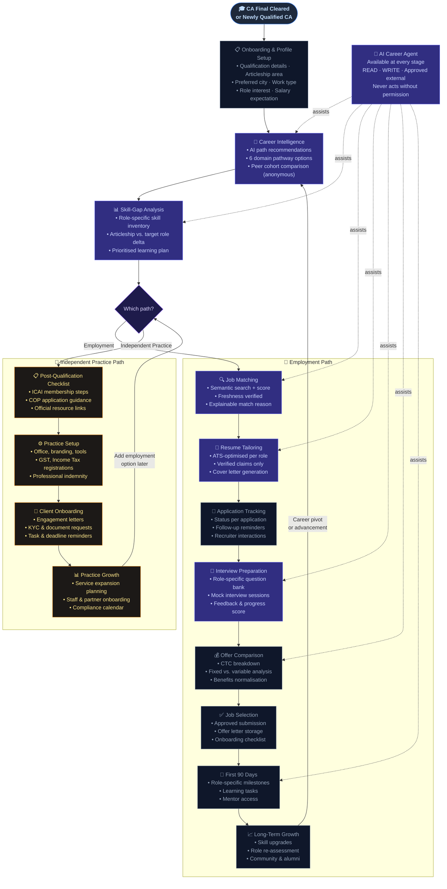
<!-- DIAGRAM:user-journey:END -->

#### Architectural Breakdown:
- **Decision Branching:** The diagnostic step dynamically unlocks either the employment module pipeline or the practice setup pipeline, adapting the dashboard UI.
- **Attestation Gate:** Before transitioning from `RESUME_TAILOR` to `APP_TRACK`, the candidate must review and attest to all resume bullet points.

---

### 2.9 Job Ingestion Pipeline

- **Purpose:** Architecture of the job ingestion engine, detailing verified source ingestion, schema normalization, SHA-256 fingerprint deduplication, freshness enforcement, and semantic vector indexing.
- **Canonical Source:** [`job-ingestion-pipeline.mmd`](job-ingestion-pipeline.mmd)
- **Implementation Status:** *Blueprint / Pipeline Specified*

<!-- DIAGRAM:job-ingestion-pipeline:START -->
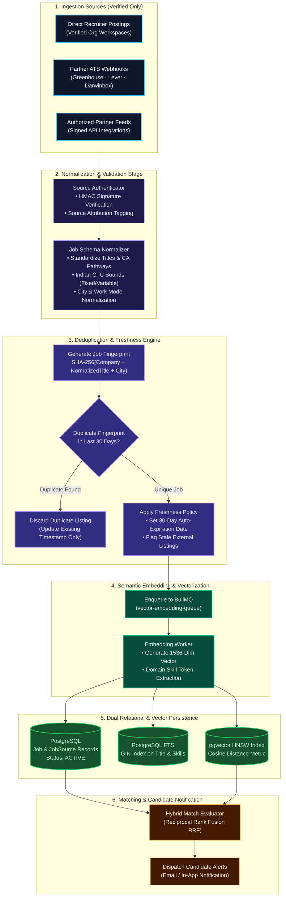
<!-- DIAGRAM:job-ingestion-pipeline:END -->

#### Architectural Breakdown:
- **Deduplication:** Computes a SHA-256 fingerprint hash of `normalized_company + normalized_title + city`. If matched within 30 days, existing job timestamp is touched rather than creating duplicate listings.
- **Freshness Policy:** Jobs older than 30 days are automatically set to `EXPIRED` unless re-verified via employer webhook or API poll.

---

### 2.10 Job Application Lifecycle State Machine

- **Purpose:** Formal state transition model tracking a job from ingestion through candidate tailoring, approval gate, employer submission, interview milestones, and offer comparison.
- **Canonical Source:** [`job-application-workflow.mmd`](job-application-workflow.mmd)
- **Implementation Status:** *Blueprint / State Machine Specified*

<!-- DIAGRAM:job-application-workflow:START -->
```mermaid
stateDiagram-v2
  [*] --> JobDiscovered : Job ingested from source

  state JobDiscovered {
    [*] --> Normalising
    Normalising --> Deduplicating
    Deduplicating --> FreshnessVerified
    FreshnessVerified --> Indexed
    Indexed --> [*]
  }

  JobDiscovered --> Available : Passes quality checks

  state Available {
    direction LR
    [*] --> Searchable
    Searchable --> SavedByCandidate : Candidate saves job
    Searchable --> AlertSent : Matches job alert
  }

  SavedByCandidate --> ResumeVersionSelected : Candidate picks resume
  AlertSent --> ResumeVersionSelected

  state ResumeVersionSelected {
    [*] --> SelectingVersion
    SelectingVersion --> Tailoring : Candidate requests tailoring
    Tailoring --> TailoredDraftReady
    TailoredDraftReady --> CandidateReviewing
    CandidateReviewing --> ApprovedForApplication : Candidate approves
    CandidateReviewing --> Tailoring : Revise
  }

  ApprovedForApplication --> EligibilityCheck

  state EligibilityCheck {
    [*] --> CheckingRequirements
    CheckingRequirements --> EligibilityMet : Requirements met
    CheckingRequirements --> EligibilityWarning : Partial match
    CheckingRequirements --> EligibilityFailed : Hard requirement missing
    EligibilityWarning --> CandidateProceedsAnyway : User explicitly continues
    EligibilityFailed --> [*] : Blocked — inform candidate
  }

  EligibilityMet --> PendingExplicitApproval
  CandidateProceedsAnyway --> PendingExplicitApproval

  state PendingExplicitApproval {
    [*] --> ShowingApprovalDialog
    ShowingApprovalDialog --> UserConfirmed : "Submit Application" clicked
    ShowingApprovalDialog --> UserDeclined : Cancelled or timeout
    UserDeclined --> [*]
  }

  UserConfirmed --> IdempotencyCheck

  state IdempotencyCheck {
    [*] --> CheckingKey
    CheckingKey --> DuplicateDetected : Key already exists
    CheckingKey --> NewSubmission : First attempt
    DuplicateDetected --> ReplayingResult
    ReplayingResult --> [*]
  }

  NewSubmission --> ApplicationSubmitted : External action via service

  ApplicationSubmitted --> Tracking

  state Tracking {
    direction LR
    [*] --> Applied
    Applied --> AcknowledgedByEmployer : Employer viewed
    Applied --> NoResponse
    AcknowledgedByEmployer --> InterviewInvited
    AcknowledgedByEmployer --> Rejected
    InterviewInvited --> InterviewPrepStarted
    InterviewPrepStarted --> InterviewCompleted
    InterviewCompleted --> OfferReceived
    InterviewCompleted --> Rejected
    NoResponse --> FollowUpSent : Reminder triggered
    FollowUpSent --> AcknowledgedByEmployer
    FollowUpSent --> NoResponseFinal
  }

  OfferReceived --> OfferComparison
  Rejected --> PostMortemFeedback
  NoResponseFinal --> Archived

  state OfferComparison {
    [*] --> CTCAnalysis
    CTCAnalysis --> BenefitsNormalisation
    BenefitsNormalisation --> ComparisonReady
  }

  OfferComparison --> Accepted : Candidate accepts
  OfferComparison --> Declined : Candidate declines

  Accepted --> OfferLetterStored
  Declined --> Archived
  PostMortemFeedback --> Archived

  OfferLetterStored --> [*]
  Archived --> [*]
```
<!-- DIAGRAM:job-application-workflow:END -->

#### Architectural Breakdown:
- **Eligibility Check:** Evaluates mandatory hard constraints (e.g. CA Final cleared, specific city relocation) before enabling the approval button.
- **Pipeline Retention:** Applications progress to `Archived` after final resolution, maintaining full audit trails.

---

### 2.11 Database Entity-Relationship Diagram

- **Purpose:** Full relational entity-relationship model documenting all 21 core entities, primary keys, foreign keys, unique constraints, and multi-tenant workspace relationships.
- **Canonical Source:** [`data-architecture.mmd`](data-architecture.mmd)
- **Implementation Status:** *Blueprint / Prisma Schema Ready for Migration Testing*

<!-- DIAGRAM:data-architecture:START -->

<!-- DIAGRAM:data-architecture:END -->

#### Architectural Breakdown:
- **Tenant Scoping:** Critical candidate entities (`CandidateProfile`, `Resume`, `Application`, `AIConversation`, `AuditEvent`) carry explicit foreign keys to `workspaceId`.
- **Soft Deletion:** Core entities contain nullable `deletedAt` timestamps to prevent accidental physical deletion and satisfy statutory audit retention periods.

---

### 2.12 Security Boundaries & Trust Zones

- **Purpose:** Identifies network zones, trust perimeters, edge DDoS defenses, JWT authentication checkpoints, AI tool permission barriers, KMS storage encryption, and WORM audit boundaries.
- **Canonical Source:** [`security-boundaries.mmd`](security-boundaries.mmd)
- **Implementation Status:** *Blueprint / Security Architecture Specified*

<!-- DIAGRAM:security-boundaries:START -->
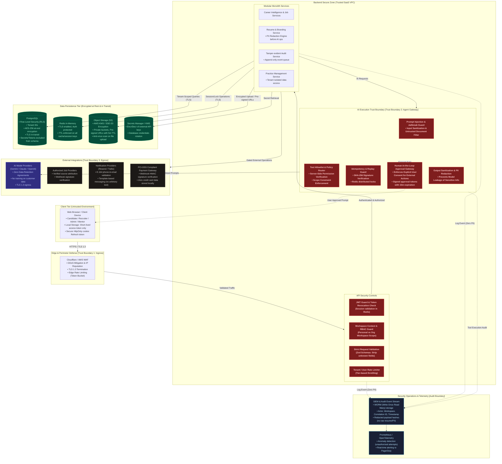
<!-- DIAGRAM:security-boundaries:END -->

#### Architectural Breakdown:
- **Trust Boundary 1 (Ingress):** Edge WAF filters malicious payloads, rate-limits IP ranges, and terminates TLS 1.3.
- **Trust Boundary 2 (Agent Gateway):** Restricts LLM tool invocation using server-side allowlists, argument validation, and interactive approval gates.
- **Trust Boundary 3 (Egress):** All outbound calls to model providers and partner APIs use TLS 1.3 and zero-data-retention headers.

---

### 2.13 Background Jobs & Asynchronous Queues

- **Purpose:** Architecture of the asynchronous task processing subsystem using BullMQ and Redis, detailing queues, concurrency settings, worker timeouts, exponential backoff retries, and the Dead-Letter Queue (DLQ).
- **Canonical Source:** [`background-processing.mmd`](background-processing.mmd)
- **Implementation Status:** *Blueprint / Worker Specification*

<!-- DIAGRAM:background-processing:START -->
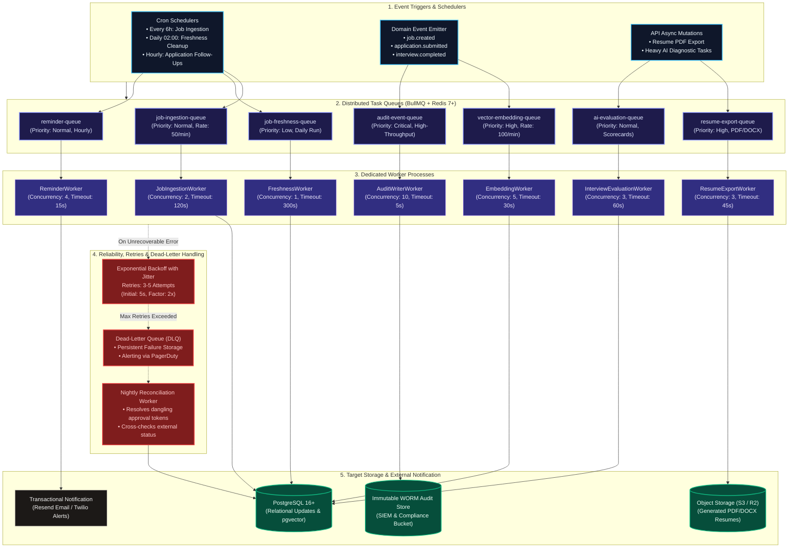
<!-- DIAGRAM:background-processing:END -->

#### Architectural Breakdown:
- **Queue vs Durable State:** Ephemeral task state is maintained in Redis BullMQ queues; durable business state (e.g. `Application.status`, `Job.status`) is stored transactionally in PostgreSQL.
- **DLQ Alerting:** When a job exhausts 5 retry attempts, it moves to the DLQ and triggers a high-priority PagerDuty incident.

---

### 2.14 Independent Practice Workflow

- **Purpose:** Architectural workflow guiding newly qualified CAs into independent public practice, enforcing compliance with ICAI Code of Ethics (Clauses 6 & 7), Certificate of Practice (COP) applications, firm constitution, client KYC, and compliance calendar tracking.
- **Canonical Source:** [`independent-practice-workflow.mmd`](independent-practice-workflow.mmd)
- **Implementation Status:** *Blueprint / Phase 3 Specification*

<!-- DIAGRAM:independent-practice-workflow:START -->
```mermaid
flowchart TD
  classDef startNode fill:#0f172a,stroke:#38bdf8,stroke-width:2px,color:#f0f9ff
  classDef stepNode fill:#1e1b4b,stroke:#818cf8,stroke-width:1px,color:#e0e7ff
  classDef ethicsNode fill:#7f1d1d,stroke:#ef4444,stroke-width:2px,color:#fecaca
  classDef firmNode fill:#064e3b,stroke:#10b981,stroke-width:1px,color:#ecfdf5
  classDef crmNode fill:#172554,stroke:#3b82f6,stroke-width:1px,color:#dbeafe
  classDef opsNode fill:#14532d,stroke:#22c55e,stroke-width:2px,color:#bbf7d0

  START(["CA Final Cleared & ICAI Enrolment"]):::startNode

  subgraph REGULATORY_PHASE["1. Regulatory & Statutory Licensing (ICAI SSP Portal)"]
    MEMBERSHIP["Apply for ICAI Associate Membership (ACA)\n(Form 2 Submission)"]:::stepNode
    COP_CHOICE{"Practice Mode Decision"}:::stepNode
    COP_FULL["Apply for Full-Time COP (Form 6)\n(Public Practice License)"]:::stepNode
    COP_PART["Apply for Part-Time COP\n(Subject to ICAI Guidelines)"]:::stepNode
  end

  subgraph ETHICAL_GUARD["2. Professional Ethics Boundary (ICAI Code of Ethics 2020)"]
    direction TB
    ETHICS_CHECK["Ethics Boundary Enforcement\n• Clause 6: Prohibition of Client Solicitation\n• Clause 7: Prohibition of Public Advertisement\n• Platform strictly acts as back-office CRM, NOT an advertising portal"]:::ethicsNode
  end

  subgraph FIRM_SETUP["3. Firm Constitution & Governance"]
    direction TB
    FIRM_TYPE{"Firm Constitution Type"}:::firmNode
    PROP["Sole Proprietorship Firm"]:::firmNode
    PARTNER["CA Partnership Firm"]:::firmNode
    LLP["Limited Liability Partnership (LLP)"]:::firmNode
    NAME_APPROVAL["Firm Name Approval Application\n(ICAI SSP Portal Deep-Link)"]:::firmNode
    MEF_TRACK["Multipurpose Empanelment Form (MEF) Readiness\n(Bank Audit & PSU Empanelment Eligibility)"]:::firmNode
  end

  subgraph CRM_SUITE["4. CA Career OS Practice Operations Suite (Org Workspace)"]
    direction TB
    CLIENT_KYC["Client Master & KYC Verification\n(PAN, GSTIN, CIN, Director KYC Tracker)"]:::crmNode
    ENGAGEMENT_DOC["Standard Engagement Letter Generator\n(Standard Terms under SA 210)"]:::crmNode
    COMPLIANCE_CAL["Statutory Compliance Calendar Engine\n• Income Tax (ITR, TDS, 44AB Tax Audit)\n• GST (GSTR-1, GSTR-3B, GSTR-9/9C)\n• MCA / ROC Filings (AOC-4, MGT-7)"]:::crmNode
    AUDIT_VAULT["Secure Client Working Paper Vault\n(KMS-Encrypted Audit Trails)"]:::crmNode
  end

  subgraph ONGOING_OPS["5. Continuous Compliance & Growth"]
    CPE_TRACKER["ICAI CPE Credit Tracker\n(Monitor Mandatory 30-40 Hours/Year)"]:::opsNode
    RECURRING_ALERTS["Automated Client Compliance Reminders\n(Email / WhatsApp Alerts)"]:::opsNode
  end

  START --> MEMBERSHIP
  MEMBERSHIP --> COP_CHOICE
  COP_CHOICE -- "Full-Time Practice" --> COP_FULL
  COP_CHOICE -- "Part-Time Practice" --> COP_PART

  COP_FULL --> ETHICS_CHECK
  COP_PART --> ETHICS_CHECK

  ETHICS_CHECK --> FIRM_TYPE
  FIRM_TYPE --> PROP
  FIRM_TYPE --> PARTNER
  FIRM_TYPE --> LLP

  PROP --> NAME_APPROVAL
  PARTNER --> NAME_APPROVAL
  LLP --> NAME_APPROVAL

  NAME_APPROVAL --> MEF_TRACK
  MEF_TRACK --> CLIENT_KYC

  CLIENT_KYC --> ENGAGEMENT_DOC
  ENGAGEMENT_DOC --> COMPLIANCE_CAL
  COMPLIANCE_CAL --> AUDIT_VAULT

  AUDIT_VAULT --> CPE_TRACKER
  COMPLIANCE_CAL --> RECURRING_ALERTS
```
<!-- DIAGRAM:independent-practice-workflow:END -->

#### Architectural Breakdown:
- **Ethics Non-Solicitation Enforcement:** The platform prohibits any public directories, firm advertising, or lead-generation bidding engines, adhering to ICAI Code of Ethics (2020).
- **Client Vault Isolation:** Practice CRM records are held in private organization workspaces with KMS encryption for client audit files.

---

## 3. Product & Domain Architecture (11 Core Modules)

This section documents the 11 major domain modules comprising CA Career OS. Each module specifies responsibilities, use cases, inputs, outputs, business rules, primary services, dependencies, authorization, API operations, external integrations, failure modes, and implementation phasing.

---

### Module 1: Career Intelligence (`CareerModule`)
- **Responsibilities:** Manages the canonical professional profile of the Chartered Accountant (articleship firm tier, exposure areas, technical domain skills, city preference, target compensation). Evaluates candidate profile against 6 major CA pathways: Statutory Audit & Assurance, Direct & Indirect Taxation, FP&A & Corporate Finance, Investment Banking & Private Equity, Management Consulting & Risk Advisory, and Independent Practice.
- **Main Use Cases:** Candidate onboarding; articleship capability inventory; career diagnostic assessment; personalized 30/60/90-day transition roadmap generation; skill-gap reporting.
- **Inputs:** `CandidateProfileInput` (articleship area, firm tier, examination attempt, target roles, preferred locations).
- **Outputs:** `CareerPathRecommendation`, `SkillGapReport` (with percentage coverage per domain), and `RoadmapPlan` (30/60/90 days).
- **Business Rules:** Zod schema validation; target salary range must be positive; notice period $\ge 0$ days; diagnostic recommendations must provide explainable percentage breakdowns across all 6 pathways.
- **Primary Services:** `CareerIntelligenceService`, `SkillAssessmentEngine`.
- **Data Dependencies:** `CandidateProfile`, `CareerPreference`, `Skill`, `CandidateSkill`, `SkillGapReport`, `LearningTask`.
- **Authorization Boundaries:** Personal workspace only (`WorkspaceType.PERSONAL`). Cross-workspace reads prohibited. Current employer cannot inspect candidate profiles.
- **API Operations:** `GET /api/v1/career/profile`, `PUT /api/v1/career/profile`, `POST /api/v1/career/diagnostic`, `GET /api/v1/career/roadmaps`.
- **External Integrations:** LLM Provider Adapter (for qualitative skill bridging recommendations).
- **Failure Cases:** If LLM is unreachable during diagnostic, return rule-based static heuristic scorecards based on articleship domain tags.
- **Scope Phasing:** **MVP:** Text diagnostic, static skill mapping, 30/60/90 roadmap. **Phase 2:** Dynamic learning module integrations.

---

### Module 2: Jobs and Recruitment (`JobsModule`)
- **Responsibilities:** Ingests jobs exclusively from verified sources (direct recruiter postings, authorized employer ATS webhooks, approved feeds). Deduplicates listings, computes hybrid lexical + vector match scores (`pgvector`), and manages applicant pipeline states.
- **Main Use Cases:** Job discovery; hybrid search filtering; job bookmarking; application pipeline tracking; recruiter job publishing and applicant review.
- **Inputs:** `JobSearchQuery` (keywords, location, mode, salary range, domain filters).
- **Outputs:** Paginated `Job` results with explainable `JobMatch` scores ($0.0-1.0$) and human-readable match factors.
- **Business Rules:** Direct ingestion requires verified employer or source ID. Unapproved third-party web scraping is prohibited. Listings auto-expire after 30 days without re-verification. Recruiter search algorithms exclude candidates who have marked the recruiter firm as their current articleship or employer firm.
- **Primary Services:** `JobsRecruitmentService`, `JobIngestionService`, `HybridSearchMatcher`.
- **Data Dependencies:** `Job`, `JobSource`, `Employer`, `JobMatch`, `Application`.
- **Authorization Boundaries:** Candidates can read active jobs and modify their own applications; recruiters in Organization Workspaces can manage their firm's jobs and view applications submitted directly to them.
- **API Operations:** `GET /api/v1/jobs`, `GET /api/v1/jobs/:id`, `POST /api/v1/jobs/:id/save`, `POST /api/v1/applications`, `GET /api/v1/applications`.
- **External Integrations:** Greenhouse, Lever, Darwinbox webhook feeds; Resend (for application receipt alerts).
- **Failure Cases:** If vector embedding service fails during search, fall back to pure PostgreSQL Full-Text Search (lexical).
- **Scope Phasing:** **MVP:** Verified postings, hybrid search, application tracking. **Phase 2:** ATS partner webhooks.

---

### Module 3: AI Resume and Professional Branding (`ResumeModule`)
- **Responsibilities:** Generates ATS-friendly resume versions formatted in PDF and DOCX. Dynamically tailors resume bullet points to target job descriptions while enforcing the **Zero Fabrication Rule (ADR-009)**.
- **Main Use Cases:** Master resume creation; job-specific resume tailoring; candidate claim attestation; PDF/DOCX document export; LinkedIn profile bullet point recommendations.
- **Inputs:** `ResumeDraftInput` (selected profile sections, target `jobId`).
- **Outputs:** `ResumeVersion` record and binary PDF/DOCX stored in private object storage.
- **Business Rules:** **Zero-Fabrication Guard (ADR-009):** The AI engine is programmatically prohibited from inventing audit client names, transaction numbers, or unverified metrics. Mandatory candidate attestation checkbox before finalizing a resume version.
- **Primary Services:** `ResumeBrandingService`, `ResumePdfRenderer`, `ProvenanceVerifier`.
- **Data Dependencies:** `Resume`, `ResumeVersion`, `CandidateProfile`, `CandidateSkill`.
- **Authorization Boundaries:** Personal workspace only. Resumes are encrypted at rest using tenant-specific KMS keys.
- **API Operations:** `POST /api/v1/resumes`, `POST /api/v1/resumes/tailor`, `POST /api/v1/resumes/:id/attest`, `GET /api/v1/resumes/:id/download`.
- **External Integrations:** S3/Cloudflare R2 (storage); LLM Adapter (tailoring); Puppeteer/PDFKit (rendering).
- **Failure Cases:** If PDF generation fails, retain the validated structured JSON resume draft and provide immediate retry.
- **Scope Phasing:** **MVP:** Master resume, job tailoring, attestation, PDF export. **Phase 2:** Word (.docx) export, LinkedIn audit.

---

### Module 4: AI Interview and Practical Skills Lab (`InterviewModule`)
- **Responsibilities:** Conducts role-specific technical mock interviews across Ind AS revenue recognition, Transfer Pricing, GST input credit checks, and financial modeling drills. Produces structured evaluations with constructive feedback.
- **Main Use Cases:** Role-specific technical practice; interactive turn-based question drills; post-session rubric scorecards; progression tracking across repeated sessions.
- **Inputs:** `InterviewSessionStart` (`targetRole`, `domain`, `mode: TEXT | VOICE`).
- **Outputs:** `InterviewSession`, real-time conversational prompts, and final `InterviewFeedback` scorecards.
- **Business Rules:** Only synthetic or properly licensed case data used for exercises. Max turn limit enforced (default: 8 question-answer rounds per session). Voice audio processed ephemerally with zero persistent storage of candidate voice data beyond session scoring.
- **Primary Services:** `InterviewSkillsService`, `TechnicalRubricEvaluator`.
- **Data Dependencies:** `InterviewSession`, `InterviewFeedback`, `CandidateProfile`.
- **Authorization Boundaries:** Personal workspace only. Recruiter or employer accounts cannot view mock interview scores or practice transcripts.
- **API Operations:** `POST /api/v1/interviews/sessions`, `POST /api/v1/interviews/sessions/:id/turns`, `POST /api/v1/interviews/sessions/:id/finish`.
- **External Integrations:** LLM Provider Adapter (interactive interviewer); Whisper API (ephemeral STT in Phase 2).
- **Failure Cases:** In case of mid-session disconnect, session state is preserved in Redis for 1 hour, allowing the candidate to resume turn count.
- **Scope Phasing:** **MVP:** Text-based technical drills and scoring. **Phase 2:** Turn-based audio interview simulator.

---

### Module 5: Career and Financial Intelligence (`FinancialIntelModule`)
- **Responsibilities:** Collects anonymous, self-reported compensation data with sample-size ($N$) indicators. Unbundles CTC offers into fixed in-hand pay, performance bonuses, joining incentives, retiral contributions, and stock options, adjusting for city cost-of-living differences.
- **Main Use Cases:** CTC offer unbundling; side-by-side offer comparison calculator; Indian tax regime projections (Old vs New Regime); salary benchmark exploration.
- **Inputs:** `OfferTermsInput` (fixed pay, variable pay, PF, gratuity, bonus, city).
- **Outputs:** `OfferComparisonReport` with monthly estimated take-home pay, tax projections under Indian tax regimes, and side-by-side offer decision matrices.
- **Business Rules:** Sample size ($N$) must be prominently displayed; salary estimates are marked as directional benchmarks, not guarantees. Offer documents are encrypted with KMS keys accessible only by the candidate's personal workspace.
- **Primary Services:** `FinancialIntelService`, `TaxCalculatorEngine`.
- **Data Dependencies:** `CandidateProfile`, `OfferComparisonReport`, `SalaryBenchmark`.
- **Authorization Boundaries:** Personal workspace only. Employers cannot view candidates' uploaded offer letters or salary expectations.
- **API Operations:** `POST /api/v1/financial/unbundle-ctc`, `POST /api/v1/financial/compare-offers`, `GET /api/v1/financial/benchmarks`.
- **External Integrations:** Indian Income Tax slab rules database (stamped with effective fiscal year).
- **Failure Cases:** If tax calculator parameters are missing, prompt user for specific deductions rather than applying unverified assumptions.
- **Scope Phasing:** **MVP:** CTC unbundler, tax estimator, side-by-side matrix. **Phase 2:** Crowdsourced salary benchmark explorer with $N$-count filtering.

---

### Module 6: Mentorship and Advisory (`MentorshipModule`)
- **Responsibilities:** Connects newly qualified CAs with senior Chartered Accountants (Partners, CFOs, Financial Directors) for 1-on-1 career guidance, mock interview evaluations, and transition advisory.
- **Main Use Cases:** Mentor profile search; slot booking; payment processing; session note recording.
- **Inputs:** `BookingRequest` (mentorId, scheduledSlot, agendaNotes).
- **Outputs:** `MentorBooking` record, calendar invitation, payment receipt.
- **Business Rules:** Mentors must possess verified ICAI membership credentials. Fees are held in escrow until session completion. Mentors cannot offer job placement guarantees.
- **Primary Services:** `MentorshipService`, `BookingSchedulerService`.
- **Data Dependencies:** `MentorBooking`, `User`, `CandidateProfile`.
- **Authorization Boundaries:** Candidate and booked Mentor have mutual read access to the session agenda. Other platform users cannot inspect session notes.
- **API Operations:** `GET /api/v1/mentors`, `POST /api/v1/mentorship/bookings`, `POST /api/v1/mentorship/bookings/:id/confirm`.
- **External Integrations:** Razorpay (payment processing); Google Calendar / Outlook integration; Twilio (session reminder alerts).
- **Failure Cases:** Payment failure releases calendar hold within 10 minutes.
- **Scope Phasing:** **MVP:** Static mentor directory & booking requests. **Phase 2:** Full calendar sync & automated payment gateway escrow.

---

### Module 7: Professional Setup and Practice Management (`PracticeModule`)
- **Responsibilities:** Guides candidates seeking to launch an independent CA practice. Provides post-qualification step-by-step checklists (ICAI associate membership application, Certificate of Practice (COP) form filing), curated links to official ICAI portals, and a lightweight practice CRM (client onboarding, KYC document tracking, statutory compliance calendar).
- **Main Use Cases:** Post-qualification checklist tracking; COP Form 6 guidance; firm name approval tracker; client master KYC management; statutory compliance deadline calendar (Income Tax, GST, ROC).
- **Inputs:** `PracticeSetupInput` (firm type, target services, location).
- **Outputs:** `ComplianceChecklist`, `ClientOnboardingTemplate`, recurring statutory compliance reminders.
- **Business Rules:** Strict adherence to the ICAI Code of Ethics (no client solicitation or public advertising). All compliance guides display an "As of [Date]" stamp.
- **Primary Services:** `PracticeManagementService`, `ComplianceCalendarService`.
- **Data Dependencies:** `ClientMaster`, `ComplianceTask`, `FirmRegistration`, `Workspace`.
- **Authorization Boundaries:** Organization Workspace (`WorkspaceType.ORGANIZATION`) scoped to the firm partners and team members.
- **API Operations:** `GET /api/v1/practice/checklists`, `POST /api/v1/practice/clients`, `GET /api/v1/practice/compliance-calendar`.
- **External Integrations:** Official ICAI portal deep-links; SMS/Email compliance alerts to firm clients.
- **Failure Cases:** Reminder worker retry with exponential backoff on notification failure.
- **Scope Phasing:** **MVP:** Static post-qual checklist & COP guide. **Phase 3:** Full practice CRM, client KYC vault, and statutory deadline engine.

---

### Module 8: AI Career Agent (`AgentModule`)
- **Responsibilities:** Natural language copilot that plans and coordinates cross-module tasks on behalf of the user. Translates candidate intent into safely validated tool calls governed by the 4-tier permission policy.
- **Main Use Cases:** Interactive conversational career guidance; multi-step action planning (e.g., "Find audit jobs in Mumbai, tailor my resume, and draft application"); tool invocation with human confirmation.
- **Inputs:** User chat prompt, permitted profile context, active workspace context.
- **Outputs:** Streaming conversational response, structured tool suggestions, and pending `ApprovalRequest` cards.
- **Business Rules:** Tool allowlist enforcement; deterministic permission routing (4 tiers); mandatory human approval for external actions; 15-minute token TTL; zero PII in telemetry.
- **Primary Services:** `AgentOrchestratorService`, `ToolPolicyEngine`, `ApprovalGatewayService`.
- **Data Dependencies:** `AIConversation`, `AgentToolExecution`, `ApprovalRequest`, `IdempotencyRecord`.
- **Authorization Boundaries:** Enforced strictly via active `workspaceId`. Cannot invoke tools across workspace boundaries.
- **API Operations:** `POST /api/v1/agent/chat`, `POST /api/v1/approvals/:id/confirm`, `POST /api/v1/approvals/:id/decline`.
- **External Integrations:** Google Gemini, Anthropic Claude, OpenAI GPT-4o.
- **Failure Cases:** LLM provider timeouts trigger safe fallback responses; invalid tool arguments trigger rejection without state change.
- **Scope Phasing:** **MVP:** Full 4-tier permission router, interactive chat, approval cards. **Phase 2:** Multi-modal document review.

---

### Module 9: Workspace and Multi-Tenancy (`WorkspaceModule`)
- **Responsibilities:** Manages tenant isolation, workspace creation, membership roles (`OWNER`, `ADMIN`, `MEMBER`, `RECRUITER`, `VIEWER`), and billing subscription bindings.
- **Main Use Cases:** Personal workspace creation for candidates; Organization workspace creation for CA firms and corporate employers; role management; context switching.
- **Inputs:** `CreateWorkspaceInput`, `InviteMemberInput`.
- **Outputs:** `Workspace`, `WorkspaceMembership`, tenant context tokens.
- **Business Rules:** Candidates are strictly 1:1 with Personal Workspaces; Organization Workspaces support 1:N team members; Personal Workspaces cannot be inspected by Organization Workspaces.
- **Primary Services:** `WorkspaceService`, `TenantContextGuard`.
- **Data Dependencies:** `Workspace`, `WorkspaceMembership`, `Subscription`.
- **Authorization Boundaries:** All database queries must include `where: { workspaceId }`. Row-Level Security (RLS) policies enforce workspace boundaries at the PostgreSQL layer.
- **API Operations:** `GET /api/v1/workspaces`, `POST /api/v1/workspaces`, `POST /api/v1/workspaces/:id/members`.
- **External Integrations:** Payment gateway billing subscriptions.
- **Failure Cases:** Missing workspace header returns HTTP 400 Bad Request; unauthorized workspace access returns HTTP 403 Forbidden.
- **Scope Phasing:** **MVP:** Dual workspace isolation (Personal vs Organization). **Phase 2:** Multi-seat team invites.

---

### Module 10: Identity and Access Management (`IdentityModule`)
- **Responsibilities:** User registration, password hashing (bcrypt, 12 rounds), JWT issue and rotation, email verification, session revocation, and RBAC enforcement.
- **Main Use Cases:** Candidate signup; employer registration; secure login; token refresh; password recovery.
- **Inputs:** `RegisterInput`, `LoginInput`, `RefreshTokenInput`.
- **Outputs:** Access token (JWT in-memory, 15m TTL), Refresh token (`HttpOnly` cookie, 7d TTL), `User` profile.
- **Business Rules:** Passwords must meet minimum complexity (12+ characters, uppercase, digit, symbol); refresh tokens are single-use with automatic family invalidation upon reuse detection.
- **Primary Services:** `IdentityService`, `TokenService`, `PasswordHasher`.
- **Data Dependencies:** `User`, `Session`, `AuditEvent`.
- **Authorization Boundaries:** Unauthenticated access permitted only on `/api/v1/auth/*` endpoints.
- **API Operations:** `POST /api/v1/auth/register`, `POST /api/v1/auth/login`, `POST /api/v1/auth/refresh`, `POST /api/v1/auth/logout`.
- **External Integrations:** Resend (verification emails).
- **Failure Cases:** Account lockout after 5 consecutive failed login attempts (15-minute cooldown).
- **Scope Phasing:** **MVP:** Email/password authentication, JWT rotation, email verification. **Phase 2:** Google / LinkedIn OAuth2 social login.

---

### Module 11: Platform Administration and Telemetry (`AdminModule`)
- **Responsibilities:** Operational health monitoring, aggregated system statistics, job feed ingestion monitoring, abuse detection, and tamper-evident audit log search.
- **Main Use Cases:** Ingestion worker monitoring; job report reviews; security audit log inspection; user support escalation.
- **Inputs:** `AuditSearchQuery`, `JobReviewAction`.
- **Outputs:** Telemetry metrics, aggregated active job counts, audit event records.
- **Business Rules:** Platform administrators **cannot view** candidate resumes, prompt dialogues, or raw offer letters without a formally logged, time-limited security escalation token. All admin actions generate immutable audit logs.
- **Primary Services:** `AdminTelemetryService`, `AuditReviewService`.
- **Data Dependencies:** `AuditEvent`, `Job`, `JobSource`, `User`.
- **Authorization Boundaries:** Restricted strictly to users with `role: PLATFORM_ADMIN`.
- **API Operations:** `GET /api/v1/admin/telemetry`, `GET /api/v1/admin/audit-logs`, `POST /api/v1/admin/jobs/:id/expire`.
- **External Integrations:** Prometheus / OpenTelemetry, SIEM log stream.
- **Failure Cases:** Audit log writes must never be skipped; write failures trigger circuit-breaking alerts.
- **Scope Phasing:** **MVP:** Operational dashboards and audit queries. **Phase 2:** Automated abuse detection and anomaly alerts.

---

## 4. AI Agent Request & Execution Lifecycle

### 4.1 Step-by-Step Lifecycle Specification

Every AI Career Agent action follows a strict 13-stage deterministic lifecycle:

```
[User Request]
       │
       ▼
1. Authentication Check (Verify JWT Bearer token & session validity in Redis)
       │
       ▼
2. Workspace Authorization (Confirm active workspaceId & candidate membership)
       │
       ▼
3. Tool Registry Allowlist (Verify requested tool is registered in server-side allowlist)
       │
       ▼
4. Input Schema Validation (Parse tool arguments through strict Zod schemas, strip unknown keys)
       │
       ▼
5. Rate Limiting Evaluation (Redis token-bucket check per user and per workspace)
       │
       ▼
6. Policy Evaluation & Permission Routing (Route to READ_ONLY, WRITE, EXTERNAL, or DESTRUCTIVE)
       │
       ▼
7. Idempotency Verification (Check Redis for duplicate SHA-256 operation signature)
       │
       ▼
8. Human Approval Gate (If EXTERNAL: Generate 15m signed token card & await UI confirmation)
       │
       ▼
9. Execution Engine (Execute DB replica query, Prisma transaction, or external worker egress)
       │
       ▼
10. Result Validation & Redaction (Sanitize outputs; enforce ADR-009 zero-fabrication rules)
       │
       ▼
11. State & Cache Update (Commit DB transaction; record completed idempotency key with 24h TTL)
       │
       ▼
12. Audit Event Emission (Dispatch immutable AuditEvent with SHA-256 payload hash & zero PII)
       │
       ▼
13. User Response Delivery (Stream conversational markdown and action status to web client)
```

---

### 4.2 Four Deterministic Permission Tiers

| Permission Level | Description & Rules | Side Effects | Human Confirmation | Failure Behavior | Audit Requirements |
| :--- | :--- | :--- | :--- | :--- | :--- |
| **`READ_ONLY`** | Safe diagnostic queries and lookups. Executed against database replicas or Redis cache. | **Zero** state mutation. | None required; automatic execution. | Fall back to cache or empty list. | Standard audit event (actor, tool, duration). |
| **`WRITE`** | Controlled internal state changes within active workspace (e.g. saving tasks, updating preferences, drafting resumes). | Local database mutation within Prisma transaction. | None; executes immediately with idempotency key. | Rollback transaction; delete processing key lock. | Log entity ID, operation, and outcome. |
| **`EXPLICITLY_APPROVED_EXTERNAL`** | Real-world side effects interacting with third parties (submitting applications, sending recruiter messages, booking paid mentors). | External API calls, partner webhooks, or email dispatches. | **Mandatory human confirmation in UI via interactive Approval Card with 15-minute TTL.** | Action cancelled; zero external call made. Enqueue DLQ on provider error. | Full audit record, signed approval token hash, confirmation timestamp. |
| **`DESTRUCTIVE`** | Permanent erasure or removal of user assets (deleting resume versions, removing documents, account deletion). | Soft deletion, tombstone insertion, and delayed 30-day purge queue. | Statutory retention check + Two-step confirmation modal with explicit text verification. | Block deletion if statutory retention period is active. | Comprehensive audit log with reason and operator context. |

---

### 4.3 Tool Classification Table

| Tool Name | Module | Tier | Auth Requirement | Side Effects | Confirmation Rule |
| :--- | :--- | :--- | :--- | :--- | :--- |
| `get_user_profile` | Career | `READ_ONLY` | Personal Workspace | None | Automatic |
| `search_jobs` | Jobs | `READ_ONLY` | Authenticated | None | Automatic |
| `get_job_details` | Jobs | `READ_ONLY` | Authenticated | None | Automatic |
| `get_application_status`| Jobs | `READ_ONLY` | Personal Workspace | None | Automatic |
| `get_skill_gap_report` | Career | `READ_ONLY` | Personal Workspace | None | Automatic |
| `get_learning_tasks` | Career | `READ_ONLY` | Personal Workspace | None | Automatic |
| `create_career_task` | Career | `WRITE` | Personal Workspace | Task row created in DB | Idempotency key |
| `update_user_preferences`| Career| `WRITE` | Personal Workspace | Preference row updated | Idempotency key |
| `save_job` | Jobs | `WRITE` | Personal Workspace | SavedJob row created | Idempotency key |
| `create_resume_draft` | Resume | `WRITE` | Personal Workspace | ResumeVersion draft created | ADR-009 attestation flag |
| `schedule_follow_up` | Jobs | `WRITE` | Personal Workspace | BullMQ reminder enqueued | Idempotency key |
| `submit_job_application`| Jobs | `EXPLICITLY_APPROVED_EXTERNAL` | Candidate Personal WS | Application sent to employer | **Explicit click on Approval Card** |
| `send_recruiter_message`| Jobs | `EXPLICITLY_APPROVED_EXTERNAL` | Candidate Personal WS | Email/message sent | **Explicit preview & confirmation** |
| `book_paid_mentorship` | Mentor | `EXPLICITLY_APPROVED_EXTERNAL` | Candidate Personal WS | Payment order created | **Explicit payment checkout click** |
| `delete_resume_version`| Resume | `DESTRUCTIVE` | Personal Workspace | ResumeVersion soft-deleted | Two-step confirmation modal |
| `remove_saved_document`| Resume | `DESTRUCTIVE` | Personal Workspace | Document soft-deleted | Validate not tied to active app |
| `delete_user_data` | Identity| `DESTRUCTIVE` | Account Owner | Full account erasure | Statutory retention check + modal |

---

### 4.4 The Exactly-Once Fallacy Across External Integrations

> **Architectural Law:** An idempotency key can guarantee exactly-once processing **only within the local persistence boundary** where distributed locks and ACID database transactions operate. An idempotency key **cannot, by itself, guarantee exactly-once execution across distributed external third-party systems**.

#### The Failure Scenario:
1. Candidate confirms `submit_job_application` in the UI.
2. CA Career OS backend acquires a local Redis lock, creates an idempotency record (`status: PROCESSING`), and issues an HTTP POST request to an external partner job board API or employer ATS.
3. The external API processes the application, saves it in its internal database, but **a network partition or TCP socket timeout occurs before the HTTP 200 response reaches our server**.
4. Our backend catches a connection timeout. The local transaction is in an indeterminate state.
5. If our backend naively retries the request using the same idempotency key, unless the external partner API **also natively parses, records, and respects that exact idempotency header**, the external system will treat the retry as a brand-new application, generating a **duplicate submission**.

#### Mitigation Architecture:
To prevent duplicate external mutations, CA Career OS enforces a **Reconciliation-First Retry Strategy**:
- **Status Inquiry Before Retry:** Before re-attempting a timed-out external action, the worker issues an idempotent query (`GET /applications?externalRef=...` or checks employer pipeline status).
- **Compensating Transactions:** If the provider confirms receipt, mark the local record `COMPLETED` without re-transmitting.
- **DLQ and Human Escalation:** If status remains indeterminate, the operation is paused and flagged in the user UI with an *"Action Status Pending Reconciliation"* notification rather than blindly repeating the call.

---

## 5. Database Architecture & Schema Specification

### 5.1 Relational Architecture Overview

The persistence architecture is designed around PostgreSQL 16+ using Prisma ORM with the `pgvector` extension. The model comprises 21 relational tables organized across 6 architectural domains:

1. **Identity & Workspaces:** `User`, `Workspace`, `WorkspaceMembership`, `Subscription`.
2. **Candidate Profile & Skills:** `CandidateProfile`, `CareerPreference`, `Skill`, `CandidateSkill`, `SkillGapReport`, `LearningTask`.
3. **Jobs & Recruitment:** `Employer`, `JobSource`, `Job`, `JobMatch`, `Application`.
4. **Resumes & Branding:** `Resume`, `ResumeVersion`.
5. **Interviews & Mentorship:** `InterviewSession`, `InterviewFeedback`, `MentorBooking`.
6. **AI Agent & Governance:** `AIConversation`, `AgentToolExecution`, `ApprovalRequest`, `IdempotencyRecord`, `AuditEvent`.

> **Implementation Disclaimer:** The entities and relationships detailed here represent the approved architectural blueprint and data model specification. They are not yet deployed as production database migrations and must undergo performance testing and migration index optimization during Phase 1 implementation.

---

### 5.2 Key Entity Definitions & Constraints

#### `User` (Identity Root)
- **Primary Key:** `id` (`UUIDv7` or `UUIDv4`).
- **Uniqueness:** `email` (`UNIQUE`).
- **Password:** `hashedPassword` (bcrypt, 12 rounds; never stored in plaintext).
- **Soft Deletion:** `deletedAt` (`TIMESTAMP WITH TIME ZONE`, default `NULL`). Soft deletion retains foreign key integrity while excluding deactivated users from queries.
- **Indexes:** B-tree on `email`, B-tree on `deletedAt`.

#### `Workspace` (Tenant Boundary)
- **Primary Key:** `id` (`UUIDv4`).
- **Uniqueness:** `slug` (`UNIQUE`).
- **Types:** `PERSONAL` (1:1 candidate boundary) or `ORGANIZATION` (1:N CA firm or employer boundary).
- **Ownership:** `ownerId` (`FK -> User.id`, `ON DELETE RESTRICT`).

#### `WorkspaceMembership` (RBAC Binding)
- **Primary Key:** `id` (`UUIDv4`).
- **Foreign Keys:** `workspaceId` (`FK -> Workspace.id`, `ON DELETE CASCADE`), `userId` (`FK -> User.id`, `ON DELETE CASCADE`).
- **Uniqueness:** Compound `(workspaceId, userId)` (`UNIQUE`).
- **Roles:** `OWNER`, `ADMIN`, `MEMBER`, `RECRUITER`, `VIEWER`.

#### `Job` (Core Vacancy Entity)
- **Primary Key:** `id` (`UUIDv4`).
- **Foreign Keys:** `employerId` (`FK -> Employer.id`), `sourceId` (`FK -> JobSource.id`).
- **Vector Column:** `embedding` (`vector(1536)`). Indexed using HNSW (Hierarchical Navigable Small World) with cosine distance metric (`vector_cosine_ops`).
- **Full-Text Search:** `tsv` (`tsvector` generated from `title`, `companyName`, and `rawDescription`). Indexed with GIN.
- **Freshness Policy:** `status` (`ACTIVE`, `EXPIRED`, `REMOVED`). Auto-expires after 30 days (`expiresAt < NOW()`).

#### `ResumeVersion` (Attested Document Draft)
- **Primary Key:** `id` (`UUIDv4`).
- **Foreign Keys:** `resumeId` (`FK -> Resume.id`, `ON DELETE CASCADE`), `targetedJobId` (`FK -> Job.id`, `ON DELETE SET NULL`).
- **Attestation Fields:** `candidateAttested` (`BOOLEAN`, default `FALSE`), `claimAttestations` (`JSONB`).
- **Enforcement Rule:** `Application.resumeVersionId` can only link to a `ResumeVersion` where `candidateAttested == TRUE`.

#### `IdempotencyRecord` (Mutation Guard)
- **Primary Key:** `id` (`UUIDv4`).
- **Uniqueness:** `idempotencyKey` (`UNIQUE`).
- **Status:** `PROCESSING`, `COMPLETED`, `FAILED`.
- **TTL:** `expiresAt` (`NOW() + INTERVAL '24 HOURS'`). Expired records purged via scheduled daily cron.

#### `AuditEvent` (Immutable Compliance Log)
- **Primary Key:** `id` (`UUIDv4`).
- **Attributes:** `actorId`, `workspaceId`, `operation`, `resourceType`, `resourceId`, `outcome`, `correlationId`, `payloadSha256`, `durationMs`, `createdAt`.
- **Security Rule:** Append-only. No `UPDATE` or `DELETE` grants on this table for application database users.

---

## 6. API Architecture & Endpoint Contracts

### 6.1 Architectural Decision: Standard REST API for MVP

> **Architecture Resolution (REST vs tRPC):** For the Phase 1 MVP baseline, **CA Career OS adopts a standard RESTful API architecture** with strict JSON-Schema / Zod validation contracts and OpenAPI (Swagger) documentation.

#### Architectural Rationale:
1. **Third-Party & Webhook Interoperability:** External job feed ingestion, employer ATS integrations, and payment gateways (Razorpay webhooks) require standard HTTP/REST endpoints with standard HMAC signature verification.
2. **Gateway & Edge Semantics:** Standard HTTP verbs (`GET`, `POST`, `PUT`, `DELETE`), status codes (`200`, `201`, `400`, `401`, `403`, `409`, `429`), and headers (`Idempotency-Key`, `X-Workspace-Id`, `Authorization: Bearer <token>`) integrate natively with AWS/Cloudflare WAFs, CDN caching, and rate limiters.
3. **Decoupled Frontend Consumption:** Next.js App Router Server Actions and client components can consume standard REST APIs via type-safe generated clients (`openapi-typescript`).
4. **tRPC Evaluation:** tRPC is deferred to Phase 2 for purely internal server-to-server micro-optimizations, avoiding premature protocol lock-in.

---

### 6.2 Standard Envelopes

#### Success Envelope (HTTP 200 / 201)
```json
{
  "success": true,
  "data": { ... },
  "meta": {
    "correlationId": "8f1a3e8b-2c4d-4e6f-9a0b-1c2d3e4f5a6b",
    "timestamp": "2026-10-19T13:00:00.000Z"
  }
}
```

#### Error Envelope (HTTP 4xx / 5xx)
```json
{
  "success": false,
  "error": {
    "code": "VALIDATION_FAILED",
    "message": "The request payload failed schema validation.",
    "details": [
      { "field": "targetSalaryMin", "issue": "Expected positive integer, received -50000" }
    ],
    "correlationId": "8f1a3e8b-2c4d-4e6f-9a0b-1c2d3e4f5a6b",
    "timestamp": "2026-10-19T13:00:00.000Z"
  }
}
```

---

### 6.3 Critical Proposed REST Endpoint Specifications

#### Endpoint 1: Search Jobs (Hybrid FTS + Vector)
- **Route:** `GET /api/v1/jobs`
- **Auth:** JWT required (`Authorization: Bearer <token>`), Header: `X-Workspace-Id: <uuid>`.
- **Query Params:** `query` (string), `caPathway` (enum), `city` (string), `minSalary` (int), `page` (int, default 1), `limit` (int, default 20).
- **Response `200 OK`:**
  ```json
  {
    "success": true,
    "data": {
      "jobs": [
        {
          "id": "e4b3c2a1-0000-4000-8000-123456789abc",
          "title": "Assistant Manager — Statutory Audit",
          "companyName": "Deloitte India",
          "locationCity": "Mumbai",
          "caPathway": "AUDIT",
          "salaryMin": 1200000,
          "salaryMax": 1500000,
          "matchScore": 0.92,
          "matchFactors": {
            "articleshipFit": "High (Statutory Audit in Big 10 firm)",
            "skillsMatched": ["Ind AS 115", "Internal Financial Controls", "Audit Planning"],
            "salaryFit": "Within target range"
          },
          "postedAt": "2026-10-18T09:30:00.000Z"
        }
      ],
      "pagination": { "page": 1, "limit": 20, "total": 142, "totalPages": 8 }
    }
  }
  ```
- **Error Codes:** `400 BAD_REQUEST`, `401 UNAUTHORIZED`, `429 RATE_LIMITED`.

#### Endpoint 2: Tailor Resume to Job
- **Route:** `POST /api/v1/resumes/tailor`
- **Auth:** JWT required, Header: `X-Workspace-Id: <uuid>`, Header: `Idempotency-Key: <uuid>`.
- **Request Body:**
  ```json
  {
    "baseResumeId": "3fa85f64-5717-4562-b3fc-2c963f66afa6",
    "targetJobId": "e4b3c2a1-0000-4000-8000-123456789abc",
    "focusAreas": ["Ind AS Disclosures", "Statutory Vouching", "Team Leadership"]
  }
  ```
- **Response `201 CREATED`:**
  ```json
  {
    "success": true,
    "data": {
      "resumeVersionId": "7c9e6679-7425-40de-944b-e07fc1f90ae7",
      "status": "DRAFT_PENDING_ATTESTATION",
      "tailoredSections": {
        "summary": "Chartered Accountant with 3 years articleship experience in Statutory Audit...",
        "experience": [...]
      },
      "candidateAttested": false,
      "attestationNotice": "Review and attest that all claims accurately reflect verified experience."
    }
  }
  ```
- **Validation Rules:** Target job must exist and be active; base resume must belong to candidate workspace.
- **Idempotency:** Replays cached draft if identical request payload is submitted within 24 hours.

#### Endpoint 3: Confirm External Agent Approval
- **Route:** `POST /api/v1/approvals/:id/confirm`
- **Auth:** JWT required, Header: `X-Workspace-Id: <uuid>`, Header: `Idempotency-Key: <uuid>`.
- **Request Body:**
  ```json
  {
    "signedApprovalToken": "eyJhbGciOiJIUzI1NiIsInR5cCI6IkpXVCJ9.eyJhcHByb3ZhbElkIjoiZTEyMy...signature"
  }
  ```
- **Response `200 OK`:**
  ```json
  {
    "success": true,
    "data": {
      "executionId": "b1a2c3d4-e5f6-7a8b-9c0d-1e2f3a4b5c6d",
      "toolName": "submit_job_application",
      "status": "COMPLETED",
      "result": {
        "applicationId": "f9e8d7c6-b5a4-3210-9876-543210fedcba",
        "externalConfirmationId": "DEL-2026-APP-9981"
      }
    }
  }
  ```
- **Error Codes:** `400 TOKEN_EXPIRED`, `403 INVALID_SIGNATURE`, `409 CONCURRENT_EXECUTION`.
- **Audit Requirement:** Logs immutable `AuditEvent` with `tool:submit_job_application`, `outcome:SUCCESS`, and signed token hash.

---

## 7. Security Architecture & Threat Model

### 7.1 Multi-Tenant Data Isolation

- **Dual-Workspace Model:** Candidates operate within `PERSONAL` workspaces; firms and employers operate within `ORGANIZATION` workspaces.
- **Current Employer Blindfold:** Search and recommendation queries explicitly filter out the candidate's current articleship firm or employer. An employer firm subscribed to the platform can never query or view whether their employee has an active Personal Workspace.
- **Cross-Tenant Prevention:** All database operations execute through `TenantContextGuard`, which binds queries to `where: { workspaceId }`. Direct object references (`/api/v1/resumes/:id`) verify workspace ownership before returning documents.

---

### 7.2 AI Agent Security Controls

- **Prompt Injection Defense:** External job listings and uploaded candidate documents are treated as untrusted data, enclosed within `<untrusted_content>` delimiters in LLM prompts. System instructions prohibit model execution of commands embedded in untrusted blocks.
- **Zero-Fabrication Guard (ADR-009):** The resume generation pipeline restricts generative output to factual assertions grounded in the candidate's verified profile data. Generated drafts cannot be exported to PDF or attached to applications without an active candidate attestation checkbox.
- **Pre-Inference PII Redaction:** Phone numbers, email addresses, and postal addresses are tokenized before prompt submission to external LLMs.

---

### 7.3 Threat Matrix

| Asset | Threat | Attack Path | Impact | Architectural Prevention | Detection | Recovery | Remaining Risk |
| :--- | :--- | :--- | :--- | :--- | :--- | :--- | :--- |
| **Candidate Resumes & PII** | Unauthorized Cross-Tenant Access | Attacker alters `workspaceId` header or manipulates document UUIDs. | Exposure of confidential candidate job search or contact details. | `WorkspaceGuard` validates token scope against resource workspace; PostgreSQL RLS. | Telemetry alerts on HTTP 403 authorization spikes. | Immediate session token revocation; security incident investigation. | Low: Relies on consistent guard application across all endpoints. |
| **AI Resume Generation** | Credential Fabrication | LLM hallucinates unearned audit clients, metrics, or certifications. | Candidate ethics violation under ICAI Code of Ethics; recruiter distrust. | **Zero-Fabrication Guard (ADR-009)**; structured extraction; mandatory human attestation. | Automated diff parser flags metrics absent from profile. | Candidate edits and attests to verified numbers before export. | Low: Requires human attestation before document release. |
| **Recruiter Outreach** | Agent Autonomous Spamming | Compromised agent loop sends repeated messages to recruiters. | Recruiter inbox flooding; platform IP reputation damage. | **Human-in-the-Loop Gateway**; Redis token bucket rate limiting (max 10 outreach/day). | Rate limiter emission alerts; DLQ monitoring. | Automated 15-minute token expiration; circuit breaker kills agent loop. | Negligible: External calls cannot execute without user click. |
| **Document Storage (S3)** | Public S3 Bucket Exposure | Misconfigured bucket permissions allow direct public downloads. | Mass leak of resume PDFs and client audit files. | Buckets are 100% private; downloads strictly require short-lived pre-signed URLs (15m TTL); KMS SSE. | AWS CloudTrail / IAM policy drift scanners. | Re-apply private bucket policy via Terraform; rotate KMS keys. | Negligible: Zero public bucket access policies allowed in IaC. |
| **Job Feed Ingestion** | Prompt Injection via Job Posting | Malicious recruiter injects jailbreak prompt into job description. | Agent executes unintended tool or leaks system instructions. | Document parser sanitizes raw text; prompts isolate job data in XML blocks; strict JSON schemas. | WAF inspection; regex pattern detector on ingestion. | Ingestion worker discards malformed payload to DLQ. | Low: LLMs may evolve new evasion syntax; ongoing evaluation required. |

---

## 8. Background Processing, Queues & Reliability

### 8.1 BullMQ Queue Configuration

| Queue Name | Trigger Frequency | Concurrency | Timeout | Priority | Retry Backoff Strategy |
| :--- | :--- | :--- | :--- | :--- | :--- |
| `job-ingestion-queue` | Cron: Every 6 hours | 2 | 120s | Normal | Exponential backoff (3 attempts, initial delay 10s) |
| `vector-embedding-queue` | Event: `job.created` | 5 | 30s | High | Exponential backoff (5 attempts, initial delay 5s) |
| `job-freshness-queue` | Cron: Daily at 02:00 | 1 | 300s | Low | Linear retry (2 attempts, delay 60s) |
| `resume-export-queue` | API: Async export | 3 | 45s | High | Exponential backoff (3 attempts, initial delay 5s) |
| `reminder-queue` | Cron: Hourly | 4 | 15s | Normal | Fixed retry (3 attempts, delay 30s) |
| `ai-evaluation-queue` | Event: `interview.completed` | 3 | 60s | Normal | Exponential backoff (3 attempts, initial delay 15s) |
| `audit-event-queue` | Event: `audit.event` | 10 | 5s | Critical | In-memory retry + secondary file buffer |

---

### 8.2 Failure Modes & Disaster Recovery

- **Redis Outage:** Caching degrades gracefully to direct database queries. BullMQ worker execution pauses; web applications queue pending jobs in a fallback memory buffer until Redis reconnects.
- **PostgreSQL Outage:** Read operations fail over to read replicas within 30 seconds. Write mutations return HTTP 503 Service Unavailable with descriptive retry-after headers. Point-in-time recovery (PITR) maintains 15-minute Recovery Point Objective (RPO) and 60-minute Recovery Time Objective (RTO).
- **AI Provider Outage:** The Universal Provider Adapter automatically routes inference to secondary models (e.g. falling back from Gemini to Claude 3.5 or GPT-4o) if consecutive timeouts exceed 3 requests.

---

## 9. Architecture Decision Records (ADRs) Summary

All 9 formal Architecture Decision Records are maintained in [`decisions.md`](decisions.md):

| ADR ID | Decision Title | Core Decision & Architectural Rationale | Status |
| :--- | :--- | :--- | :--- |
| **[ADR-001](decisions.md#adr-001-modular-monolith-architecture-over-microservices)** | Modular Monolith Architecture | Adopt single deployable NestJS service with clean domain boundaries, eliminating microservice latency and overhead. | Accepted |
| **[ADR-002](decisions.md#adr-002-technology-stack-baseline-nextjs-nestjs-prisma-postgresql)** | Technology Stack Baseline | Standardize on Next.js 15+, NestJS, Prisma ORM, PostgreSQL 16+, Redis 7+, and BullMQ. Standardize on REST for MVP. | Accepted |
| **[ADR-003](decisions.md#adr-003-multi-tenant-workspace-and-data-isolation-model)** | Dual-Workspace Isolation Model | Enforce strict isolation between candidate Personal Workspaces and employer Organization Workspaces. | Accepted |
| **[ADR-004](decisions.md#adr-004-tiered-tool-permissions-and-human-in-the-loop-approval-gateway)** | Tiered Tool Permissions & HITL | 4 deterministic permission tiers; mandatory signed human approval cards for external side effects. | Accepted |
| **[ADR-005](decisions.md#adr-005-interchangeable-ai-provider-abstraction-and-data-retention-requirements)** | AI Provider Abstraction & ZDR | Universal adapter interface supporting Gemini, Claude, and GPT; contractual zero-data retention agreements. | Accepted |
| **[ADR-006](decisions.md#adr-006-hybrid-search-postgresql-full-text-search--pgvector-embeddings)** | Hybrid Lexical + Vector Search | Combine PostgreSQL Full-Text Search with `pgvector` HNSW embeddings using Reciprocal Rank Fusion (RRF). | Accepted |
| **[ADR-007](decisions.md#adr-007-idempotency-keys-and-distributed-lock-strategy)** | Idempotency Keys & Distributed Locks | SHA-256 operation signatures cached in Redis with sliding 24h TTL; status reconciliation for external calls. | Accepted |
| **[ADR-008](decisions.md#adr-008-privacy-preserving-audit-logging-and-zero-pii-telemetry)** | Privacy-Preserving Audit Logging | Immutable append-only audit events logging SHA-256 payload hashes; zero PII, passwords, or raw resume text. | Accepted |
| **[ADR-009](decisions.md#adr-009-strict-candidate-verification-and-prohibition-of-ai-fabrication)** | Zero-Fabrication Guard | Programmatic constraints prohibiting AI hallucination of credentials; mandatory candidate claim attestation. | Accepted |

---

## 10. Feature-to-Pain-Point Traceability Matrix

| User Pain Point | Feature | Domain Module | Backend Service | API Endpoint | Database Entity | Permission Level | Security Control | Acceptance Criteria | MVP Phase | Status |
| :--- | :--- | :--- | :--- | :--- | :--- | :--- | :--- | :--- | :--- | :--- |
| **1. Career Direction Uncertainty** | 6-Pathway Diagnostic & 30/60/90 Roadmaps | `CareerModule` | `CareerIntelligenceService` | `POST /api/v1/career/diagnostic` | `CandidateProfile`, `SkillGapReport` | `WRITE` | Personal workspace isolation | Candidate receives percentage fit across 6 pathways within 3 seconds | **MVP** | *Hypothesis* |
| **2. Articleship Experience Gap** | Role Skill-Gap Analysis & Bridging Drills | `CareerModule`, `InterviewModule` | `SkillAssessmentEngine` | `GET /api/v1/career/skill-gap` | `SkillGapReport`, `LearningTask` | `READ_ONLY` | Objective scoring; no firm disparagement | Lists missing vs acquired skills with actionable learning tasks | **MVP** | *Planned* |
| **3. Fragmented & Stale Jobs** | Verified Job Ingestion & Hybrid Matcher | `JobsModule` | `JobsRecruitmentService` | `GET /api/v1/jobs` | `Job`, `JobSource`, `JobMatch` | `READ_ONLY` | Verified source checks; 30-day auto-expiry | Listings display source attribution and match scores > 0.0 | **MVP** | *Hypothesis* |
| **4. Generic Resumes Failing ATS** | ATS Resume Tailor with Attestation | `ResumeModule` | `ResumeBrandingService` | `POST /api/v1/resumes/tailor` | `Resume`, `ResumeVersion` | `WRITE` | **Zero-Fabrication Guard (ADR-009)** | Resume bullet points link to verified claims; attestation required | **MVP** | *Hypothesis* |
| **5. Interview Apprehension** | Technical Mock Interview Simulator | `InterviewModule` | `InterviewSkillsService` | `POST /api/v1/interviews/sessions` | `InterviewSession`, `InterviewFeedback` | `WRITE` | Ephemeral audio; synthetic Ind AS/Tax cases | Evaluates technical accuracy with Ind AS rubric scorecards | **MVP** (Text), **Phase 2** (Voice) | *Planned* |
| **6. Opaque Compensation Packages** | CTC Unbundler & Offer Decision Matrix | `FinancialIntelModule`| `FinancialIntelService` | `POST /api/v1/financial/unbundle-ctc` | `CandidateProfile` | `WRITE` | KMS-encrypted confidential offer storage | Computes estimated monthly in-hand take-home and tax impact | **MVP** | *Hypothesis* |
| **7. Disjointed Career Tools** | Unified Application Tracker & Alerts | `JobsModule` | `JobsRecruitmentService` | `GET /api/v1/applications` | `Application` | `WRITE` | Idempotent updates; personal workspace scope | Displays real-time pipeline status and scheduled follow-ups | **MVP** | *Planned* |
| **8. Independent Practice Obstacles** | COP Application Guide & Practice CRM | `PracticeModule` | `PracticeManagementService`| `GET /api/v1/practice/checklists` | `FirmRegistration`, `ComplianceTask` | `READ_ONLY` (Guide), `WRITE` (CRM) | ICAI Code of Ethics compliance (no solicitation) | Provides step-by-step COP guide and statutory compliance calendar | **Phase 3** | *Planned* |

---

## 11. Architecture Status, Implementation Phases & Roadmap

```
+───────────────────────────────────────────────────────────────────────────────────────────+
|                                    IMPLEMENTATION ROADMAP                                 |
+───────────────────────────────────────────────────────────────────────────────────────────+
|  PHASE 1: MVP (Proposed Baseline)                                                         |
|  • Candidate onboarding, articleship inventory, and career pathway diagnostic             |
|  • Verified direct job postings and approved partner API ingestion                       |
|  • Hybrid job search (Postgres FTS + pgvector) and explainable match scoring              |
|  • ATS resume builder with job-specific tailoring and candidate attestation               |
|  • Unified application tracking board with follow-up task scheduling                      |
|  • Text-based technical mock interviews with Ind AS / Tax question banks                  |
|  • CTC Unbundler and side-by-side offer comparison calculator                             |
|  • AI Career Agent with 4-tier permission router and Human-in-the-Loop approval cards     |
|  • Tamper-evident audit logging and workspace authorization guards                        |
+───────────────────────────────────────────────────────────────────────────────────────────+
|  PHASE 2: ENHANCED INTELLIGENCE & COMMUNITY (Planned)                                     |
|  • Real-time voice mock interviews (turn-based audio pipeline)                            |
|  • ATS partner webhooks (Greenhouse, Lever, Darwinbox)                                    |
|  • Practical skills simulation lab (synthetic Excel financial modeling & audit cases)     |
|  • Mentorship marketplace with calendar scheduling and payment processing                 |
|  • Aggregated salary intelligence engine with sample-size (N) indicators                  |
+───────────────────────────────────────────────────────────────────────────────────────────+
|  PHASE 3: PRACTICE MANAGEMENT & ENTERPRISE (Future)                                       |
|  • Independent Practice Suite: Post-qualification checklist, COP guide, and client CRM    |
|  • Employer hiring analytics and candidate matching pipeline                              |
|  • WhatsApp Business API alerts for urgent interview invites                              |
|  • Continuous Professional Education (CPE) credit tracker                                 |
+───────────────────────────────────────────────────────────────────────────────────────────+
```

---

## 12. Architecture Glossary

- **ATS (Applicant Tracking System):** Enterprise hiring software used by employers to parse, filter, and track job candidates.
- **Certificate of Practice (COP):** Formal regulatory license granted by the Institute of Chartered Accountants of India (ICAI) permitting a qualified member to engage in public practice.
- **CTC (Cost to Company):** Total annual gross cost incurred by an employer on an employee, comprising fixed base pay, variable performance bonuses, retiral contributions (Provident Fund, Gratuity), and perks.
- **DLQ (Dead-Letter Queue):** Secondary queue in BullMQ storing messages that have repeatedly failed processing after exhausting maximum retry attempts.
- **HNSW (Hierarchical Navigable Small World):** Graph-based multi-layer vector indexing algorithm in `pgvector` providing sub-linear approximate nearest neighbor (ANN) search latency.
- **Idempotency Key:** Unique cryptographic identifier attached to a state-mutating API call ensuring an identical operation is never executed more than once.
- **Ind AS (Indian Accounting Standards):** Accounting standards converged with International Financial Reporting Standards (IFRS) notified by the Ministry of Corporate Affairs (MCA) in India.
- **pgvector:** Open-source PostgreSQL extension enabling vector embeddings storage and similarity search directly inside relational tables.
- **RAG (Retrieval-Augmented Generation):** Architecture where an LLM is supplied with relevant, verified domain knowledge retrieved from a vector or relational database before generating responses.
- **WORM (Write Once Read Many):** Storage integrity architecture where records, once written, cannot be overwritten, modified, or deleted prior to retention expiration.
- **Zero Fabrication Rule (ADR-009):** Architectural constraint ensuring AI tools never invent credentials, client names, numerical achievements, or certifications not verified by the candidate.

---

## 13. Legal, Professional Ethics & Regulatory Disclaimers

This architectural handbook is prepared strictly for software engineering, system design, and product planning purposes. Features interacting with the **Chartered Accountants Act, 1949**, and the **ICAI Code of Ethics (2020)** are designed with the following constraints:
- **Non-Solicitation & Non-Advertising:** In strict compliance with Clauses (6) and (7) of Part I of the First Schedule to the Chartered Accountants Act, 1949, the platform does not function as an advertising clearinghouse, client bidding engine, or commercial solicitation portal for practicing Chartered Accountants.
- **No Formal Advisory:** Educational case studies, compliance checklists, mock interview feedback, and CTC tax calculations provided on the platform are automated simulations and do not constitute formal legal, statutory audit, or tax advisory opinions.
- **Regulatory Review:** Operational production deployment requires formal legal and professional ethics review against current official ICAI regulations, CBDT circulars, and the Digital Personal Data Protection Act (DPDP), 2023.
