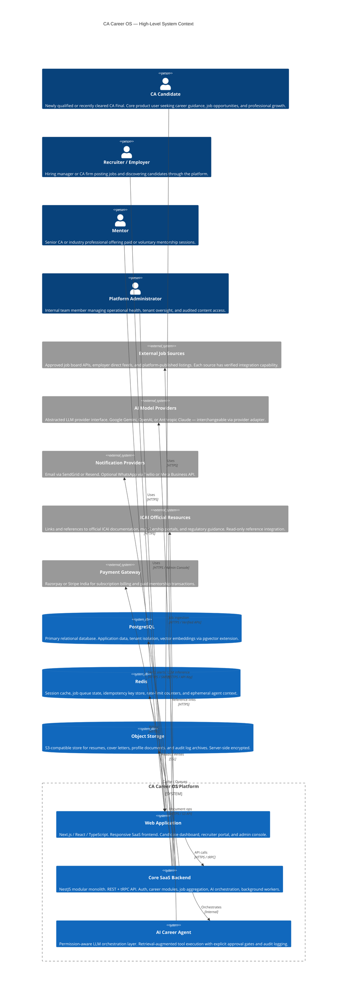
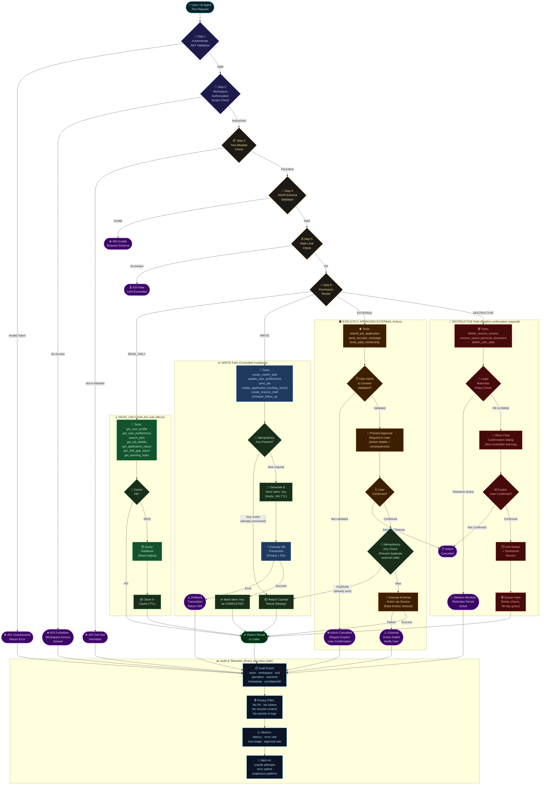
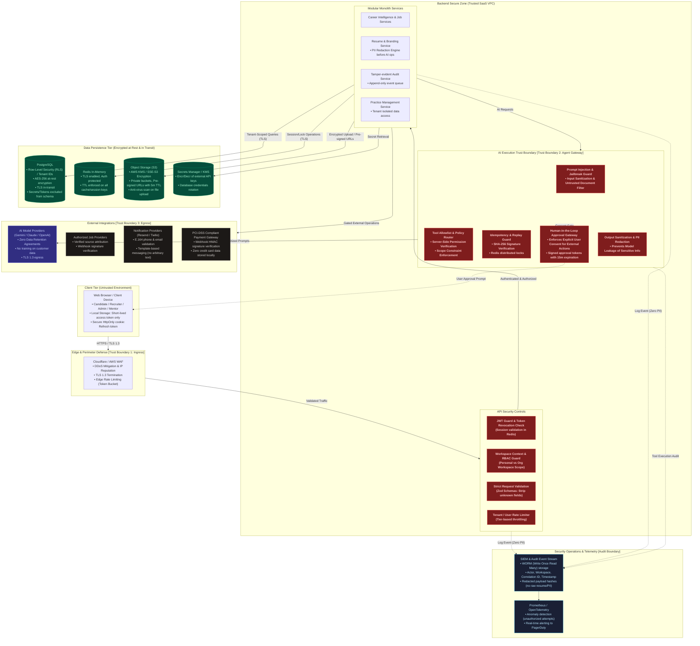

# CA Career OS — Complete System Architecture Specification

> **Version:** 1.0.0-draft  
> **Status:** Production-Ready Architectural Blueprint  
> **Author:** Principal Software Architect & AI Systems Engineering Team  
> **Target Audience:** Engineering Leads, SaaS Architects, Security Auditors, Product Managers  

---

## Table of Contents

1. [Executive Summary & Product Vision](#1-executive-summary--product-vision)
2. [Product Modules & Responsibilities](#2-product-modules--responsibilities)
3. [Inter-Module Data Flows](#3-inter-module-data-flows)
4. [AI Agent Architecture & Tool Execution Engine](#4-ai-agent-architecture--tool-execution-engine)
5. [Feature-to-Pain-Point Matrix](#5-feature-to-pain-point-matrix)
6. [Multi-Tenant Isolation & Workspace Model](#6-multi-tenant-isolation--workspace-model)
7. [Implementation Roadmap: MVP vs Future Phases](#7-implementation-roadmap-mvp-vs-future-phases)
8. [Architecture Diagrams Directory](#8-architecture-diagrams-directory)
9. [Architecture Glossary](#9-architecture-glossary)
10. [Reference Links & Architecture Decisions](#10-reference-links--architecture-decisions)

---

## 1. Executive Summary & Product Vision

### 1.1 The Core Product Promise

> *"From CA qualification to career success — one intelligent workspace."*

**CA Career OS** is an AI-powered career management and professional growth SaaS platform engineered specifically for Chartered Accountants in India, with focused capabilities for candidates who have recently cleared CA Final and newly qualified CAs (0–3 years post-qualification).

Rather than acting as a superficial, passive job board, CA Career OS is an active career copilot unifying:
1. Personalized career discovery and path recommendations.
2. Verified, deduplicated job aggregation and transparent matching.
3. ATS-optimized, ethics-compliant resume generation.
4. Technical mock interviews and practical skills simulation labs.
5. Objective salary and offer comparison intelligence.
6. Professional practice setup and lightweight client practice management.
7. An orchestrated, permission-governed AI Career Agent.

### 1.2 Core Architectural Principles

- **Security First:** Strict separation of personal candidate workspaces from employer organization workspaces.
- **Controlled AI Autonomy:** Deterministic 4-tier permission model. Autonomous read and write operations; **mandatory human-in-the-loop approval** for all external side effects; zero autonomous destructive actions.
- **Truth & Ethics in AI:** Strict zero-fabrication policies for candidate credentials and metrics; clear provenance and date-stamping on all regulatory tax/compliance simulations.
- **Modular Monolith Baseline:** Single deployable NestJS service with clear domain boundaries, avoiding distributed system sprawl while preserving clear future extraction pathways.

---

## 2. Product Modules & Responsibilities

```
+---------------------------------------------------------------------------------------------------------+
|                                        CA CAREER OS MODULE SUITE                                        |
+---------------------------------------------------------------------------------------------------------+
|  [A] Career Intelligence    | Profile & skills inventory · AI pathway matching · 30/60/90 roadmaps      |
|  [B] Jobs & Recruitment     | Verified job discovery · Semantic search · Recruiter ATS pipeline         |
|  [C] AI Resume & Branding   | ATS resume builder · Role tailoring · Verification flags · Portfolio      |
|  [D] Interview & Skills Lab | Voice/text mock interviews · Ind AS/Tax scenarios · Excel modeling       |
|  [E] Financial Intelligence | Salary transparency · CTC unbundling · Offer compare · Mentorship         |
|  [F] Practice Management    | Post-qual checklist · COP guidance · Client CRM · Task tracking           |
|  [G] AI Career Agent        | Cross-module assistant · Safe tool execution · Approval gateway           |
+---------------------------------------------------------------------------------------------------------+
```

### Module A: Career Intelligence
- **Responsibilities:**
  - Manages the candidate's canonical professional profile (articleship firm, exposure areas, technical domain skills, city preference, target compensation).
  - Evaluates candidate profile against 6 major CA pathways: Statutory Audit & Assurance, Direct & Indirect Taxation, FP&A & Corporate Finance, Investment Banking & Private Equity, Management Consulting & Risk Advisory, and Independent Practice.
  - Generates personalized 30-day, 60-day, and 90-day transition roadmaps with role-specific skill-gap reports.
- **Boundaries:** Does not scrape candidate profiles without consent; does not promise job placement or rank candidates publicly.

### Module B: Jobs and Recruitment
- **Responsibilities:**
  - Aggregates job opportunities exclusively through authorized employer feeds, direct platform postings, and verified partner APIs.
  - De-duplicates and normalizes job descriptions; computes explainable semantic match scores (0.0–1.0) using hybrid lexical + vector search (`pgvector`).
  - Manages candidate application tracking lifecycle (`SAVED` $\rightarrow$ `APPLIED` $\rightarrow$ `INTERVIEWING` $\rightarrow$ `OFFERED` $\rightarrow$ `ARCHIVED`).
  - Recruiter Portal: Job posting, applicant pipeline management, verified employer badging, and suspicious listing reporting.
- **Boundaries:** Zero unauthorized scraping of commercial job boards. All job listings feature source provenance and freshness verification (auto-expiry at 30 days).

### Module C: AI Resume and Professional Branding
- **Responsibilities:**
  - Generates ATS-friendly resume versions formatted in PDF and DOCX.
  - Dynamically tailors resume bullet points to specific target job descriptions while enforcing the **Zero Fabrication Rule** (ADR-009).
  - Drafts contextual cover letters and recruiter outreach messages.
  - Generates LinkedIn headline and summary optimization recommendations.
  - Builds verified project portfolios highlighting articleship audit engagements and financial modeling assignments.
- **Boundaries:** The model cannot invent numbers, client names, or credentials. All metrics require candidate attestation.

### Module D: AI Interview and Practical Skills Lab
- **Responsibilities:**
  - Conducts turn-based text and voice mock technical interviews tailored to target roles (e.g., Ind AS 115 revenue recognition cases, Transfer Pricing documentation, GST audit checks).
  - Provides objective, granular scoring across technical accuracy, structured communication, and regulatory awareness.
  - Practical Simulation Exercises: Synthetic financial statements for audit reconciliations, financial model templates, and tax computation drills.
- **Boundaries:** All scenario data uses synthetic or properly licensed source material. Educational simulation only — does not provide formal legal/tax opinions.

### Module E: Career and Financial Intelligence
- **Responsibilities:**
  - Aggregates self-reported, anonymized salary benchmarks tagged with sample size ($N$), percentile distributions (25th, 50th, 75th), and effective dates.
  - Offer Unbundling Calculator: Normalizes CTC offers by splitting fixed in-hand salary, variable performance bonuses, joining bonuses, retiral benefits (PF/Gratuity), and stock incentives.
  - Side-by-side offer comparison tool with personalized cost-of-living index adjustments across Indian metro cities (Mumbai, Bengaluru, Delhi-NCR, Pune, Hyderabad, Chennai).
  - Mentorship Marketplace: Discovery, availability calendar, and appointment scheduling with senior industry CAs.
- **Boundaries:** No salary or career projection is presented as a guarantee. All statistics show sample size provenance.

### Module F: Professional Setup and Practice Management
- **Responsibilities:**
  - Post-qualification step-by-step checklist: ICAI associate membership application, Certificate of Practice (COP) forms, and firm registration prerequisites.
  - Curated, dated reference links to official ICAI portals, CPE credit guidelines, and professional ethics resources.
  - Lightweight Practice CRM: Client onboarding templates, KYC document checklists, recurring compliance calendar (advance tax, GST returns, statutory audit deadlines), and task reminders.
- **Boundaries:** Strict adherence to ICAI Code of Ethics (no client solicitation or public commercial advertising). Back-office productivity workflows only.

### Module G: AI Career Agent (Cross-Module Orchestrator)
- **Responsibilities:**
  - Conversational copilot that parses candidate career intents (e.g., *"I have 3 years of statutory audit articleship and want an FP&A role in Mumbai; prepare my plan and tailor my resume"*).
  - Coordinates cross-module tool invocations in accordance with the 4-tier security policy.
  - Surfaces structured approval cards for high-consequence operations.
- **Boundaries:** The LLM can never bypass server-side authorization guards or autonomously initiate external actions.

---

## 3. Inter-Module Data Flows

```
+---------------------------------------------------------------------------------------------------------+
|                                      INTER-MODULE DATA FLOW DIAGRAM                                     |
+---------------------------------------------------------------------------------------------------------+
|                                                                                                         |
|  [Candidate Onboarding]                                                                                 |
|           |                                                                                             |
|           v                                                                                             |
|  [Module A: Career Intel]  ====(Skills & Domain)====>  [Module D: Interview Lab]                        |
|           |                                                      |                                      |
|    (Target Roles)                                         (Readiness Score)                             |
|           |                                                      |                                      |
|           v                                                      v                                      |
|  [Module B: Jobs Search]   ====(Job Description)===>  [Module C: Resume Tailor]                         |
|           |                                                      |                                      |
|   (Saved & Applied Jobs)                                 (Tailored Resume)                              |
|           |                                                      |                                      |
|           +-----------------------\      /-----------------------+                                      |
|                                   v      v                                                              |
|                            [Application Record]                                                         |
|                                     |                                                                   |
|                              (Offer Received)                                                           |
|                                     |                                                                   |
|                                     v                                                                   |
|                       [Module E: Offer Comparison]                                                      |
|                                     |                                                                   |
|                       +-------------+-------------+                                                     |
|                       |                           |                                                     |
|                 (Corporate Job)            (Independent Practice)                                       |
|                       |                           |                                                     |
|                       v                           v                                                     |
|             [First 90-Days Plan]       [Module F: Practice CRM]                                         |
|                                                                                                         |
+---------------------------------------------------------------------------------------------------------+
```

1. **Profile to Skill Gap & Recommendations:** Module A digests user articleship details and queries the Skill catalog. The generated `SkillGapReport` informs Module D of target interview drill areas and Module B of semantic search queries.
2. **Job Description to Tailored Resume:** When a candidate saves a job in Module B, the job's required skills and responsibilities are passed to Module C. Module C cross-references the candidate's verified profile data and creates a job-tailored `ResumeVersion`.
3. **Application Tracking to Offer Analysis:** Once an employer issues an offer, the application status transitions to `OFFERED`. The candidate uploads the offer terms into Module E, where fixed vs. variable components are parsed, normalized, and benchmarked against cohort statistics.
4. **Transition to Practice:** Candidates electing the practice route trigger Module F, generating an ICAI compliance roadmap, firm registration workflow, and initializing the practice CRM workspace.

---

## 4. AI Agent Architecture & Tool Execution Engine

The AI Career Agent is built on a **Permission-Aware Deterministic Gateway** inspired by enterprise zero-trust principles:

```
[Agent Tool Call Request]
          |
          v
[1. Authentication Guard] ---- (Invalid JWT) ----> [401 Unauthorized + Audit Log]
          | (Valid)
          v
[2. Workspace Guard] --------- (Cross-tenant) ---> [403 Forbidden + Audit Log]
          | (Authorized)
          v
[3. Tool Allowlist Check] ---- (Unregistered) ---> [403 Tool Denied + Audit Log]
          | (Permitted)
          v
[4. Zod Schema Validation] --- (Invalid schema) -> [400 Bad Request + Audit Log]
          | (Valid)
          v
[5. Rate Limiter Check] ------ (Limit exceeded) -> [429 Rate Limited + Audit Log]
          | (Within quota)
          v
[6. Permission Level Router]
          |
          +---> [READ_ONLY]  ---------> [Query DB / Cache] -------> [Result]
          |
          +---> [WRITE] --------------> [Idempotency Check] ------> [DB Transaction] --> [Result]
          |
          +---> [EXTERNAL ACTION] ----> [Human Approval Gate] ----> [User Confirms?]
          |                                                             |-- YES --> [Service Call]
          |                                                             \-- NO ---> [Cancel Action]
          |
          +---> [DESTRUCTIVE] --------> [Retention Check] --------> [Final Warning Dialog]
                                                                        |-- YES --> [Soft Delete]
                                                                        \-- NO ---> [Cancel Action]
          |
          v
[7. Privacy-Safe Audit Logging & Telemetry Engine] (Actor, Tool, Outcome, Latency, Zero PII)
```

### Tool Categorization Table

| Tool Name | Tier | Description | Side Effects | Guardrails & Controls |
| :--- | :--- | :--- | :--- | :--- |
| `get_user_profile` | **READ_ONLY** | Retrieves candidate profile | None | Workspace-scoped read; excludes hashed credentials |
| `get_user_preferences` | **READ_ONLY** | Reads target roles and cities | None | Workspace-scoped read |
| `search_jobs` | **READ_ONLY** | Performs hybrid job search | None | Filtered by verified job sources |
| `get_job_details` | **READ_ONLY** | Fetches full job description | None | Checks job active status |
| `get_application_status` | **READ_ONLY** | Queries status of applications | None | Candidate's own applications only |
| `get_skill_gap_report` | **READ_ONLY** | Fetches latest skill gap report | None | Cached in Redis (1h TTL) |
| `get_learning_tasks` | **READ_ONLY** | Lists assigned learning tasks | None | Workspace-scoped read |
| `create_career_task` | **WRITE** | Adds item to career roadmap | DB Insert | Idempotency key; max 50 active tasks |
| `update_user_preferences`| **WRITE** | Updates preferred domains/salary | DB Update | Strict Zod validation; change audit event |
| `save_job` | **WRITE** | Bookmarks job for candidate | DB Upsert | Prevents duplicate bookmarks |
| `create_application_tracking_record` | **WRITE** | Creates new tracking entry | DB Insert | Idempotency key; validates job existence |
| `create_resume_draft` | **WRITE** | Generates tailored resume draft | DB Insert + S3 | ADR-009 Zero-Fabrication prompt guard |
| `schedule_follow_up` | **WRITE** | Sets reminder date for job | DB Insert | Dispatches BullMQ reminder job |
| `submit_job_application` | **EXTERNAL** | Sends application to employer | External API / Email | **Mandatory Approval Request** card; explicit user click |
| `send_recruiter_message` | **EXTERNAL** | Sends outreach to recruiter | External Email / Portal| **Mandatory Approval Request** card; preview message |
| `book_paid_mentorship` | **EXTERNAL** | Initiates paid mentor booking | Razorpay charge | **Mandatory Approval Request**; checkout authorization |
| `delete_resume_version` | **DESTRUCTIVE** | Removes a tailored resume version| Soft-delete | Two-step confirmation; 30-day tombstone |
| `remove_saved_personal_document` | **DESTRUCTIVE** | Deletes uploaded doc/certificate | S3 soft-delete | Confirmation dialog; check if linked to live app |
| `delete_user_data` | **DESTRUCTIVE** | GDPR/DPDP user erasure request | Async purge queue | Statutory retention check; 14-day grace period |

---

## 5. Feature-to-Pain-Point Matrix

| User Pain Point | Target User | Proposed Feature | Required System Components | Required Data | Security Considerations | Success Metric | Phase |
| :--- | :--- | :--- | :--- | :--- | :--- | :--- | :--- |
| **1. Career Path Uncertainty** | Newly qualified CA | Career Intelligence Engine & 6-pathway diagnostic | `CareerModule`, LLM Adapter, `Skill` Catalog | Articleship details, domain interests, preferred cities | Personal workspace isolation; no sharing with current employer | Completion of career diagnostic; reduction in time to career choice | **MVP** |
| **2. Articleship Experience Gap** | CA Final passed / Fresh CA | Role-Specific Skill-Gap Analysis & Practical Roadmap | `CareerModule`, `LearningModule`, RAG Engine | Target job requirements vs articleship exposure | Objective scoring; no disparagement of articleship firms | $>75\%$ completion rate of assigned bridging tasks | **MVP** |
| **3. Fragmented & Stale Job Listings** | All CA job seekers | Unified Verified Job Aggregator with Hybrid Search | `JobsModule`, Job Ingestion Worker, `pgvector`, Redis | Standardized job feeds from verified employers & APIs | Zero unauthorized scraping; source attribution check | Stale/ghost listing rate $<2\%$; search relevance CTR $>40\%$ | **MVP** |
| **4. Generic Resumes Fail ATS** | Job applicants | Job-Specific ATS Resume Tailor with Provenance Link | `ResumeModule`, PDF/DOCX Generator, Prompt Guard | Candidate verified profile, Target Job Description | **Zero-Fabrication Guard (ADR-009)**; mandatory candidate attestation | Verified resume creation time $<10$ min; interview shortlist rate $+35\%$ | **MVP** |
| **5. Technical Interview Anxiety** | Candidates facing corporate interviews | AI Mock Interview & Domain Case Simulator | `InterviewModule`, Speech-to-Text, Feedback Engine | Role question banks, Ind AS / Tax synthetic case studies | Synthetic data only; zero PII in audio storage; encrypted logs | $\ge 2$ mock sessions completed per candidate; score uplift $>20\%$ | **MVP** (Text), **Phase 2** (Voice) |
| **6. Opaque CTC & Offer Comparison** | Candidates evaluating offers | CTC Unbundler & Offer Decision Matrix | `FinancialIntelModule`, Cost-of-Living Index API | Offer letter terms (fixed, variable, ESOPs, retiral) | Confidential offer storage; client-side unbundling; no employer leaks | $100\%$ candidate comprehension of in-hand vs CTC; decision time $<48$h | **MVP** |
| **7. Scattered Applications & Tools** | Active job seekers | Unified Application Tracker & Follow-Up Automation | `JobsModule`, BullMQ Reminder Worker, Email Service | Application state, follow-up dates, recruiter correspondence | Idempotent status updates; strict user opt-in for alerts | Application follow-up rate $>80\%$; tracking completeness $>90\%$ | **MVP** |
| **8. Independent Practice Hurdles** | CAs entering practice | Practice Setup Assistant & Lightweight Client CRM | `PracticeModule`, Compliance Calendar Worker | Post-qualification steps, KYC checklists, deadline schemas | ICAI Code of Ethics compliance; strictly no client solicitation | Practice setup completion time reduced from 30 days to 7 days | **Phase 3** |

---

## 6. Multi-Tenant Isolation & Workspace Model

```
+---------------------------------------------------------------------------------------------------------+
|                                    WORKSPACE MULTI-TENANCY MODEL                                        |
+---------------------------------------------------------------------------------------------------------+
|                                                                                                         |
|    +----------------------------------+          +------------------------------------+                 |
|    |    PERSONAL WORKSPACE            |          |    ORGANIZATION WORKSPACE          |                 |
|    |    (Owned by 1 Candidate)        |          |    (CA Firm / Corporate Employer)  |                 |
|    +----------------------------------+          +------------------------------------+                 |
|    | • Resumes & Tailored Versions    |          | • Employer Profile & Verification  |                 |
|    | • Career Diagnostics & Roadmaps  |          | • Job Postings & Ingested Feeds    |                 |
|    | • Interview Transcripts & Scores |          | • Applicant Tracking Pipeline      |                 |
|    | • Saved Jobs & Applications      |          | • Team Members (Admin, Recruiter)  |                 |
|    | • Confidential Offer Letters     |          | • Subscription & Team Invoicing    |                 |
|    +----------------------------------+          +------------------------------------+                 |
|                     |                                              |                                    |
|                     +----------------------\      /----------------+                                    |
|                                            v      v                                                     |
|                           [POSTGRESQL MULTI-TENANT PERSISTENCE]                                         |
|                           • Row-Level Security (RLS) enforcement                                        |
|                           • Tenant ID on every query via WorkspaceGuard                                 |
|                           • Zero cross-tenant data exposure guarantee                                   |
|                                                                                                         |
+---------------------------------------------------------------------------------------------------------+
```

### Access Isolation Rules
1. **Candidate Privacy Shield:** A candidate's current employer, even if subscribed to CA Career OS as an Organization Workspace, can never view whether their employee has an active Personal Workspace, what jobs they are saving, or what interviews they are practicing.
2. **Platform Admin Segregation:** Platform Administrators have access to telemetry, health metrics, and aggregated billing data. They **cannot view** candidate resumes, prompt dialogues, or raw offer letters without a formally logged, time-limited security escalation token.

---

## 7. Implementation Roadmap: MVP vs Future Phases

```
+---------------------------------------------------------------------------------------------------+
|                                      IMPLEMENTATION TIMELINE                                      |
+---------------------------------------------------------------------------------------------------+
|  [PHASE 1: MVP]                                                                                   |
|  * Candidate Onboarding & Profile Engine                                                          |
|  * Career Intelligence diagnostic & 30/60/90 roadmap                                              |
|  * Direct Job Publishing + Partner Feed Ingestion                                                |
|  * Hybrid Job Search & Match Scoring (Postgres FTS + pgvector)                                     |
|  * ATS Resume Generator & Tailoring with Zero-Fabrication Guard                                   |
|  * Application Tracking Board & Follow-up Notifications                                           |
|  * Text-based Mock Technical Interviews & Scoring                                                 |
|  * Basic CTC & Offer Comparison Calculator                                                        |
|  * AI Career Agent with 4-Tier Permission Router & Approval Gate                                  |
|  * Tamper-evident Audit Logging & Admin Controls                                                  |
+---------------------------------------------------------------------------------------------------+
|  [PHASE 2: ENHANCED INTELLIGENCE & COMMUNITY]                                                     |
|  * Real-time Voice Mock Interviews (Speech-to-Text & Text-to-Speech)                              |
|  * ATS Partner Integrations (Greenhouse, Lever, Darwinbox)                                        |
|  * Advanced Financial Modeling & Audit Case Simulator Lab                                        |
|  * Mentorship Marketplace with Calendar Scheduling & Razorpay Gateway                             |
|  * Anonymous Salary Intelligence Engine with Cohort Percentiles                                   |
|  * Verified Employer Badging & Company Profile Pages                                              |
+---------------------------------------------------------------------------------------------------+
|  [PHASE 3: ENTERPRISE & PRACTICE SUITE]                                                           |
|  * Professional Practice Management Suite (Client CRM, KYC, Compliance Calendar)                  |
|  * Enterprise Recruiter Analytics & Bulk Candidate Matching Pipeline                              |
|  * WhatsApp Business API Alerts for High-Priority Interview Invites                               |
|  * Alumni & Regional Chapter Professional Networking Circles                                      |
|  * Continuous Professional Education (CPE) Credit Tracker with ICAI Guidelines                    |
+---------------------------------------------------------------------------------------------------+
```

---

## 8. Architecture Diagrams Directory & Visual Previews

All architecture diagrams are authored in pure Mermaid format to ensure GitHub-native rendering. You can view the standalone `.mmd` source files or examine the interactive diagrams embedded below.

---

### Diagram 1: High-Level System Context (C4 Model)
*Source:* [`./system-context.mmd`](file:///home/vishal/Downloads/CA%20Carrer%20OS/docs/architecture/system-context.mmd)



---

### Diagram 2: Detailed Layered System Architecture
*Source:* [`./system-architecture.mmd`](file:///home/vishal/Downloads/CA%20Carrer%20OS/docs/architecture/system-architecture.mmd)


---

### Diagram 3: AI Agent Permission and Execution Flow
*Source:* [`./agent-execution-flow.mmd`](file:///home/vishal/Downloads/CA%20Carrer%20OS/docs/architecture/agent-execution-flow.mmd)



---

### Diagram 4: Core CA User Journey (Dual Pathways)
*Source:* [`./user-journey.mmd`](file:///home/vishal/Downloads/CA%20Carrer%20OS/docs/architecture/user-journey.mmd)


---

### Diagram 5: Job Application Workflow State Machine
*Source:* [`./job-application-workflow.mmd`](file:///home/vishal/Downloads/CA%20Carrer%20OS/docs/architecture/job-application-workflow.mmd)

```mermaid
stateDiagram-v2
  [*] --> JobDiscovered : Job ingested from source

  state JobDiscovered {
    [*] --> Normalising
    Normalising --> Deduplicating
    Deduplicating --> FreshnessVerified
    FreshnessVerified --> Indexed
    Indexed --> [*]
  }

  JobDiscovered --> Available : Passes quality checks

  state Available {
    direction LR
    [*] --> Searchable
    Searchable --> SavedByCandidate : Candidate saves job
    Searchable --> AlertSent : Matches job alert
  }

  SavedByCandidate --> ResumeVersionSelected : Candidate picks resume
  AlertSent --> ResumeVersionSelected

  state ResumeVersionSelected {
    [*] --> SelectingVersion
    SelectingVersion --> Tailoring : Candidate requests tailoring
    Tailoring --> TailoredDraftReady
    TailoredDraftReady --> CandidateReviewing
    CandidateReviewing --> ApprovedForApplication : Candidate approves
    CandidateReviewing --> Tailoring : Revise
  }

  ApprovedForApplication --> EligibilityCheck

  state EligibilityCheck {
    [*] --> CheckingRequirements
    CheckingRequirements --> EligibilityMet : Requirements met
    CheckingRequirements --> EligibilityWarning : Partial match
    CheckingRequirements --> EligibilityFailed : Hard requirement missing
    EligibilityWarning --> CandidateProceedsAnyway : User explicitly continues
    EligibilityFailed --> [*] : Blocked — inform candidate
  }

  EligibilityMet --> PendingExplicitApproval
  CandidateProceedsAnyway --> PendingExplicitApproval

  state PendingExplicitApproval {
    [*] --> ShowingApprovalDialog
    ShowingApprovalDialog --> UserConfirmed : "Submit Application" clicked
    ShowingApprovalDialog --> UserDeclined : Cancelled or timeout
    UserDeclined --> [*]
  }

  UserConfirmed --> IdempotencyCheck

  state IdempotencyCheck {
    [*] --> CheckingKey
    CheckingKey --> DuplicateDetected : Key already exists
    CheckingKey --> NewSubmission : First attempt
    DuplicateDetected --> ReplayingResult
    ReplayingResult --> [*]
  }

  NewSubmission --> ApplicationSubmitted : External action via service

  ApplicationSubmitted --> Tracking

  state Tracking {
    direction LR
    [*] --> Applied
    Applied --> AcknowledgedByEmployer : Employer viewed
    Applied --> NoResponse
    AcknowledgedByEmployer --> InterviewInvited
    AcknowledgedByEmployer --> Rejected
    InterviewInvited --> InterviewPrepStarted
    InterviewPrepStarted --> InterviewCompleted
    InterviewCompleted --> OfferReceived
    InterviewCompleted --> Rejected
    NoResponse --> FollowUpSent : Reminder triggered
    FollowUpSent --> AcknowledgedByEmployer
    FollowUpSent --> NoResponseFinal
  }

  OfferReceived --> OfferComparison
  Rejected --> PostMortemFeedback
  NoResponseFinal --> Archived

  state OfferComparison {
    [*] --> CTCAnalysis
    CTCAnalysis --> BenefitsNormalisation
    BenefitsNormalisation --> ComparisonReady
  }

  OfferComparison --> Accepted : Candidate accepts
  OfferComparison --> Declined : Candidate declines

  Accepted --> OfferLetterStored
  Declined --> Archived
  PostMortemFeedback --> Archived

  OfferLetterStored --> [*]
  Archived --> [*]
```



---

### Diagram 6: Data Architecture & Entity-Relationship Model
*Source:* [`./data-architecture.mmd`](file:///home/vishal/Downloads/CA%20Carrer%20OS/docs/architecture/data-architecture.mmd)

```mermaid
erDiagram
  User {
    uuid id PK
    string email UK
    string hashedPassword "bcrypt, never plain"
    string firstName
    string lastName
    enum role "CANDIDATE | RECRUITER | MENTOR | ORG_ADMIN | PLATFORM_ADMIN"
    boolean emailVerified
    timestamp createdAt
    timestamp updatedAt
    timestamp deletedAt "soft delete"
  }

  Workspace {
    uuid id PK
    enum type "PERSONAL | ORGANIZATION"
    string name
    string slug UK
    uuid ownerId FK
    jsonb settings
    timestamp createdAt
  }

  WorkspaceMembership {
    uuid id PK
    uuid workspaceId FK
    uuid userId FK
    enum memberRole "OWNER | ADMIN | MEMBER | RECRUITER | VIEWER"
    boolean isDefault
    timestamp joinedAt
  }

  Subscription {
    uuid id PK
    uuid workspaceId FK
    enum plan "FREE | PRO | TEAM | ENTERPRISE"
    enum status "ACTIVE | PAST_DUE | CANCELLED | TRIALING"
    string externalSubscriptionId "Payment gateway ref"
    timestamp currentPeriodEnd
    timestamp createdAt
  }

  CandidateProfile {
    uuid id PK
    uuid userId FK
    uuid workspaceId FK
    string icaiMembershipNo "Optional, user-provided"
    date qualificationDate
    string articleshipFirm
    string_array articleshipAreas
    string_array targetCities
    enum workType "FULL_TIME | PART_TIME | CONSULTING | PRACTICE"
    integer targetSalaryMin
    integer targetSalaryMax
    string summary
    timestamp updatedAt
  }

  CareerPreference {
    uuid id PK
    uuid candidateProfileId FK
    string_array preferredDomains
    string_array preferredRoles
    string_array preferredSectors
    integer noticePeriodDays
    boolean openToRelocation
    jsonb additionalPreferences
    timestamp updatedAt
  }

  Skill {
    uuid id PK
    string name UK
    string category "domain | tool | soft"
    string normalizedName
  }

  CandidateSkill {
    uuid id PK
    uuid candidateProfileId FK
    uuid skillId FK
    enum proficiency "BEGINNER | INTERMEDIATE | ADVANCED | EXPERT"
    string source "articleship | self-declared | assessed"
    boolean verified
    timestamp addedAt
  }

  SkillGapReport {
    uuid id PK
    uuid candidateProfileId FK
    string targetRole
    jsonb gapAnalysis "required vs present skills"
    jsonb learningPlan
    timestamp generatedAt
    timestamp expiresAt
  }

  Employer {
    uuid id PK
    uuid workspaceId FK "org workspace"
    string name
    string domain UK
    boolean verified
    enum verificationStatus "PENDING | VERIFIED | SUSPENDED"
    string logoUrl "object storage path"
    timestamp verifiedAt
  }

  JobSource {
    uuid id PK
    string name UK
    string type "DIRECT_API | EMPLOYER_FEED | PLATFORM"
    string baseUrl
    boolean active
    jsonb integrationCapabilityCheck "documented at setup time"
    timestamp lastFetchedAt
  }

  Job {
    uuid id PK
    uuid employerId FK
    uuid jobSourceId FK
    string externalId "source-specific ID"
    string title
    string normalizedTitle
    text description
    string_array requiredSkills
    string_array preferredSkills
    string location
    enum workMode "ON_SITE | HYBRID | REMOTE"
    integer salaryMin
    integer salaryMax
    string currency "INR"
    enum status "ACTIVE | EXPIRED | FILLED | REMOVED"
    timestamp postedAt
    timestamp expiresAt
    timestamp lastVerifiedAt
    vector embedding "pgvector 1536-dim"
    timestamp createdAt
  }

  JobMatch {
    uuid id PK
    uuid jobId FK
    uuid candidateProfileId FK
    float matchScore "0.0–1.0"
    jsonb matchReasons "explainable factors"
    boolean shownToCandidate
    timestamp calculatedAt
  }

  Resume {
    uuid id PK
    uuid candidateProfileId FK
    uuid workspaceId FK
    string title
    boolean isDefault
    timestamp createdAt
  }

  ResumeVersion {
    uuid id PK
    uuid resumeId FK
    integer versionNumber
    string objectStoragePath "S3 path — access-controlled"
    enum format "PDF | DOCX"
    boolean isTailored
    uuid tailoredForJobId FK "nullable"
    string atsScore "provider-generated, nullable"
    enum status "DRAFT | APPROVED | ARCHIVED | DELETED"
    timestamp createdAt
    timestamp deletedAt "soft delete"
  }

  Application {
    uuid id PK
    uuid candidateProfileId FK
    uuid jobId FK
    uuid resumeVersionId FK
    enum status "SAVED | APPLIED | ACKNOWLEDGED | INTERVIEWING | OFFERED | ACCEPTED | REJECTED | WITHDRAWN | ARCHIVED"
    string appliedVia "platform | direct"
    boolean submittedByPlatform
    timestamp appliedAt
    timestamp statusUpdatedAt
    timestamp followUpAt
    text notes "candidate personal notes"
  }

  ApprovalRequest {
    uuid id PK
    uuid userId FK
    uuid workspaceId FK
    string toolName "submit_job_application | send_recruiter_message | book_paid_mentorship"
    jsonb actionPayload
    enum status "PENDING | APPROVED | DENIED | EXPIRED"
    string correlationId
    timestamp requestedAt
    timestamp resolvedAt
    timestamp expiresAt
  }

  InterviewSession {
    uuid id PK
    uuid candidateProfileId FK
    uuid jobId FK "nullable — may be general practice"
    string domain
    enum mode "TEXT | VOICE"
    enum status "IN_PROGRESS | COMPLETED | ABANDONED"
    integer durationSeconds
    timestamp startedAt
    timestamp endedAt
  }

  InterviewFeedback {
    uuid id PK
    uuid sessionId FK
    jsonb questionAnswerPairs "synthetic/licensed data only"
    jsonb scores "technical | communication | structure"
    text overallFeedback
    string_array improvementAreas
    timestamp generatedAt
  }

  LearningTask {
    uuid id PK
    uuid candidateProfileId FK
    uuid skillGapReportId FK "nullable"
    string title
    text description
    string resourceUrl "licensed or official source"
    enum status "TODO | IN_PROGRESS | COMPLETED | SKIPPED"
    timestamp dueDate
    timestamp completedAt
  }

  MentorBooking {
    uuid id PK
    uuid mentorUserId FK
    uuid candidateUserId FK
    enum status "PENDING | CONFIRMED | COMPLETED | CANCELLED"
    timestamp scheduledAt
    integer durationMinutes
    string meetingLink "nullable"
    boolean isPaid
    string paymentRef "external payment ref, nullable"
    timestamp createdAt
  }

  AIConversation {
    uuid id PK
    uuid userId FK
    uuid workspaceId FK
    string title
    jsonb metadata "model used, token counts"
    timestamp startedAt
    timestamp lastActiveAt
  }

  AgentToolExecution {
    uuid id PK
    uuid conversationId FK
    uuid approvalRequestId FK "nullable"
    string toolName
    enum permissionLevel "READ_ONLY | WRITE | EXTERNAL | DESTRUCTIVE"
    enum status "PENDING | COMPLETED | FAILED | REJECTED | REPLAYED"
    string idempotencyKey
    jsonb inputHash "hashed — no PII in logs"
    jsonb outputSummary "non-sensitive summary only"
    integer durationMs
    string correlationId
    timestamp executedAt
  }

  IdempotencyRecord {
    uuid id PK
    string key UK "SHA-256 of operation signature"
    string toolName
    enum status "PROCESSING | COMPLETED | FAILED"
    jsonb cachedResult "sanitised response"
    timestamp createdAt
    timestamp expiresAt
  }

  AuditEvent {
    uuid id PK
    uuid actorId FK "userId or system"
    uuid workspaceId FK
    string operation
    string resourceType
    uuid resourceId
    enum outcome "SUCCESS | FAILURE | DENIED | CANCELLED"
    jsonb metadata "no PII, no secrets"
    string correlationId
    inet ipAddress "hashed in logs"
    string userAgent
    timestamp occurredAt
  }

  User ||--o{ WorkspaceMembership : "belongs to"
  Workspace ||--o{ WorkspaceMembership : "has members"
  Workspace ||--o| Subscription : "has"
  User ||--o| CandidateProfile : "has"
  CandidateProfile ||--o| CareerPreference : "has"
  CandidateProfile ||--o{ CandidateSkill : "has"
  Skill ||--o{ CandidateSkill : "tagged in"
  CandidateProfile ||--o{ SkillGapReport : "has"
  CandidateProfile ||--o{ Resume : "owns"
  Resume ||--o{ ResumeVersion : "has versions"
  CandidateProfile ||--o{ Application : "makes"
  Application ||--|| Job : "targets"
  Application ||--o| ResumeVersion : "uses"
  Job ||--o{ JobMatch : "matched to"
  CandidateProfile ||--o{ JobMatch : "receives"
  Employer ||--o{ Job : "posts"
  JobSource ||--o{ Job : "provides"
  CandidateProfile ||--o{ InterviewSession : "has"
  InterviewSession ||--o| InterviewFeedback : "produces"
  CandidateProfile ||--o{ LearningTask : "assigned"
  User ||--o{ MentorBooking : "as mentor"
  User ||--o{ MentorBooking : "as candidate"
  User ||--o{ AIConversation : "has"
  AIConversation ||--o{ AgentToolExecution : "contains"
  AgentToolExecution ||--o| ApprovalRequest : "may require"
  User ||--o{ ApprovalRequest : "requests"
  User ||--o{ AuditEvent : "generates"
```



---

### Diagram 7: Security Boundaries and Trust Zones
*Source:* [`./security-boundaries.mmd`](file:///home/vishal/Downloads/CA%20Carrer%20OS/docs/architecture/security-boundaries.mmd)




---

## 9. Architecture Glossary

- **ATS (Applicant Tracking System):** Recruitment software used by employers to parse, rank, and track resumes.
- **Certificate of Practice (COP):** Regulatory license granted by ICAI permitting a Chartered Accountant to engage in public practice.
- **CTC (Cost to Company):** Total gross annual expenditure incurred by an employer on an employee, including fixed pay, variable incentives, PF, gratuity, and perks.
- **Idempotency Key:** Unique identifier attached to an API mutation to ensure an identical operation is never executed more than once.
- **Ind AS (Indian Accounting Standards):** The accounting standards converged with IFRS notified by the Ministry of Corporate Affairs (MCA) in India.
- **pgvector:** PostgreSQL open-source vector similarity search extension enabling embedding storage and cosine similarity queries directly inside relational tables.
- **RAG (Retrieval-Augmented Generation):** Architectural pattern where an LLM is provided with domain-specific, verified context retrieved from a database before generating responses.
- **Zero Fabrication Rule:** Programmatic and architectural constraint ensuring generative AI never introduces unverified credentials, metrics, or factual statements into candidate documents.

---

## 10. Reference Links & Architecture Decisions

- [Architecture Decision Records (ADRs)](./decisions.md)
- [Assumptions, Risks, Constraints & Spikes](./assumptions-and-risks.md)
- [Official ICAI Resources Reference Portal](https://www.icai.org)
- [The Chartered Accountants Act, 1949 & Code of Ethics](https://www.icai.org/post/code-of-ethics-2020)
