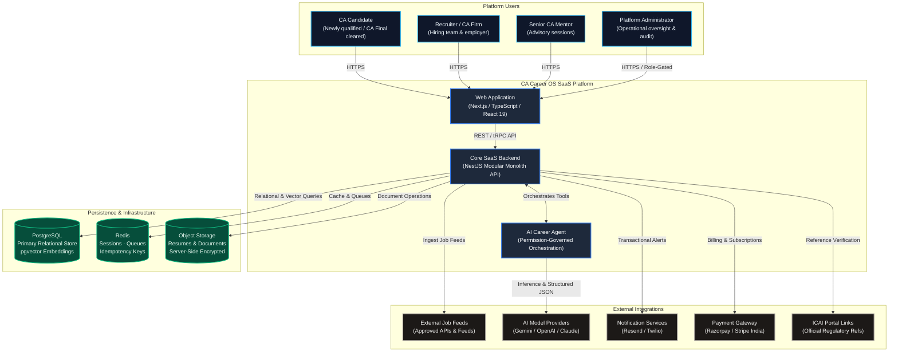
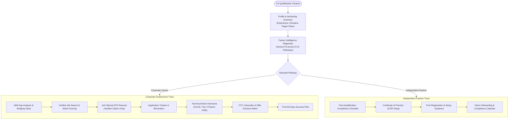
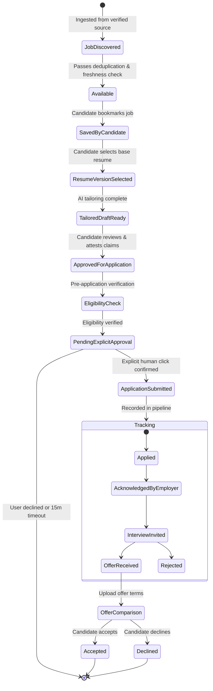
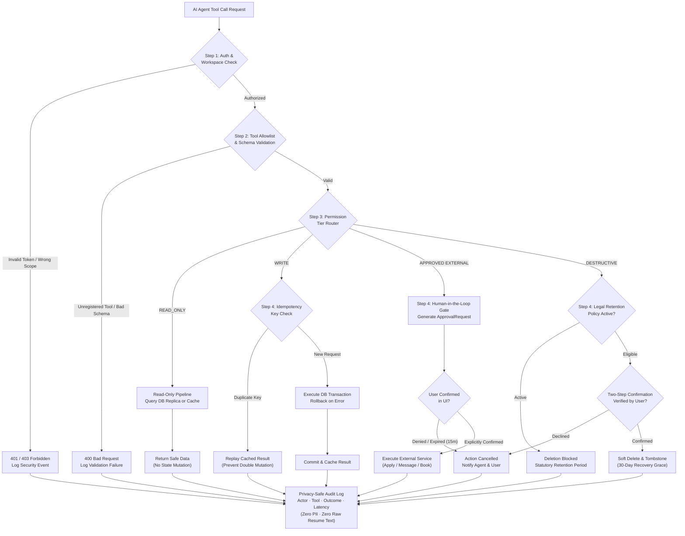
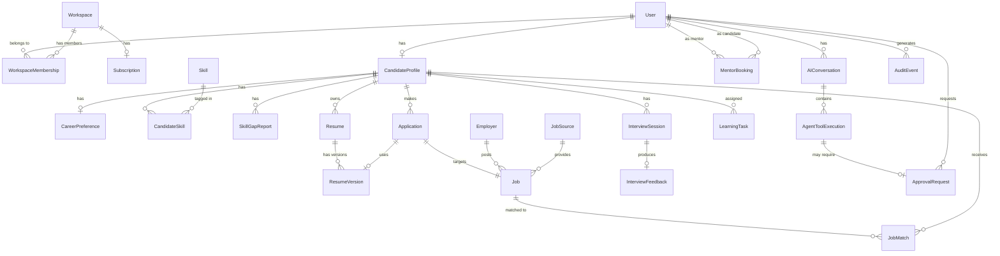
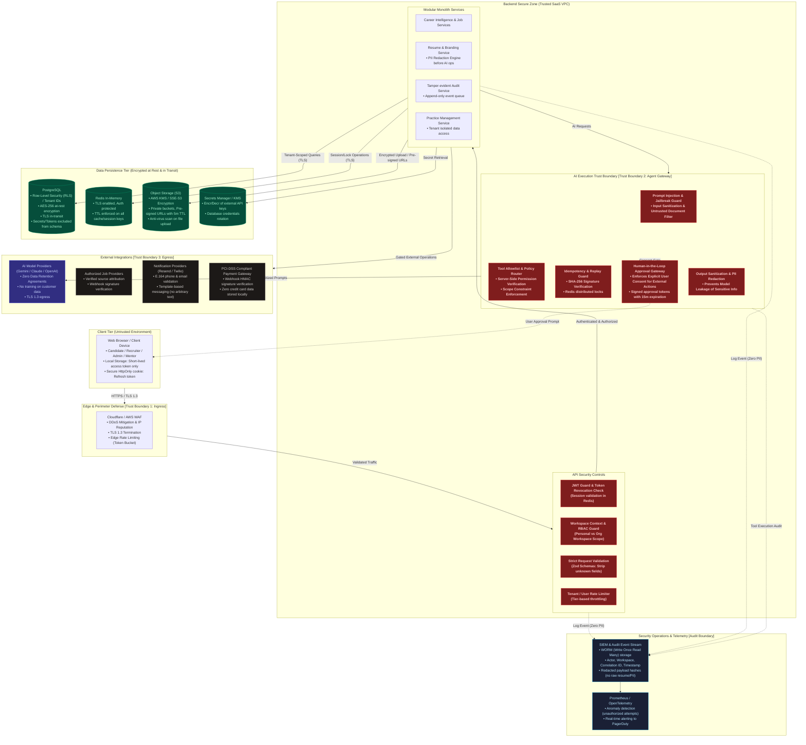

# CA Career OS — Master System Architecture Specification

> **Document Type:** Production-Grade SaaS Architecture Blueprint & Engineering Specification  
> **Status:** Architecture Blueprint — Implementation Pending  
> **Target Audience:** Principal Software Architects, Backend Engineers, Security Auditors, Product Leads  
> **Repository:** `Vishaldubey2210/CA-Carrier-OS`

[](#14-architecture-status--implementation-phases)
[](decisions.md#adr-001-modular-monolith-architecture-over-microservices)
[](#6-ai-agent-request--execution-lifecycle)
[-orange.svg)](#16-legal-professional-ethics--disclaimers)

---

## Table of Contents

1. [Executive Summary & Product Vision](#1-executive-summary--product-vision)
2. [System Context & External Boundaries](#2-system-context--external-boundaries)
3. [Core Module Specifications & Technical Contracts](#3-core-module-specifications--technical-contracts)
4. [Internal Backend Components & Dependencies](#4-internal-backend-components--dependencies)
5. [User Workflows (Candidate & Recruiter)](#5-user-workflows-candidate--recruiter)
6. [AI Agent Request & Execution Lifecycle](#6-ai-agent-request--execution-lifecycle)
7. [Permission Tiers & Human-in-the-Loop Gateway](#7-permission-tiers--human-in-the-loop-gateway)
8. [Idempotency, Retries, Failure Handling & Reconciliation](#8-idempotency-retries-failure-handling--reconciliation)
9. [Workspace Multi-Tenancy & Data Isolation Model](#9-workspace-multi-tenancy--data-isolation-model)
10. [Database Entities, Relationships & Ownership](#10-database-entities-relationships--ownership)
11. [API Contracts, Protocols & Error Handling](#11-api-contracts-protocols--error-handling)
12. [Background Workers & Scheduled Tasks](#12-background-workers--scheduled-tasks)
13. [Security Architecture & Threat Model](#13-security-architecture--threat-model)
14. [Observability, Telemetry & Failure Recovery](#14-observability-telemetry--failure-recovery)
15. [Feature-to-Pain-Point Traceability Matrix](#15-feature-to-pain-point-traceability-matrix)
16. [Architecture Decision Records & Trade-Offs](#16-architecture-decision-records--trade-offs)
17. [Implementation Phases & Scope Boundaries](#17-implementation-phases--scope-boundaries)
18. [Visual Architecture Diagrams Catalog](#18-visual-architecture-diagrams-catalog)
19. [Architecture Glossary](#19-architecture-glossary)
20. [Legal, Professional Ethics & Disclaimers](#20-legal-professional-ethics--disclaimers)

---

## 1. Executive Summary & Product Vision

### 1.1 The Core Product Promise

> *"From CA qualification to career success — one intelligent workspace."*

**CA Career OS** is an integrated software-as-a-service (SaaS) platform engineered specifically for Chartered Accountants in India, with focused emphasis on candidates who have recently cleared CA Final and newly qualified CAs (0–3 years post-qualification).

Rather than acting as another passive, unverified job listing directory, CA Career OS provides an active, personalized career copilot combining:
1. Pathway diagnostics and personalized 30/60/90-day transition roadmaps.
2. Verified, deduplicated job discovery and explainable semantic matching.
3. ATS-optimized resume building with strict zero-fabrication verification.
4. Technical mock interviews and domain simulation labs.
5. Transparent CTC unbundling and side-by-side offer decision comparison.
6. Post-qualification compliance checklists and independent practice setup tools.
7. A permission-governed AI Career Agent operating under strict human-in-the-loop controls.

### 1.2 Core Architectural Principles

- **Security & Multi-Tenant Isolation First:** Personal candidate workspaces and employer organization workspaces are strictly decoupled. A candidate's current employer can never observe their job search or career planning activities.
- **Deterministic AI Safeguards:** LLMs are never granted autonomous write permissions for external side effects. Tool invocations are partitioned into four deterministic tiers (`READ_ONLY`, `WRITE`, `EXPLICITLY_APPROVED_EXTERNAL`, and `DESTRUCTIVE`).
- **Zero-Fabrication Guard (ADR-009):** The platform strictly prohibits AI fabrication of credentials, client names, engagement fees, or professional metrics. All resume claims require explicit candidate attestation.
- **Modular Monolith Baseline:** Single deployable NestJS service with clear domain boundaries, avoiding microservices network latency while preserving clean future extraction boundaries.

---

## 2. System Context & External Boundaries

The platform operates within a well-defined boundary interacting with four primary user roles, verified external job feeds, interchangeable AI providers, transactional notification gateways, and secure persistence stores.



---

## 3. Core Module Specifications & Technical Contracts

```
+───────────────────────────────────────────────────────────────────────────────────────────+
|                                    CORE DOMAIN MODULES                                    |
+───────────────────────────────────────────────────────────────────────────────────────────+
|  [A] Career Intelligence    | Profile & skills inventory · AI pathway matching · Roadmaps |
|  [B] Jobs & Recruitment     | Verified job discovery · Semantic search · Recruiter ATS    |
|  [C] AI Resume & Branding   | ATS resume builder · Role tailoring · Verification flags    |
|  [D] Interview & Skills Lab | Voice/text mock interviews · Ind AS/Tax drills · Modeling   |
|  [E] Financial Intelligence | Salary transparency · CTC unbundling · Offer matrix         |
|  [F] Practice Management    | Post-qual checklist · COP guidance · Client CRM (Lite)      |
|  [G] AI Career Agent        | Cross-module orchestrator · Safe tool execution gateway     |
+───────────────────────────────────────────────────────────────────────────────────────────+
```

### Module A: Career Intelligence
- **Domain Responsibilities:** Manages canonical professional profile (articleship firm, exposure areas, technical domain skills, city preference, target compensation). Evaluates candidate profile against 6 major CA pathways: Statutory Audit & Assurance, Direct & Indirect Taxation, FP&A & Corporate Finance, Investment Banking & Private Equity, Management Consulting & Risk Advisory, and Independent Practice.
- **Inputs:** `CandidateProfileInput` (articleship area, firm tier, examination attempt, target roles, preferred locations).
- **Outputs:** `CareerPathRecommendation`, `SkillGapReport` (with percentage coverage per domain), and `RoadmapPlan` (30/60/90 days).
- **Validation Rules:** Zod schema validation; target salary range must be positive; notice period $\ge 0$ days.
- **Persistence Effects:** Writes to `CandidateProfile`, `CareerPreference`, `CandidateSkill`, and `SkillGapReport` tables.
- **Security & Privacy:** Scoped strictly to `workspaceId`. No articleship firm ratings or disparaging content permitted.

### Module B: Jobs and Recruitment
- **Domain Responsibilities:** Ingests jobs exclusively from verified sources (direct recruiter postings, authorized employer ATS webhooks, approved feeds). Deduplicates listings, computes hybrid lexical + vector match scores (`pgvector`), and manages applicant pipeline states.
- **Inputs:** `JobSearchQuery` (keywords, location, mode, salary range, domain filters).
- **Outputs:** Paginated `Job` results with explainable `JobMatch` scores ($0.0-1.0$) and human-readable match factors.
- **Validation Rules:** Ingestion requires verified employer ID or verified job source ID. Unapproved third-party scraping is blocked. Listings auto-expire after 30 days without re-verification.
- **Persistence Effects:** Inserts/updates `Job`, `JobSource`, `JobMatch`, and `Application`.
- **Security & Privacy:** Recruiter search algorithms exclude candidates who have marked the recruiter firm as their current articleship or employer firm.

### Module C: AI Resume and Professional Branding
- **Domain Responsibilities:** Generates ATS-friendly resume versions formatted in PDF and DOCX. Dynamically tailors resume bullet points to target job descriptions while enforcing the **Zero Fabrication Rule (ADR-009)**.
- **Inputs:** `ResumeDraftInput` (selected profile sections, target `jobId`).
- **Outputs:** `ResumeVersion` record and binary PDF/DOCX stored in private object storage.
- **Validation Rules:** Mandatory candidate attestation checkbox before finalizing a resume version. All suggested metrics must link to candidate-provided inputs.
- **Persistence Effects:** Writes to `Resume` and `ResumeVersion`; uploads encrypted file to S3.
- **Security & Privacy:** PII redaction engine strips phone numbers, email, and full postal addresses before prompt submission to external LLMs. Pre-signed download URLs have a 15-minute expiration.

### Module D: AI Interview and Practical Skills Lab
- **Domain Responsibilities:** Conducts role-specific technical mock interviews across Ind AS revenue recognition, Transfer Pricing, GST input credit checks, and financial modeling drills. Produces structured evaluations with constructive feedback.
- **Inputs:** `InterviewSessionStart` (`targetRole`, `domain`, `mode: TEXT | VOICE`).
- **Outputs:** `InterviewSession`, real-time conversational prompts, and final `InterviewFeedback` scorecards.
- **Validation Rules:** Only synthetic or properly licensed case data used for exercises. Max turn limit enforced (default: 8 question-answer rounds per session).
- **Persistence Effects:** Writes to `InterviewSession` and `InterviewFeedback`.
- **Security & Privacy:** Audio recordings (Phase 2) are processed ephemerally with zero persistent storage of candidate voice data beyond session scoring.

### Module E: Career and Financial Intelligence
- **Domain Responsibilities:** Collects anonymous, self-reported compensation data with sample-size ($N$) indicators. Unbundles CTC offers into fixed in-hand pay, performance bonuses, joining incentives, retiral contributions, and stock options, adjusting for city cost-of-living differences.
- **Inputs:** `OfferTermsInput` (fixed pay, variable pay, PF, gratuity, bonus, city).
- **Outputs:** `OfferComparisonReport` with monthly estimated take-home pay, tax projections under Indian tax regimes, and side-by-side offer decision matrices.
- **Validation Rules:** Sample size ($N$) must be prominently displayed; salary estimates are marked as directional benchmarks, not guarantees.
- **Persistence Effects:** Optional anonymous entry in salary benchmark pool; confidential offer storage in `CandidateProfile`.
- **Security & Privacy:** Offer documents are encrypted with KMS keys accessible only by the candidate's personal workspace.

### Module F: Professional Setup and Practice Management
- **Domain Responsibilities:** Guides candidates seeking to launch an independent CA practice. Provides post-qualification step-by-step checklists (ICAI associate membership application, Certificate of Practice (COP) form filing), curated links to official ICAI portals, and a lightweight practice CRM (client onboarding, KYC document tracking, statutory compliance calendar).
- **Inputs:** `PracticeSetupInput` (firm type, target services, location).
- **Outputs:** `ComplianceChecklist`, `ClientOnboardingTemplate`, and recurring compliance reminders.
- **Validation Rules:** Strict adherence to the ICAI Code of Ethics (no client solicitation or public advertising). All compliance guides display an "As of [Date]" stamp.
- **Persistence Effects:** Writes to practice CRM entities in organization workspaces.
- **Security & Privacy:** Client confidential financial data stored in dedicated tenant schemas.

### Module G: AI Career Agent (Cross-Module Orchestrator)
- **Domain Responsibilities:** Natural language copilot that plans and coordinates cross-module tasks on behalf of the user. Translates candidate intent into safely validated tool calls governed by the 4-tier permission policy.
- **Inputs:** User chat prompt, permitted profile context, active workspace context.
- **Outputs:** Streaming conversational response, structured tool suggestions, and pending `ApprovalRequest` cards.
- **Validation Rules:** All tool calls must match allowlist schemas and execute within server-side authorization boundaries.

---

## 4. Internal Backend Components & Dependencies

The backend is organized as a modular monolith in NestJS:

```mermaid
flowchart TB
  subgraph PRESENTATION["Presentation Tier"]
    CAND_APP["Candidate Dashboard"]
    RECRUITER_PORTAL["Recruiter Portal"]
    ADMIN_CONSOLE["Admin Console"]
  end

  subgraph API_GATEWAY["API Gateway Layer"]
    JWT_GUARD["JWT Guard\n(Token validation)"]
    WS_GUARD["Workspace Guard\n(Tenancy scope)"]
    RATE_LIMIT["Rate Limiter\n(Redis token bucket)"]
    VALIDATION_PIPE["Zod Validation Pipe\n(Schema enforcement)"]
  end

  subgraph DOMAIN_SERVICES["Domain Services (Modular Monolith)"]
    CAREER_SVC["CareerIntelligenceService"]
    JOBS_SVC["JobsRecruitmentService"]
    RESUME_SVC["ResumeBrandingService"]
    INTERVIEW_SVC["InterviewSkillsService"]
    FINANCIAL_SVC["FinancialIntelService"]
    PRACTICE_SVC["PracticeManagementService"]
    AGENT_SVC["AgentOrchestratorService"]
  end

  subgraph INFRA_SERVICES["Core Infrastructure Services"]
    POLICY_ENGINE["ToolPolicyEngine"]
    APPROVAL_GATEWAY["ApprovalGatewayService"]
    LLM_ADAPTER["LLMProviderAdapter"]
    QUEUE_SERVICE["QueueManagerService (BullMQ)"]
    AUDIT_SERVICE["AuditLoggingService"]
  end

  subgraph PERSISTENCE_LAYER["Persistence & External"]
    DB[(PostgreSQL + pgvector)]
    CACHE[(Redis 7+)]
    STORAGE[(Object Storage S3)]
  end

  PRESENTATION --> API_GATEWAY
  API_GATEWAY --> DOMAIN_SERVICES
  DOMAIN_SERVICES --> INFRA_SERVICES
  INFRA_SERVICES --> PERSISTENCE_LAYER
```



---

## 5. User Workflows (Candidate & Recruiter)

### 5.1 Candidate Dual-Pathway Journey



### 5.2 Job Application Lifecycle State Machine



---

## 6. AI Agent Request & Execution Lifecycle

Every AI Career Agent tool call follows a deterministic execution lifecycle:



---

## 7. Permission Tiers & Human-in-the-Loop Gateway

| Tool Name | Permission Tier | Execution Behavior | Safety Guarantees |
| :--- | :--- | :--- | :--- |
| `get_user_profile` | **`READ_ONLY`** | Reads candidate profile data | Workspace-scoped; credentials excluded |
| `get_user_preferences` | **`READ_ONLY`** | Reads target roles, cities, salary | Workspace-scoped read |
| `search_jobs` | **`READ_ONLY`** | Hybrid lexical + semantic job query | Verified sources only; active listings |
| `get_job_details` | **`READ_ONLY`** | Fetches detailed job description | Checks active expiration status |
| `get_application_status` | **`READ_ONLY`** | Queries candidate's own pipeline | Personal workspace isolation |
| `get_skill_gap_report` | **`READ_ONLY`** | Fetches latest skill gap diagnostic | Cached in Redis (1h TTL) |
| `get_learning_tasks` | **`READ_ONLY`** | Lists assigned roadmap tasks | Scoped to active candidate profile |
| `create_career_task` | **`WRITE`** | Inserts task into roadmap | Idempotency key; max 50 active tasks |
| `update_user_preferences` | **`WRITE`** | Updates target domains/salary | Strict Zod validation; audit event |
| `save_job` | **`WRITE`** | Bookmarks job for candidate | Prevents duplicate bookmarks |
| `create_application_tracking_record` | **`WRITE`** | Creates tracking board record | Idempotency check; validates job existence |
| `create_resume_draft` | **`WRITE`** | Generates tailored resume version | ADR-009 Zero-Fabrication guard |
| `schedule_follow_up` | **`WRITE`** | Sets reminder date for application | Dispatches BullMQ reminder job |
| `submit_job_application` | **`APPROVED EXTERNAL`** | Transmits application to employer | **Mandatory user click on approval card** |
| `send_recruiter_message` | **`APPROVED EXTERNAL`** | Sends outreach to hiring manager | **Mandatory user preview & confirmation** |
| `book_paid_mentorship` | **`APPROVED EXTERNAL`** | Initiates mentor payment session | **Mandatory payment checkout authorization** |
| `delete_resume_version` | **`DESTRUCTIVE`** | Deletes tailored resume version | Two-step confirmation modal; soft-delete |
| `remove_saved_personal_document` | **`DESTRUCTIVE`** | Deletes uploaded certificate | Validates document not linked to active app |
| `delete_user_data` | **`DESTRUCTIVE`** | Full account erasure request | Statutory retention check; 14-day grace |

---

## 8. Idempotency, Retries, Failure Handling & Reconciliation

```
[Incoming Mutation Request]
           │
           ▼
[Check SHA-256 Idempotency Key in Redis]
           │
           ├────► [Key Found with status: COMPLETED]
           │            │
           │            ▼
           │      [Replay Cached Response (HTTP 200) without executing DB/API]
           │
           ├────► [Key Found with status: PROCESSING]
           │            │
           │            ▼
           │      [Return HTTP 409 Conflict: Concurrent Operation in Progress]
           │
           └────► [Key Not Found]
                        │
                        ▼
                  [Acquire Redis Distributed Lock (30s TTL)]
                        │
                        ▼
                  [Execute Prisma DB Transaction]
                        │
                        ├────► [Transaction Success] ──► [Save Result, Mark COMPLETED, Release Lock]
                        │
                        └────► [Transaction Error]   ──► [Rollback DB, Delete Key, Release Lock]
```

- **Idempotency Strategy:** All `WRITE`, `APPROVED EXTERNAL`, and `DESTRUCTIVE` operations require an `Idempotency-Key` header (UUIDv4 or SHA-256 hash of operation payload). Cached results are stored in Redis with a 24-hour TTL.
- **Retry Policy for External Side Effects:** If an external API call (`submit_job_application`) times out after client confirmation, the worker queries the downstream provider for operation status before retrying to prevent duplicate applications.
- **Dead-Letter Queue & Reconciliation:** Failed background jobs move to a BullMQ Dead-Letter Queue (DLQ). A nightly reconciliation worker identifies dangling records and alerts engineering.

---

## 9. Workspace Multi-Tenancy & Data Isolation Model

```
+───────────────────────────────────────────────────────────────────────────────────────────+
|                                    WORKSPACE MULTI-TENANCY MODEL                          |
+───────────────────────────────────────────────────────────────────────────────────────────+
|                                                                                           |
|    +──────────────────────────────────+          +────────────────────────────────────+   |
|    |    PERSONAL WORKSPACE            |          |    ORGANIZATION WORKSPACE          |   |
|    |    (Owned by 1 Candidate)        |          |    (CA Firm / Corporate Employer)  |   |
|    +──────────────────────────────────+          +────────────────────────────────────+   |
|    | • Resumes & Tailored Versions    |          | • Employer Profile & Verification  |   |
|    | • Career Diagnostics & Roadmaps  |          | • Job Postings & Ingested Feeds    |   |
|    | • Interview Transcripts & Scores |          | • Applicant Tracking Pipeline      |   |
|    | • Saved Jobs & Applications      |          | • Team Members (Admin, Recruiter)  |   |
|    | • Confidential Offer Letters     |          | • Subscription & Team Invoicing    |   |
|    +──────────────────────────────────+          +────────────────────────────────────+   |
|                     │                                              │                      |
|                     +──────────────────────\      /────────────────+                      |
|                                            ▼      ▼                                       |
|                           [POSTGRESQL MULTI-TENANT PERSISTENCE]                           |
|                           • Row-Level Security (RLS) enforcement                          |
|                           • Tenant ID on every query via WorkspaceGuard                   |
|                           • Zero cross-tenant data exposure guarantee                     |
|                                                                                           |
+───────────────────────────────────────────────────────────────────────────────────────────+
```

### Access Isolation Rules
1. **Candidate Privacy Shield:** A candidate's current employer, even if subscribed to CA Career OS as an Organization Workspace, can never view whether their employee has an active Personal Workspace, what jobs they are saving, or what interviews they are practicing.
2. **Platform Admin Segregation:** Platform Administrators have access to telemetry, health metrics, and aggregated billing data. They **cannot view** candidate resumes, prompt dialogues, or raw offer letters without a formally logged, time-limited security escalation token.

---

## 10. Database Entities, Relationships & Ownership

The system persistence model is defined across 21 relational entities:



*The complete schema definition including column types, constraints, and indexes is maintained in [`data-architecture.mmd`](data-architecture.mmd).*

---

## 11. API Contracts, Protocols & Error Handling

### Standard Response Envelope
```json
{
  "success": true,
  "data": { ... },
  "meta": {
    "correlationId": "f47ac10b-58cc-4372-a567-0e02b2c3d479",
    "timestamp": "2026-10-19T13:00:00Z"
  }
}
```

### Standard Error Envelope
```json
{
  "success": false,
  "error": {
    "code": "VALIDATION_FAILED",
    "message": "The request payload failed schema validation.",
    "details": [
      { "field": "targetSalaryMin", "issue": "Expected number, received string" }
    ],
    "correlationId": "f47ac10b-58cc-4372-a567-0e02b2c3d479",
    "timestamp": "2026-10-19T13:00:00Z"
  }
}
```

---

## 12. Background Workers & Scheduled Tasks

| Worker Name | Trigger | Queue Name | Processing Responsibility | Concurrency & Timeout |
| :--- | :--- | :--- | :--- | :--- |
| `JobIngestionWorker` | Cron: Every 6h | `job-ingestion-queue` | Ingests from verified feeds, normalizes titles, deduplicates | Concurrency: 2, Timeout: 120s |
| `EmbeddingWorker` | Event: `job.created` | `vector-embedding-queue` | Generates 1536-dim vector embeddings via model provider | Concurrency: 5, Timeout: 30s |
| `JobFreshnessWorker` | Cron: Daily 02:00 | `job-freshness-queue` | Re-checks job sources; expires jobs older than 30 days | Concurrency: 1, Timeout: 300s |
| `FollowUpReminderWorker`| Cron: Hourly | `reminder-queue` | Checks scheduled follow-ups; dispatches transactional email | Concurrency: 4, Timeout: 15s |
| `AuditWriterWorker` | Event: `audit.event` | `audit-event-queue` | Writes events to immutable PostgreSQL store and SIEM | Concurrency: 10, Timeout: 5s |

---

## 13. Security Architecture & Threat Model



---

## 14. Observability, Telemetry & Failure Recovery

- **Privacy-Safe Application Logging:** Raw resume text, user phone numbers, financial CTC values, and LLM prompt dialogues are never written to log sinks. Log events contain correlation IDs and SHA-256 hashes of inputs and outputs.
- **Metrics Emission:** Prometheus metrics for request latency, AI model latency, tool execution counts, rate-limit hits, and approval acceptance rates.
- **Disaster Recovery:** Automated daily encrypted database backups with 30-day point-in-time recovery (PITR) in PostgreSQL. RTO target: 60 minutes; RPO target: 15 minutes.

---

## 15. Feature-to-Pain-Point Traceability Matrix

| User Problem | Target Persona | Proposed Capability | Relevant Backend Module | Important Data Dependencies | Security Considerations | Measurable Outcome | Proposed Metric Definition | Data Required to Measure It | Phase | Status |
| :--- | :--- | :--- | :--- | :--- | :--- | :--- | :--- | :--- | :--- | :--- |
| **1. Career Path Uncertainty** | Newly qualified CA | 6-Pathway Diagnostic & 30/60/90 Roadmaps | `CareerModule`, LLM Adapter | Articleship areas, examination attempt, preferred cities | Personal workspace isolation; no sharing with current employer | Reduction in time to select career path | % of onboarded CAs who lock in a primary pathway within 7 days | Onboarding timestamp vs roadmap confirmation event | **MVP** | *Hypothesis* |
| **2. Articleship Experience Gap** | CA Final passed / Fresh CA | Role-Specific Skill-Gap Analysis & Bridging Drills | `CareerModule`, `InterviewModule` | Target role requirements vs articleship exposure | Objective scoring; no disparagement of articleship firms | Practical skill acquisition | % of assigned bridging tasks marked complete | LearningTask status logs | **MVP** | *Planned* |
| **3. Fragmented & Stale Jobs** | All CA job seekers | Verified Job Feed Aggregator with Hybrid Search | `JobsModule`, Ingestion Worker | Direct employer feeds, authorized partner APIs | Zero unauthorized scraping; source attribution check | Stale listing rate | % of job postings reported stale or expired | User report flags vs total active job postings | **MVP** | *Hypothesis* |
| **4. Generic Resumes Failing ATS** | Job applicants | ATS Resume Tailor with Provenance Linking | `ResumeModule`, Prompt Guard | Candidate profile, target Job Description | **Zero-Fabrication Guard (ADR-009)**; mandatory candidate attestation | Interview shortlist conversion rate | Shortlist rate of tailored vs generic resume submissions | Application state transitions (`SAVED` to `INTERVIEWING`) | **MVP** | *Hypothesis* |
| **5. Interview Apprehension** | Candidates facing corporate interviews | AI Mock Interview & Domain Case Simulator | `InterviewModule`, Speech-to-Text | Role question banks, Ind AS / Tax synthetic case studies | Synthetic data only; zero PII in audio storage; encrypted logs | Technical confidence uplift | Delta in scores across repeated mock interview sessions | `InterviewFeedback` score progression | **MVP** (Text), **Phase 2** (Voice) | *Planned* |
| **6. Opaque Compensation Packages** | Candidates evaluating offers | CTC Unbundler & Offer Decision Matrix | `FinancialIntelModule` | Offer letter terms (fixed, variable, retiral benefits) | Confidential offer storage; client-side unbundling; no employer leaks | Candidate compensation comprehension | % of candidates using offer unbundler before acceptance | Offer unbundler calculation events | **MVP** | *Hypothesis* |
| **7. Disjointed Career Tools** | Active job seekers | Unified Application Tracker & Follow-Up Automation | `JobsModule`, BullMQ Reminder Worker | Application state, follow-up dates, recruiter interactions | Idempotent updates; opt-in email notifications | Application follow-up rate | % of pending applications with scheduled follow-ups completed | `Application` status timestamps and reminder task logs | **MVP** | *Planned* |
| **8. Independent Practice Obstacles** | CAs entering practice | Practice Setup Assistant & Lightweight Client CRM | `PracticeModule`, Compliance Calendar | Post-qualification steps, KYC checklists, deadline schemas | ICAI Code of Ethics compliance; strictly no client solicitation | Time to operational practice setup | Days elapsed from COP grant to first client onboarded | Client onboarding timestamp in CRM | **Phase 3** | *Planned* |

---

## 16. Architecture Decision Records & Trade-Offs

The platform architecture is guided by 9 formal Architecture Decision Records documented in [`decisions.md`](decisions.md):

- **[ADR-001: Modular Monolith Architecture](decisions.md#adr-001-modular-monolith-architecture-over-microservices):** Single deployable NestJS service with clean domain boundaries.
- **[ADR-002: Technology Stack Baseline](decisions.md#adr-002-technology-stack-baseline-nextjs-nestjs-prisma-postgresql):** Next.js 15+, TypeScript, Tailwind tokens, NestJS, PostgreSQL 16+, Redis 7+, BullMQ.
- **[ADR-003: Multi-Tenant Workspace & Data Isolation Model](decisions.md#adr-003-multi-tenant-workspace-and-data-isolation-model):** Personal Workspaces for candidates; Organization Workspaces for firms and employers.
- **[ADR-004: Tiered Tool Permissions & Human Approval Gate](decisions.md#adr-004-tiered-tool-permissions-and-human-in-the-loop-approval-gateway):** 4 deterministic permission tiers with signed approval tokens for external actions.
- **[ADR-005: AI Provider Abstraction & Zero Data Retention](decisions.md#adr-005-interchangeable-ai-provider-abstraction-and-zero-data-retention):** Universal provider adapter; contractual zero-retention terms to be established.
- **[ADR-006: Hybrid Lexical + Vector Search](decisions.md#adr-006-hybrid-search-postgresql-full-text-search--pgvector-embeddings):** PostgreSQL Full-Text Search combined with `pgvector` embeddings.
- **[ADR-007: Idempotency Keys & Distributed Locks](decisions.md#adr-007-idempotency-keys-and-distributed-lock-strategy):** SHA-256 operation signatures cached in Redis with sliding 24-hour expiration.
- **[ADR-008: Privacy-Preserving Audit Logging](decisions.md#adr-008-privacy-preserving-audit-logging-and-zero-pii-telemetry):** Immutable WORM audit events with zero PII, credentials, or raw resume text.
- **[ADR-009: Strict Candidate Verification & Zero AI Fabrication](decisions.md#adr-009-strict-candidate-verification-and-prohibition-of-ai-fabrication):** Programmatic guardrails prohibiting LLM hallucination of credentials or metrics.

---

## 17. Implementation Phases & Scope Boundaries

```
+───────────────────────────────────────────────────────────────────────────────────────────+
|                                    IMPLEMENTATION ROADMAP                                 |
+───────────────────────────────────────────────────────────────────────────────────────────+
|  PHASE 1: MVP (Proposed Baseline)                                                         |
|  • Candidate onboarding, articleship inventory, and career pathway diagnostic             |
|  • Verified direct job postings and approved partner API ingestion                       |
|  • Hybrid job search (Postgres FTS + pgvector) and explainable match scoring              |
|  • ATS resume builder with job-specific tailoring and candidate attestation               |
|  • Unified application tracking board with follow-up task scheduling                      |
|  • Text-based technical mock interviews with Ind AS / Tax question banks                  |
|  • CTC Unbundler and side-by-side offer comparison calculator                             |
|  • AI Career Agent with 4-tier permission router and Human-in-the-Loop approval cards     |
|  • Tamper-evident audit logging and workspace authorization guards                        |
+───────────────────────────────────────────────────────────────────────────────────────────+
|  PHASE 2: ENHANCED INTELLIGENCE & COMMUNITY (Planned)                                     |
|  • Real-time voice mock interviews (turn-based audio pipeline)                            |
|  • ATS partner webhooks (Greenhouse, Lever, Darwinbox)                                    |
|  • Practical skills simulation lab (synthetic Excel financial modeling & audit cases)     |
|  • Mentorship marketplace with calendar scheduling and payment processing                 |
|  • Aggregated salary intelligence engine with sample-size ($N$) indicators                |
+───────────────────────────────────────────────────────────────────────────────────────────+
|  PHASE 3: PRACTICE MANAGEMENT & ENTERPRISE (Future)                                       |
|  • Independent Practice Suite: Post-qualification checklist, COP guide, and client CRM    |
|  • Employer hiring analytics and candidate matching pipeline                              |
|  • WhatsApp Business API alerts for urgent interview invites                              |
|  • Continuous Professional Education (CPE) credit tracker                                 |
+───────────────────────────────────────────────────────────────────────────────────────────+
```

---

## 18. Visual Architecture Diagrams Catalog

All diagrams are authored in pure Mermaid format to ensure GitHub-native rendering:

1. [High-Level System Context](system-context.mmd)
2. [Detailed Layered System Architecture](system-architecture.mmd)
3. [AI Agent Permission & Execution Flow](agent-execution-flow.mmd)
4. [Core CA User Journey](user-journey.mmd)
5. [Job Application Lifecycle & State Machine](job-application-workflow.mmd)
6. [Data Architecture & Entity-Relationship Model](data-architecture.mmd)
7. [Security Boundaries & Trust Zones](security-boundaries.mmd)

---

## 19. Architecture Glossary

- **ATS (Applicant Tracking System):** Recruitment software used by employers to parse, rank, and track resumes.
- **Certificate of Practice (COP):** Regulatory license granted by ICAI permitting a Chartered Accountant to engage in public practice.
- **CTC (Cost to Company):** Total gross annual expenditure incurred by an employer on an employee, including fixed pay, variable incentives, PF, gratuity, and perks.
- **Idempotency Key:** Unique identifier attached to an API mutation ensuring an identical operation is never executed more than once.
- **Ind AS (Indian Accounting Standards):** The accounting standards converged with IFRS notified by the Ministry of Corporate Affairs (MCA) in India.
- **pgvector:** PostgreSQL open-source vector similarity search extension enabling embedding storage and cosine similarity queries directly inside relational tables.
- **RAG (Retrieval-Augmented Generation):** Architectural pattern where an LLM is provided with domain-specific, verified context retrieved from a database before generating responses.
- **Zero Fabrication Rule:** Programmatic and architectural constraint ensuring generative AI never introduces unverified credentials, metrics, or factual statements into candidate documents.

---

## 20. Legal, Professional Ethics & Disclaimers

This architectural document is prepared for engineering and system design purposes. Features touching upon the **Chartered Accountants Act, 1949**, and the **ICAI Code of Ethics (2020)** are designed to respect regulatory constraints:
- The platform does not function as an advertising or client solicitation agency for members in practice.
- Educational case studies, compliance checklists, and mock interview drills do not constitute formal legal, statutory audit, or tax advisory opinions.
- Operational implementation requires formal legal and regulatory review prior to commercial production launch.
