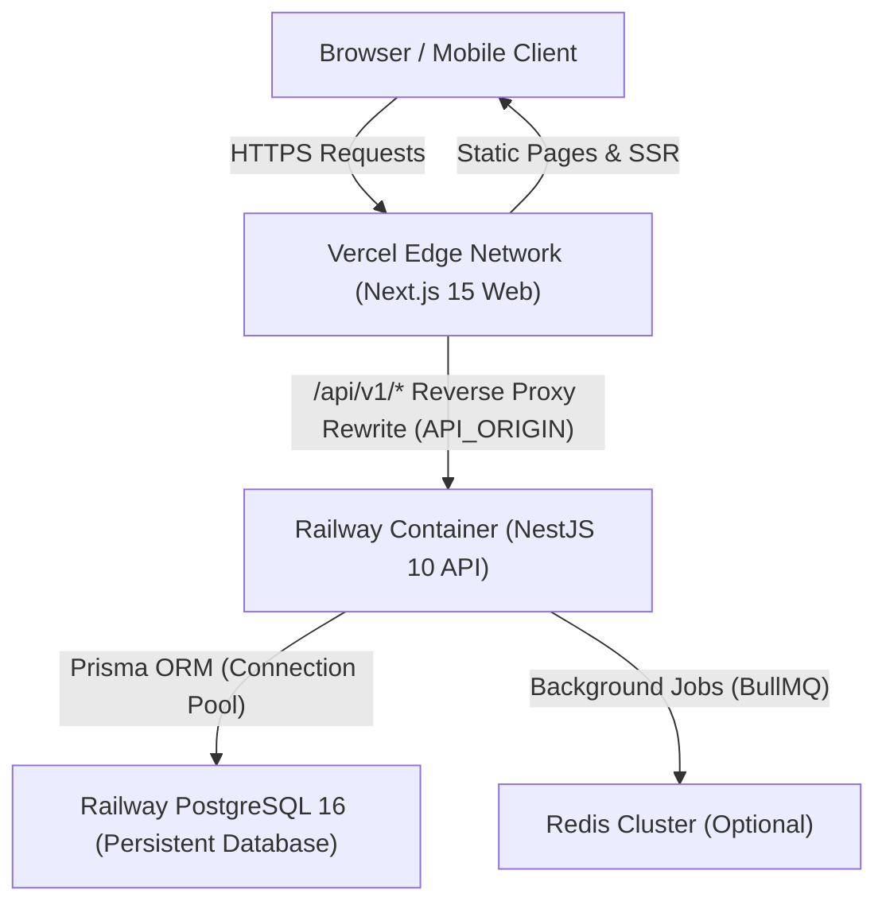

# CA Career OS — Vercel + Railway Production Deployment Guide

**Target Architecture:**
- **Frontend:** Next.js 15 App Router deployed on **Vercel**
- **Backend:** NestJS 10 REST API deployed on **Railway**
- **Database:** Managed **Railway PostgreSQL 16** with persistent storage
- **Proxy Layer:** Same-origin `/api/v1/*` reverse rewrite on Vercel to Railway API

---

## 1. System Topology & Request Flow



---

## 2. Monorepo Service Configuration

### A. Vercel Frontend (`apps/web`)

The Next.js 15 application is located at `apps/web` and depends on `@ca-career-os/shared`.

#### Build Settings
- **Root Directory:** Repository root (`/`) or `apps/web`
- **Build Command:**
  ```bash
  pnpm --filter @ca-career-os/shared build && pnpm --filter @ca-career-os/web build
  ```
- **Output Directory:** `apps/web/.next`
- **Install Command:**
  ```bash
  pnpm install
  ```
- **Framework Preset:** Next.js

#### Environment Variables (Vercel Project Settings)
| Variable Name | Environment | Description | Example / Required Format |
| :--- | :--- | :--- | :--- |
| `API_ORIGIN` | Production, Preview | Origin of the deployed Railway NestJS API | `https://your-api.up.railway.app` (no `/api/v1` suffix) |

> [!IMPORTANT]
> **Safety Gate:** `apps/web/next.config.mjs` validates `API_ORIGIN` during Vercel builds. If `API_ORIGIN` is not defined on a Vercel deployment, the build fails immediately to prevent traffic from silently attempting to route to local addresses.

---

### B. Railway API (`apps/api`)

The NestJS backend runs as a standalone Railway service configured via `railway.json`.

#### Service Build & Deployment (`railway.json`)
```json
{
  "$schema": "https://railway.com/railway.schema.json",
  "build": {
    "builder": "NIXPACKS",
    "buildCommand": "pnpm install --frozen-lockfile && pnpm --filter @ca-career-os/shared build && pnpm --filter @ca-career-os/api prisma:generate && pnpm --filter @ca-career-os/api build"
  },
  "deploy": {
    "preDeployCommand": "pnpm --filter @ca-career-os/api prisma:deploy",
    "startCommand": "node apps/api/dist/main.js",
    "healthcheckPath": "/api/v1/health/ready",
    "healthcheckTimeout": 120,
    "restartPolicyType": "ON_FAILURE",
    "restartPolicyMaxRetries": 5
  }
}
```

#### Runtime Configuration
- **Host Binding:** `0.0.0.0` (required for container ingress routing)
- **Port:** Configured via `process.env.PORT` automatically assigned by Railway
- **Healthcheck Path:** `/api/v1/health/ready`
- **Pre-Deploy Migration:** `pnpm --filter @ca-career-os/api prisma:deploy` executes automatically before container traffic shifts.

---

### C. Railway PostgreSQL 16 Provisioning

1. In the Railway Project Dashboard, click **New** -> **Database** -> **Add PostgreSQL**.
2. Railway provisions an isolated PostgreSQL 16 database with persistent NVMe storage.
3. In the Railway API Service settings, connect `DATABASE_URL` using reference variable:
   ```
   ${{Postgres.DATABASE_URL}}
   ```
4. On deployment, Railway runs `prisma migrate deploy`, executing `apps/api/prisma/migrations/20261020000000_init_ca_career_os/migration.sql` to initialize all 39 tables, foreign keys, and indexes.

---

## 3. Production Environment Variables Reference

### Railway API Service

| Variable Name | Required | Default / Mode | Description |
| :--- | :---: | :--- | :--- |
| `NODE_ENV` | Yes | `production` | Enables production security policies and disables in-memory fallback |
| `PORT` | Yes | Assigned by Railway | Container port binding |
| `DATABASE_URL` | Yes | Reference from PostgreSQL | PostgreSQL connection string |
| `JWT_SECRET` | Yes | 64+ char random hex | Secret for signing 15m access tokens |
| `JWT_EXPIRES_IN` | No | `15m` | Access token lifespan |
| `REFRESH_TOKEN_EXPIRES_IN` | No | `7d` | Refresh token lifespan |
| `CORS_ORIGIN` | Yes | Vercel domain(s) | Comma-separated allowed frontend origins |
| `CORS_ALLOW_VERCEL_PREVIEWS` | No | `true` | Allows `*.vercel.app` preview deployments |
| `AI_PROVIDER` | No | `mock` (or `openai`) | AI inference engine mode |
| `AI_API_KEY` | If live AI | None | API key for OpenAI / Anthropic |
| `RAZORPAY_KEY_ID` | If live billing | `rzp_test_...` | Razorpay Merchant Key ID |
| `RAZORPAY_KEY_SECRET` | If live billing | None | Razorpay Secret Key |
| `RAZORPAY_WEBHOOK_SECRET` | If live billing | None | Secret for webhook signature validation |
| `SMTP_HOST` | If live email | None | SMTP relay server hostname |
| `SMTP_PORT` | If live email | `587` | SMTP relay port |
| `SMTP_USER` | If live email | None | SMTP relay username |
| `SMTP_PASS` | If live email | None | SMTP relay password |
| `SMTP_FROM` | If live email | `alerts@cacareeros.com`| Verified outbound sender address |

---

## 4. Health & Observability Endpoints

| Endpoint | Method | Semantic Meaning | Expected Production Response |
| :--- | :---: | :--- | :--- |
| `/api/v1/health` | `GET` | **Liveness Probe:** Indicates process is alive | `HTTP 200` with `{ "success": true, "data": { "status": "healthy" } }` |
| `/api/v1/health/ready` | `GET` | **Readiness Probe:** Verifies PostgreSQL connectivity | `HTTP 200` when DB up; `HTTP 503` when DB disconnected |

---

## 5. Deployment Step-by-Step Execution Checklist

```text
[ ] Step 1: Preflight Verification
    [x] Monorepo automated test suite passes (151 passing tests, 0 failures)
    [x] TypeScript typechecking passes across all 3 workspaces (0 errors)
    [x] Prisma schema validated (39 models, 6 enums)
    [x] Documentation and Mermaid architecture validated (all 6 checks passed)
    [x] Production build passes (Next.js App Router 15 static pages compiled)

[ ] Step 2: Railway Infrastructure Provisioning
    [ ] Link GitHub repository Vishaldubey2210/CA-Carrier-OS in Railway
    [ ] Provision Railway PostgreSQL 16 database service
    [ ] Provision Railway API service referencing railway.json
    [ ] Set production environment variables (DATABASE_URL, JWT_SECRET, CORS_ORIGIN)
    [ ] Apply Prisma migrations via pre-deploy command (prisma migrate deploy)
    [ ] Verify /api/v1/health/ready returns HTTP 200 with database status "up"

[ ] Step 3: Vercel Frontend Deployment
    [ ] Import repository in Vercel Dashboard
    [ ] Configure root build command: pnpm --filter @ca-career-os/shared build && pnpm --filter @ca-career-os/web build
    [ ] Set Output Directory: apps/web/.next
    [ ] Configure environment variable: API_ORIGIN=https://<your-railway-app>.up.railway.app
    [ ] Deploy and verify public homepage and authentication routes

[ ] Step 4: End-to-End Production Verification
    [ ] Verify homepage loads at production Vercel domain
    [ ] Register a synthetic test candidate account
    [ ] Confirm candidate profile persists in Railway PostgreSQL
    [ ] Update an application and verify status change survives API restart
    [ ] Confirm Candidate Blindfold Rule rejects cross-workspace queries
```

---

## 6. Rollback & Disaster Recovery Procedures

### A. Vercel Frontend Rollback
1. Open the Vercel Project Dashboard -> **Deployments**.
2. Identify the previous known-good deployment.
3. Click the three dots (`...`) -> **Promote to Production**.
4. Traffic shifts instantly (zero build time).

### B. Railway API Rollback
1. Open the Railway Project Dashboard -> Select API Service -> **Deployments**.
2. Select the previous successful deployment card.
3. Click **Redeploy**.

### C. Database Recovery
1. Railway automated backups run daily.
2. In Railway Dashboard -> PostgreSQL service -> **Backups**, choose the desired restore point.
3. Click **Restore Backup** to generate a cloned database or overwrite the current state.
